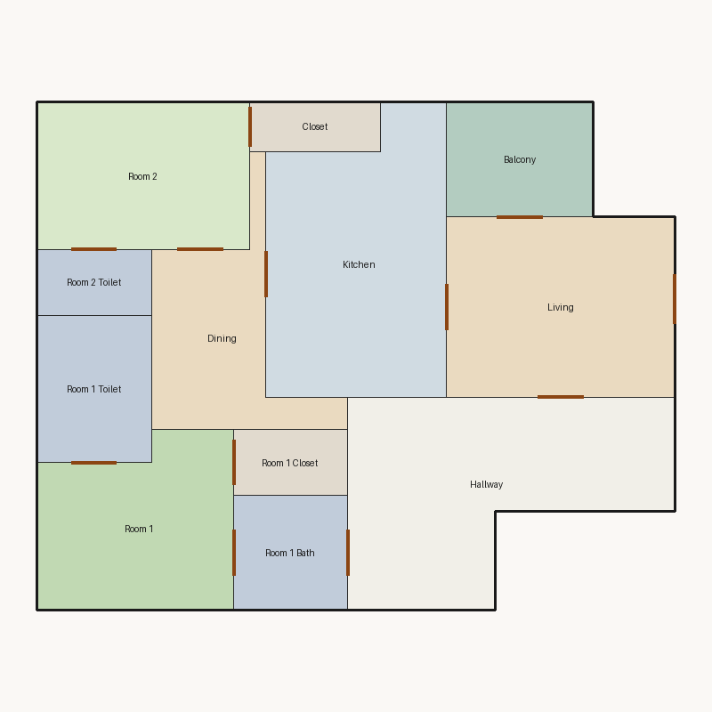

# Score report — 3-room

Source: `floorplan.json`

This floor plan scores **5.57/10 (Weak)** for “3-room” with 12 rooms, 1108.0 ft² total room area. It fails 1 hard rule(s): Window Lines. Strong areas include bedroom ratio, room proportions, storage adequacy. Weaker areas include natural light, privacy, wet core compactness. Highest category is geometry (10.0); lowest is daylight (1.9).

### Layout prompt

Room 1 Bath is in the north-center, next to Hallway and Room 1.
Room 1 is in the north-west, next to Room 1 Bath, Room 1 Closet, and Room 1 Toilet.
Hallway is in the north-east, next to Living and Room 1 Bath.
Room 1 Closet is in the north-center, next to Room 1.
Room 1 Toilet is in the west-center, next to Room 1.
Dining is in the west-center, next to Kitchen and Room 2.
Living is in the west-center, next to Balcony, Hallway, and Kitchen.
Room 2 Toilet is in the west-center, next to Room 2.
Kitchen is in the north-center, next to Dining and Living.
Room 2 is in the south-west, next to Closet, Dining, and Room 2 Toilet.
Balcony is in the south-east, next to Living.
Closet is in the north-center, next to Room 2.

## 3-room

**Overall score: 5.57 / 10 — Weak**

**Plan:** 3-room  
**Rooms (12):** Living (154.0 ft²), Room 1 (118.0 ft²), Room 2 (117.0 ft²), Room 1 Bath (49.0 ft²), Room 1 Toilet (63.0 ft²), Room 1 Closet (28.0 ft²), Room 2 Toilet (28.0 ft²), Kitchen (177.0 ft²), Dining (93.0 ft²), Hallway (194.0 ft²), Closet (24.0 ft²), Balcony (63.0 ft²)  
**Doors:** 12 line openings · **Windows:** 0 line openings

### Hard failures (plan rejected by geometry/topology rules)
- **Window Lines** (windows_on_exterior): No window lines defined — *Repair:* Add window line segments on exterior edges of living/bedrooms

### Category scores

| Category | Score | Rating | Weight |
|---|---:|---|---:|
| Geometry | 10.00 | Excellent | 0.15 |
| Topology | 10.00 | Excellent | 0.10 |
| Construction | 6.25 | Fair | 0.10 |
| Privacy | 5.00 | Weak | 0.11 |
| Circulation | 6.70 | Fair | 0.10 |
| Daylight | 1.90 | Poor | 0.13 |
| Architecture | 9.00 | Excellent | 0.13 |
| Aesthetics | 7.26 | Fair | 0.18 |

### Rule details

- **Polygon Validity** [HARD/PASS] — **10.0/10** (Excellent): Boundary polygon valid
- **Room Overlap** [HARD/PASS] — **10.0/10** (Excellent): No significant overlaps
- **Boundary Containment** [HARD/PASS] — **10.0/10** (Excellent): All rooms inside boundary
- **Minimum Area** [HARD/PASS] — **10.0/10** (Excellent): Areas OK
- **Minimum Width** [HARD/PASS] — **10.0/10** (Excellent): Widths OK
- **Reachability** [HARD/PASS] — **10.0/10** (Excellent): All rooms reachable
- **Required Rooms Exist** [HARD/PASS] — **10.0/10** (Excellent): Required rooms present
- **Door Lines** [HARD/PASS] — **10.0/10** (Excellent): Doors have room connections
- **Window Lines** [HARD/FAIL] — **0.0/10** (Poor): No window lines defined
  - Suggestion: Add window line segments on exterior edges of living/bedrooms
- **Bathroom Accessible** [HARD/PASS] — **10.0/10** (Excellent): Bathrooms connected
- **Kitchen Accessible** [HARD/PASS] — **10.0/10** (Excellent): Kitchen connected
- **Living Size** [soft/PASS] — **7.0/10** (Fair): Living area 154.0 ft²
- **Bedroom Ratio** [soft/PASS] — **9.0/10** (Excellent): Bedroom/living area ratio 1.53
- **Natural Light** [soft/FAIL] — **3.8/10** (Poor): Living: win 0.0/3.9 ft, WFR 0%, ext 11.0 ft, clear; Room 1: win 0.0/3.0 ft, WFR 0%, ext 12.0 ft, clear; Room 2: win 0.0/2.9 ft, WFR 0%, ext 13.0 ft, clear; Dining: win 0.0/2.3 ft, WFR 0%, ext 12.2 ft, blocked
  - Suggestion: Add adequately sized windows on exterior walls of bedrooms/living
- **Privacy** [soft/PASS] — **5.0/10** (Weak): Direct public-private adjacencies: 2
  - Suggestion: Buffer bedrooms from kitchen/living with hallway or dining
- **Circulation Efficiency** [soft/PASS] — **6.7/10** (Fair): Circ 17.5%; min path width 3.5 ft; 0/2 beds via hall; 3 passageway rooms; 0 dead ends
  - Suggestion: Reduce hallway waste, widen paths, and serve bedrooms from circulation
- **Wet Core Compactness** [soft/FAIL] — **2.0/10** (Poor): Avg wet-room distance 15.81 ft
  - Suggestion: Cluster wet rooms for shared plumbing
- **Construction Shape** [soft/PASS] — **6.8/10** (Fair): Avg rectangularity 0.89; 0 short door edges
  - Suggestion: Simplify room shapes and place doors on longer shared walls
- **Room Proportions** [soft/PASS] — **10.0/10** (Excellent): Over-elongated rooms: 0
- **Storage Adequacy** [soft/PASS] — **10.0/10** (Excellent): 2 storage spaces for 2 bedrooms
- **Balcony Usability** [soft/PASS] — **10.0/10** (Excellent): Balcony 63.0 ft²
- **Living Centrality** [soft/PASS] — **4.3/10** (Weak): Living 14.1 ft from plan center; mean 2.5 hops to other rooms
  - Suggestion: Place living nearer the center and connect rooms via hall/living hub
- **Kitchen–Public Link** [soft/PASS] — **10.0/10** (Excellent): Kitchen opens to dining/living
- **Entry Sequence** [soft/PASS] — **7.5/10** (Good): no entry; living at exterior
- **Public Near Exit** [soft/PASS] — **10.0/10** (Excellent): Living 0 hops from exit; bedrooms min 3 / avg 3.0 hops

### Areas to improve
- Wet Core Compactness: Avg wet-room distance 15.81 ft → Cluster wet rooms for shared plumbing
- Natural Light: Living: win 0.0/3.9 ft, WFR 0%, ext 11.0 ft, clear; Room 1: win 0.0/3.0 ft, WFR 0%, ext 12.0 ft, clear; Room 2: win 0.0/2.9 ft, WFR 0%, ext 13.0 ft, clear; Dining: win 0.0/2.3 ft, WFR 0%, ext 12.2 ft, blocked → Add adequately sized windows on exterior walls of bedrooms/living
- Living Centrality: Living 14.1 ft from plan center; mean 2.5 hops to other rooms → Place living nearer the center and connect rooms via hall/living hub
- Privacy: Direct public-private adjacencies: 2 → Buffer bedrooms from kitchen/living with hallway or dining
- Circulation Efficiency: Circ 17.5%; min path width 3.5 ft; 0/2 beds via hall; 3 passageway rooms; 0 dead ends → Reduce hallway waste, widen paths, and serve bedrooms from circulation
- Construction Shape: Avg rectangularity 0.89; 0 short door edges → Simplify room shapes and place doors on longer shared walls

_Summary: This floor plan scores **5.57/10 (Weak)** for “3-room” with 12 rooms, 1108.0 ft² total room area. It fails 1 hard rule(s): Window Lines. Strong areas include bedroom ratio, room proportions, storage adequacy. Weaker areas include natural light, privacy, wet core compactness. Highest category is geometry (10.0); lowest is daylight (1.9)._