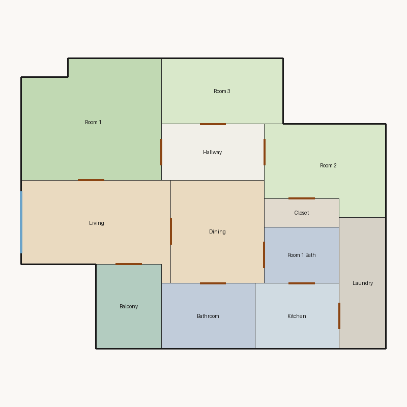

# Score report — 3-room

Source: `floorplan.json`

This floor plan scores **5.63/10 (Weak)** for “3-room” with 12 rooms, 1050.0 ft² total room area. It fails 1 hard rule(s): Window Lines. Strong areas include circulation efficiency, room proportions, balcony usability. Weaker areas include bedroom ratio, natural light, privacy. Highest category is geometry (10.0); lowest is daylight (2.5).

### Layout prompt

Bathroom is in the north-center, next to Dining.
Kitchen is in the north-east, next to Laundry and Room 1 Bath.
Balcony is in the north-west, next to Living.
Laundry is in the north-east, next to Kitchen.
Room 1 Bath is in the north-east, next to Dining and Kitchen.
Dining is in the center, next to Bathroom, Living, and Room 1 Bath.
Living is in the west-center, next to Balcony, Dining, and Room 1.
Closet is in the west-center, next to Room 2.
Room 2 is in the west-center, next to Closet and Hallway.
Hallway is in the north-center, next to Room 1, Room 2, and Room 3.
Room 1 is in the south-west, next to Hallway and Living.
Room 3 is in the north-center, next to Hallway.

## 3-room

**Overall score: 5.63 / 10 — Weak**

**Plan:** 3-room  
**Rooms (12):** Living (146.0 ft²), Room 1 (185.0 ft²), Room 2 (114.0 ft²), Room 3 (91.0 ft²), Room 1 Bath (48.0 ft²), Kitchen (63.0 ft²), Dining (110.0 ft²), Hallway (66.0 ft²), Bathroom (70.0 ft²), Closet (24.0 ft²), Balcony (63.0 ft²), Laundry (70.0 ft²)  
**Doors:** 12 line openings · **Windows:** 2 line openings

### Hard failures (plan rejected by geometry/topology rules)
- **Window Lines** (windows_on_exterior): Missing exterior glazing: ['Room 1', 'Room 2', 'Room 3', 'Dining'] — *Repair:* Add window line segments on exterior edges of living/bedrooms

### Category scores

| Category | Score | Rating | Weight |
|---|---:|---|---:|
| Geometry | 10.00 | Excellent | 0.15 |
| Topology | 9.25 | Excellent | 0.10 |
| Construction | 6.42 | Fair | 0.10 |
| Privacy | 5.00 | Weak | 0.11 |
| Circulation | 9.38 | Excellent | 0.10 |
| Daylight | 2.49 | Poor | 0.13 |
| Architecture | 6.91 | Fair | 0.13 |
| Aesthetics | 7.53 | Good | 0.18 |

### Rule details

- **Polygon Validity** [HARD/PASS] — **10.0/10** (Excellent): Boundary polygon valid
- **Room Overlap** [HARD/PASS] — **10.0/10** (Excellent): No significant overlaps
- **Boundary Containment** [HARD/PASS] — **10.0/10** (Excellent): All rooms inside boundary
- **Minimum Area** [HARD/PASS] — **10.0/10** (Excellent): Areas OK
- **Minimum Width** [HARD/PASS] — **10.0/10** (Excellent): Widths OK
- **Reachability** [HARD/PASS] — **10.0/10** (Excellent): All rooms reachable
- **Required Rooms Exist** [HARD/PASS] — **10.0/10** (Excellent): Required rooms present
- **Door Lines** [HARD/PASS] — **10.0/10** (Excellent): Doors have room connections
- **Window Lines** [HARD/FAIL] — **0.0/10** (Poor): Missing exterior glazing: ['Room 1', 'Room 2', 'Room 3', 'Dining']
  - Suggestion: Add window line segments on exterior edges of living/bedrooms
- **Bathroom Accessible** [HARD/PASS] — **10.0/10** (Excellent): Bathrooms connected
- **Kitchen Accessible** [HARD/PASS] — **10.0/10** (Excellent): Kitchen connected
- **Living Size** [soft/PASS] — **6.6/10** (Fair): Living area 146.0 ft²
  - Suggestion: Expand living room
- **Bedroom Ratio** [soft/PASS] — **4.0/10** (Weak): Bedroom/living area ratio 2.67
  - Suggestion: Rebalance bedroom vs living areas
- **Natural Light** [soft/PASS] — **5.0/10** (Weak): Living: win 7.2/3.6 ft, WFR 22%, ext 9.0 ft, clear; Room 1: win 0.0/4.4 ft, WFR 0%, ext 11.0 ft, clear; Room 2: win 0.0/2.9 ft, WFR 0%, ext 11.0 ft, clear; Room 3: win 0.0/2.3 ft, WFR 0%, ext 13.0 ft, clear; Dining: win 0.0/2.8 ft, WFR 0%, ext 10.2 ft, clear
  - Suggestion: Add adequately sized windows on exterior walls of bedrooms/living
- **Privacy** [soft/PASS] — **5.0/10** (Weak): Direct public-private adjacencies: 2
  - Suggestion: Buffer bedrooms from kitchen/living with hallway or dining
- **Circulation Efficiency** [soft/PASS] — **9.4/10** (Excellent): Circ 6.3%; min path width 6.0 ft; 3/3 beds via hall; 2 passageway rooms; 0 dead ends
- **Wet Core Compactness** [soft/FAIL] — **2.0/10** (Poor): Avg wet-room distance 9.32 ft
  - Suggestion: Cluster wet rooms for shared plumbing
- **Construction Shape** [soft/PASS] — **7.3/10** (Fair): Avg rectangularity 0.97; 0 short door edges
- **Room Proportions** [soft/PASS] — **10.0/10** (Excellent): Over-elongated rooms: 0
- **Storage Adequacy** [soft/PASS] — **7.0/10** (Fair): 1 storage spaces for 3 bedrooms
- **Balcony Usability** [soft/PASS] — **10.0/10** (Excellent): Balcony 63.0 ft²
- **Living Centrality** [soft/PASS] — **5.1/10** (Weak): Living 11.7 ft from plan center; mean 2.3 hops to other rooms
  - Suggestion: Place living nearer the center and connect rooms via hall/living hub
- **Kitchen–Public Link** [soft/PASS] — **5.5/10** (Weak): Kitchen 2 hops from living/dining
  - Suggestion: Connect kitchen to dining/living; never directly to a bedroom
- **Entry Sequence** [soft/PASS] — **7.5/10** (Good): no entry; living at exterior
- **Public Near Exit** [soft/PASS] — **10.0/10** (Excellent): Living 0 hops from exit; bedrooms min 1 / avg 2.3 hops

### Areas to improve
- Wet Core Compactness: Avg wet-room distance 9.32 ft → Cluster wet rooms for shared plumbing
- Bedroom Ratio: Bedroom/living area ratio 2.67 → Rebalance bedroom vs living areas
- Natural Light: Living: win 7.2/3.6 ft, WFR 22%, ext 9.0 ft, clear; Room 1: win 0.0/4.4 ft, WFR 0%, ext 11.0 ft, clear; Room 2: win 0.0/2.9 ft, WFR 0%, ext 11.0 ft, clear; Room 3: win 0.0/2.3 ft, WFR 0%, ext 13.0 ft, clear; Dining: win 0.0/2.8 ft, WFR 0%, ext 10.2 ft, clear → Add adequately sized windows on exterior walls of bedrooms/living
- Privacy: Direct public-private adjacencies: 2 → Buffer bedrooms from kitchen/living with hallway or dining
- Living Centrality: Living 11.7 ft from plan center; mean 2.3 hops to other rooms → Place living nearer the center and connect rooms via hall/living hub
- Kitchen–Public Link: Kitchen 2 hops from living/dining → Connect kitchen to dining/living; never directly to a bedroom
- Living Size: Living area 146.0 ft² → Expand living room

_Summary: This floor plan scores **5.63/10 (Weak)** for “3-room” with 12 rooms, 1050.0 ft² total room area. It fails 1 hard rule(s): Window Lines. Strong areas include circulation efficiency, room proportions, balcony usability. Weaker areas include bedroom ratio, natural light, privacy. Highest category is geometry (10.0); lowest is daylight (2.5)._