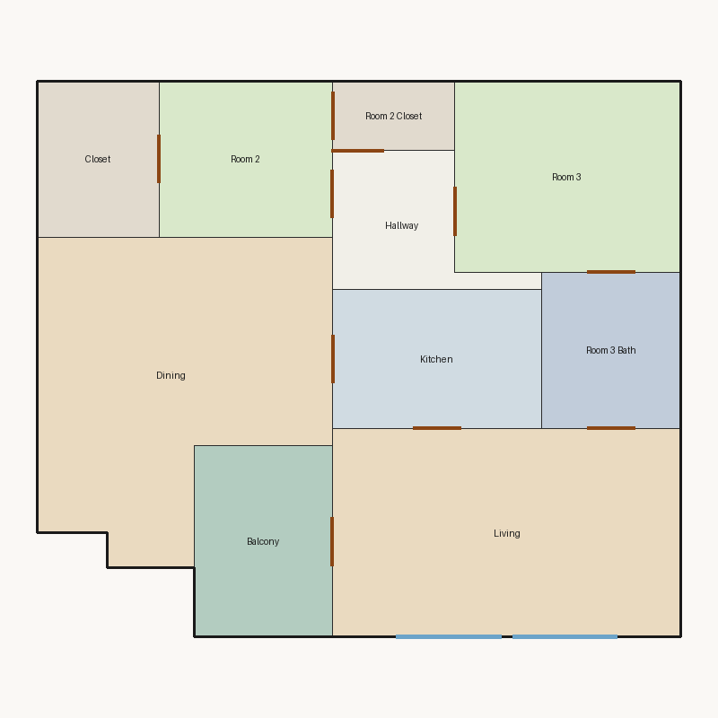

# Score report — 3-room

Source: `../plans/14855ae92998.json`

This floor plan scores **5.68/10 (Weak)** for “3-room” with 10 rooms, 1140.0 ft² total room area. It fails 1 hard rule(s): Window Lines. Strong areas include living size, bedroom ratio, circulation efficiency. Weaker areas include natural light, wet core compactness, living centrality. Highest category is geometry (10.0); lowest is daylight (2.7).

### Layout prompt

Balcony is in the north-center, next to Living.
Living is in the north-east, next to Balcony, Kitchen, and Room 3 Bath.
Dining is in the west-center, next to Kitchen.
Kitchen is in the center, next to Dining and Living.
Room 3 Bath is in the west-center, next to Living and Room 3.
Hallway is in the north-center, next to Room 2 and Room 3.
Room 3 is in the south-east, next to Hallway and Room 3 Bath.
Closet is in the south-west, next to Room 2.
Room 2 is in the south-west, next to Closet, Hallway, and Room 2 Closet.
Room 2 Closet is in the north-center, next to Room 2.

## 3-room

**Overall score: 5.68 / 10 — Weak**

**Plan:** 3-room  
**Rooms (10):** Living (240.0 ft²), Room 2 (90.0 ft²), Room 3 (143.0 ft²), Room 2 Closet (28.0 ft²), Room 3 Bath (72.0 ft²), Kitchen (96.0 ft²), Dining (259.0 ft²), Hallway (61.0 ft²), Closet (63.0 ft²), Balcony (88.0 ft²)  
**Doors:** 10 line openings · **Windows:** 2 line openings

### Hard failures (plan rejected by geometry/topology rules)
- **Window Lines** (windows_on_exterior): Missing exterior glazing: ['Room 2', 'Room 3', 'Dining'] — *Repair:* Add window line segments on exterior edges of living/bedrooms

### Category scores

| Category | Score | Rating | Weight |
|---|---:|---|---:|
| Geometry | 10.00 | Excellent | 0.15 |
| Topology | 10.00 | Excellent | 0.10 |
| Construction | 6.43 | Fair | 0.10 |
| Privacy | 7.50 | Good | 0.11 |
| Circulation | 9.08 | Excellent | 0.10 |
| Daylight | 2.66 | Poor | 0.13 |
| Architecture | 9.75 | Excellent | 0.13 |
| Aesthetics | 3.85 | Poor | 0.18 |

### Rule details

- **Polygon Validity** [HARD/PASS] — **10.0/10** (Excellent): Boundary polygon valid
- **Room Overlap** [HARD/PASS] — **10.0/10** (Excellent): No significant overlaps
- **Boundary Containment** [HARD/PASS] — **10.0/10** (Excellent): All rooms inside boundary
- **Minimum Area** [HARD/PASS] — **10.0/10** (Excellent): Areas OK
- **Minimum Width** [HARD/PASS] — **10.0/10** (Excellent): Widths OK
- **Reachability** [HARD/PASS] — **10.0/10** (Excellent): All rooms reachable
- **Required Rooms Exist** [HARD/PASS] — **10.0/10** (Excellent): Required rooms present
- **Door Lines** [HARD/PASS] — **10.0/10** (Excellent): Doors have room connections
- **Window Lines** [HARD/FAIL] — **0.0/10** (Poor): Missing exterior glazing: ['Room 2', 'Room 3', 'Dining']
  - Suggestion: Add window line segments on exterior edges of living/bedrooms
- **Bathroom Accessible** [HARD/PASS] — **10.0/10** (Excellent): Bathrooms connected
- **Kitchen Accessible** [HARD/PASS] — **10.0/10** (Excellent): Kitchen connected
- **Living Size** [soft/PASS] — **10.0/10** (Excellent): Living area 240.0 ft²
- **Bedroom Ratio** [soft/PASS] — **9.0/10** (Excellent): Bedroom/living area ratio 0.97
- **Natural Light** [soft/PASS] — **5.3/10** (Weak): Living: win 12.0/6.0 ft, WFR 22%, ext 20.0 ft, clear; Room 2: win 0.0/2.2 ft, WFR 0%, ext 10.0 ft, clear; Room 3: win 0.0/3.6 ft, WFR 0%, ext 13.0 ft, clear; Dining: win 0.0/6.5 ft, WFR 0%, ext 17.0 ft, clear
  - Suggestion: Add adequately sized windows on exterior walls of bedrooms/living
- **Privacy** [soft/PASS] — **7.5/10** (Good): Direct public-private adjacencies: 1
- **Circulation Efficiency** [soft/PASS] — **9.1/10** (Excellent): Circ 5.4%; min path width 6.0 ft; 2/2 beds via hall; 1 passageway rooms; 0 dead ends
- **Wet Core Compactness** [soft/FAIL] — **2.0/10** (Poor): Avg wet-room distance 10.01 ft
  - Suggestion: Cluster wet rooms for shared plumbing
- **Construction Shape** [soft/PASS] — **7.3/10** (Fair): Avg rectangularity 0.92; 0 short door edges
- **Room Proportions** [soft/PASS] — **10.0/10** (Excellent): Over-elongated rooms: 0
- **Storage Adequacy** [soft/PASS] — **10.0/10** (Excellent): 2 storage spaces for 2 bedrooms
- **Balcony Usability** [soft/PASS] — **10.0/10** (Excellent): Balcony 88.0 ft²
- **Living Centrality** [soft/PASS] — **5.1/10** (Weak): Living 13.2 ft from plan center; mean 2.2 hops to other rooms
  - Suggestion: Place living nearer the center and connect rooms via hall/living hub
- **Kitchen–Public Link** [soft/PASS] — **10.0/10** (Excellent): Kitchen opens to dining/living
- **Entry Sequence** [soft/PASS] — **5.5/10** (Weak): no entry; living 3 hops from exit
  - Suggestion: Add a small entry/foyer so exit leads to living, not bedrooms
- **Public Near Exit** [soft/FAIL] — **1.0/10** (Poor): Living 3 hops from exit; bedrooms min 1 / avg 1.0 hops
  - Suggestion: Keep living closer to the exit than bedrooms

### Areas to improve
- Public Near Exit: Living 3 hops from exit; bedrooms min 1 / avg 1.0 hops → Keep living closer to the exit than bedrooms
- Wet Core Compactness: Avg wet-room distance 10.01 ft → Cluster wet rooms for shared plumbing
- Living Centrality: Living 13.2 ft from plan center; mean 2.2 hops to other rooms → Place living nearer the center and connect rooms via hall/living hub
- Natural Light: Living: win 12.0/6.0 ft, WFR 22%, ext 20.0 ft, clear; Room 2: win 0.0/2.2 ft, WFR 0%, ext 10.0 ft, clear; Room 3: win 0.0/3.6 ft, WFR 0%, ext 13.0 ft, clear; Dining: win 0.0/6.5 ft, WFR 0%, ext 17.0 ft, clear → Add adequately sized windows on exterior walls of bedrooms/living
- Entry Sequence: no entry; living 3 hops from exit → Add a small entry/foyer so exit leads to living, not bedrooms

_Summary: This floor plan scores **5.68/10 (Weak)** for “3-room” with 10 rooms, 1140.0 ft² total room area. It fails 1 hard rule(s): Window Lines. Strong areas include living size, bedroom ratio, circulation efficiency. Weaker areas include natural light, wet core compactness, living centrality. Highest category is geometry (10.0); lowest is daylight (2.7)._