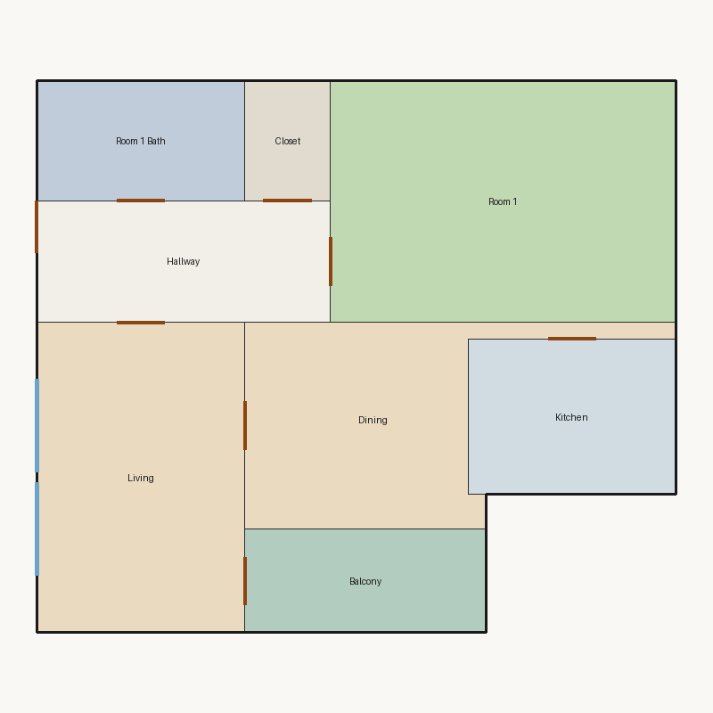

# Score report — 3-room

Source: `../plans/a5a3eda8662b.json`

This floor plan scores **6.19/10 (Fair)** for “3-room” with 8 rooms, 1096.0 ft² total room area. It fails 1 hard rule(s): Window Lines. Strong areas include living size, bedroom ratio, circulation efficiency. Weaker areas include natural light, wet core compactness, living centrality. Highest category is geometry (10.0); lowest is daylight (2.2).

### Layout prompt

Balcony is in the north-center, next to Living.
Living is in the north-west, next to Balcony, Dining, and Hallway.
Dining is in the center, next to Kitchen and Living.
Kitchen is in the west-center, next to Dining.
Hallway is in the south-west, next to Closet, Living, Room 1, and Room 1 Bath.
Room 1 is in the south-east, next to Hallway.
Room 1 Bath is in the south-west, next to Hallway.
Closet is in the north-center, next to Hallway.

## 3-room

**Overall score: 6.19 / 10 — Fair**

**Plan:** 3-room  
**Rooms (8):** Living (216.0 ft²), Room 1 (280.0 ft²), Room 1 Bath (84.0 ft²), Kitchen (108.0 ft²), Dining (170.0 ft²), Hallway (119.0 ft²), Closet (35.0 ft²), Balcony (84.0 ft²)  
**Doors:** 8 line openings · **Windows:** 2 line openings

### Hard failures (plan rejected by geometry/topology rules)
- **Window Lines** (windows_on_exterior): Missing exterior glazing: ['Room 1', 'Dining'] — *Repair:* Add window line segments on exterior edges of living/bedrooms

### Category scores

| Category | Score | Rating | Weight |
|---|---:|---|---:|
| Geometry | 10.00 | Excellent | 0.15 |
| Topology | 10.00 | Excellent | 0.10 |
| Construction | 6.38 | Fair | 0.10 |
| Privacy | 7.50 | Good | 0.11 |
| Circulation | 9.02 | Excellent | 0.10 |
| Daylight | 2.18 | Poor | 0.13 |
| Architecture | 8.95 | Good | 0.13 |
| Aesthetics | 7.66 | Good | 0.18 |

### Rule details

- **Polygon Validity** [HARD/PASS] — **10.0/10** (Excellent): Boundary polygon valid
- **Room Overlap** [HARD/PASS] — **10.0/10** (Excellent): No significant overlaps
- **Boundary Containment** [HARD/PASS] — **10.0/10** (Excellent): All rooms inside boundary
- **Minimum Area** [HARD/PASS] — **10.0/10** (Excellent): Areas OK
- **Minimum Width** [HARD/PASS] — **10.0/10** (Excellent): Widths OK
- **Reachability** [HARD/PASS] — **10.0/10** (Excellent): All rooms reachable
- **Required Rooms Exist** [HARD/PASS] — **10.0/10** (Excellent): Required rooms present
- **Door Lines** [HARD/PASS] — **10.0/10** (Excellent): Doors have room connections
- **Window Lines** [HARD/FAIL] — **0.0/10** (Poor): Missing exterior glazing: ['Room 1', 'Dining']
  - Suggestion: Add window line segments on exterior edges of living/bedrooms
- **Bathroom Accessible** [HARD/PASS] — **10.0/10** (Excellent): Bathrooms connected
- **Kitchen Accessible** [HARD/PASS] — **10.0/10** (Excellent): Kitchen connected
- **Living Size** [soft/PASS] — **9.8/10** (Excellent): Living area 216.0 ft²
- **Bedroom Ratio** [soft/PASS] — **9.0/10** (Excellent): Bedroom/living area ratio 1.30
- **Natural Light** [soft/PASS] — **4.4/10** (Weak): Living: win 10.8/5.4 ft, WFR 22%, ext 18.0 ft, clear; Room 1: win 0.0/7.0 ft, WFR 0%, ext 20.0 ft, clear; Dining: win 0.0/3.2 ft, WFR 0%, ext 0.0 ft, none
  - Suggestion: Add adequately sized windows on exterior walls of bedrooms/living
- **Privacy** [soft/PASS] — **7.5/10** (Good): Direct public-private adjacencies: 1
- **Circulation Efficiency** [soft/PASS] — **9.0/10** (Excellent): Circ 10.9%; min path width 7.0 ft; 1/1 beds via hall; 1 passageway rooms; 0 dead ends
- **Wet Core Compactness** [soft/FAIL] — **2.0/10** (Poor): Avg wet-room distance 29.68 ft
  - Suggestion: Cluster wet rooms for shared plumbing
- **Construction Shape** [soft/PASS] — **7.1/10** (Fair): Avg rectangularity 0.93; 0 short door edges
- **Room Proportions** [soft/PASS] — **10.0/10** (Excellent): Over-elongated rooms: 0
- **Storage Adequacy** [soft/PASS] — **7.0/10** (Fair): 1 storage spaces for 1 bedrooms
- **Balcony Usability** [soft/PASS] — **10.0/10** (Excellent): Balcony 84.0 ft²
- **Living Centrality** [soft/PASS] — **6.0/10** (Weak): Living 14.0 ft from plan center; mean 1.6 hops to other rooms
  - Suggestion: Place living nearer the center and connect rooms via hall/living hub
- **Kitchen–Public Link** [soft/PASS] — **10.0/10** (Excellent): Kitchen opens to dining/living
- **Entry Sequence** [soft/PASS] — **7.0/10** (Fair): no entry buffer before living
- **Public Near Exit** [soft/PASS] — **10.0/10** (Excellent): Living 1 hops from exit; bedrooms min 1 / avg 1.0 hops

### Areas to improve
- Wet Core Compactness: Avg wet-room distance 29.68 ft → Cluster wet rooms for shared plumbing
- Natural Light: Living: win 10.8/5.4 ft, WFR 22%, ext 18.0 ft, clear; Room 1: win 0.0/7.0 ft, WFR 0%, ext 20.0 ft, clear; Dining: win 0.0/3.2 ft, WFR 0%, ext 0.0 ft, none → Add adequately sized windows on exterior walls of bedrooms/living
- Living Centrality: Living 14.0 ft from plan center; mean 1.6 hops to other rooms → Place living nearer the center and connect rooms via hall/living hub

_Summary: This floor plan scores **6.19/10 (Fair)** for “3-room” with 8 rooms, 1096.0 ft² total room area. It fails 1 hard rule(s): Window Lines. Strong areas include living size, bedroom ratio, circulation efficiency. Weaker areas include natural light, wet core compactness, living centrality. Highest category is geometry (10.0); lowest is daylight (2.2)._