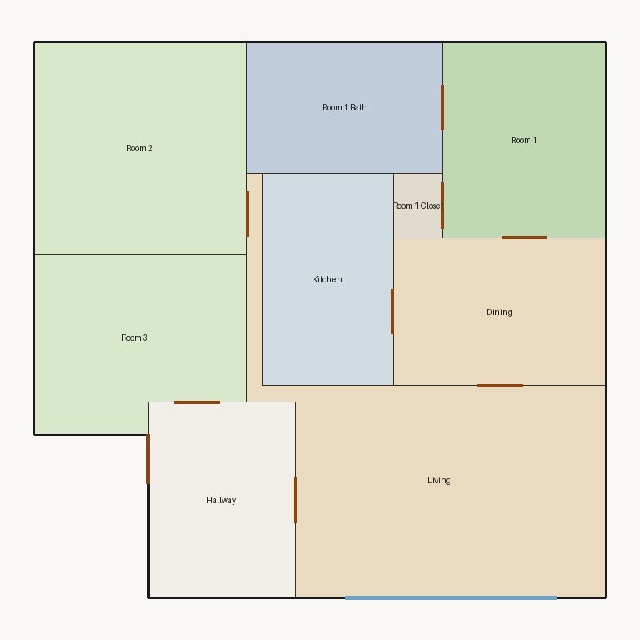

# Score report — 3-room

Source: `../plans/a62a7ba7a954.json`

This floor plan scores **5.38/10 (Weak)** for “3-room” with 9 rooms, 1120.0 ft² total room area. It fails 1 hard rule(s): Window Lines. Strong areas include living size, bedroom ratio, room proportions. Weaker areas include natural light, privacy, wet core compactness. Highest category is geometry (10.0); lowest is privacy (2.5).

### Layout prompt

Hallway is in the north-west, next to Living and Room 3.
Living is in the north-east, next to Dining, Hallway, and Room 2.
Room 3 is in the west-center, next to Hallway.
Dining is in the west-center, next to Kitchen, Living, and Room 1.
Kitchen is in the center, next to Dining.
Room 1 Closet is in the south-east, next to Room 1.
Room 2 is in the south-west, next to Living.
Room 1 is in the south-east, next to Dining, Room 1 Bath, and Room 1 Closet.
Room 1 Bath is in the north-center, next to Room 1.

## 3-room

**Overall score: 5.38 / 10 — Weak**

**Plan:** 3-room  
**Rooms (9):** Living (263.0 ft²), Room 1 (120.0 ft²), Room 2 (169.0 ft²), Room 3 (131.0 ft²), Room 1 Bath (96.0 ft²), Room 1 Closet (12.0 ft²), Kitchen (104.0 ft²), Dining (117.0 ft²), Hallway (108.0 ft²)  
**Doors:** 9 line openings · **Windows:** 2 line openings

### Hard failures (plan rejected by geometry/topology rules)
- **Window Lines** (windows_on_exterior): Missing exterior glazing: ['Room 1', 'Room 2', 'Room 3', 'Dining'] — *Repair:* Add window line segments on exterior edges of living/bedrooms

### Category scores

| Category | Score | Rating | Weight |
|---|---:|---|---:|
| Geometry | 10.00 | Excellent | 0.15 |
| Topology | 10.00 | Excellent | 0.10 |
| Construction | 6.33 | Fair | 0.10 |
| Privacy | 2.50 | Poor | 0.11 |
| Circulation | 7.17 | Fair | 0.10 |
| Daylight | 2.54 | Poor | 0.13 |
| Architecture | 8.00 | Good | 0.13 |
| Aesthetics | 7.70 | Good | 0.18 |

### Rule details

- **Polygon Validity** [HARD/PASS] — **10.0/10** (Excellent): Boundary polygon valid
- **Room Overlap** [HARD/PASS] — **10.0/10** (Excellent): No significant overlaps
- **Boundary Containment** [HARD/PASS] — **10.0/10** (Excellent): All rooms inside boundary
- **Minimum Area** [HARD/PASS] — **10.0/10** (Excellent): Areas OK
- **Minimum Width** [HARD/PASS] — **10.0/10** (Excellent): Widths OK
- **Reachability** [HARD/PASS] — **10.0/10** (Excellent): All rooms reachable
- **Required Rooms Exist** [HARD/PASS] — **10.0/10** (Excellent): Required rooms present
- **Door Lines** [HARD/PASS] — **10.0/10** (Excellent): Doors have room connections
- **Window Lines** [HARD/FAIL] — **0.0/10** (Poor): Missing exterior glazing: ['Room 1', 'Room 2', 'Room 3', 'Dining']
  - Suggestion: Add window line segments on exterior edges of living/bedrooms
- **Bathroom Accessible** [HARD/PASS] — **10.0/10** (Excellent): Bathrooms connected
- **Kitchen Accessible** [HARD/PASS] — **10.0/10** (Excellent): Kitchen connected
- **Living Size** [soft/PASS] — **10.0/10** (Excellent): Living area 263.0 ft²
- **Bedroom Ratio** [soft/PASS] — **9.0/10** (Excellent): Bedroom/living area ratio 1.60
- **Natural Light** [soft/PASS] — **5.1/10** (Weak): Living: win 13.1/6.6 ft, WFR 22%, ext 19.0 ft, clear; Room 1: win 0.0/3.0 ft, WFR 0%, ext 12.0 ft, clear; Room 2: win 0.0/4.2 ft, WFR 0%, ext 13.0 ft, clear; Room 3: win 0.0/3.3 ft, WFR 0%, ext 11.0 ft, clear; Dining: win 0.0/2.9 ft, WFR 0%, ext 9.0 ft, clear
  - Suggestion: Add adequately sized windows on exterior walls of bedrooms/living
- **Privacy** [soft/FAIL] — **2.5/10** (Poor): Direct public-private adjacencies: 3
  - Suggestion: Buffer bedrooms from kitchen/living with hallway or dining
- **Circulation Efficiency** [soft/PASS] — **7.2/10** (Fair): Circ 9.6%; min path width 8.0 ft; 1/3 beds via hall; 3 passageway rooms; 0 dead ends
- **Wet Core Compactness** [soft/FAIL] — **2.0/10** (Poor): Avg wet-room distance 10.55 ft
  - Suggestion: Cluster wet rooms for shared plumbing
- **Construction Shape** [soft/PASS] — **7.0/10** (Fair): Avg rectangularity 0.92; 0 short door edges
  - Suggestion: Simplify room shapes and place doors on longer shared walls
- **Room Proportions** [soft/PASS] — **10.0/10** (Excellent): Over-elongated rooms: 0
- **Storage Adequacy** [soft/PASS] — **7.0/10** (Fair): 1 storage spaces for 3 bedrooms
- **Balcony Usability** [soft/PASS] — **6.0/10** (Fair): No balcony in plan
- **Living Centrality** [soft/PASS] — **6.1/10** (Fair): Living 12.3 ft from plan center; mean 1.7 hops to other rooms
  - Suggestion: Place living nearer the center and connect rooms via hall/living hub
- **Kitchen–Public Link** [soft/PASS] — **10.0/10** (Excellent): Kitchen opens to dining/living
- **Entry Sequence** [soft/PASS] — **7.0/10** (Fair): no entry buffer before living
- **Public Near Exit** [soft/PASS] — **10.0/10** (Excellent): Living 1 hops from exit; bedrooms min 1 / avg 2.0 hops

### Areas to improve
- Wet Core Compactness: Avg wet-room distance 10.55 ft → Cluster wet rooms for shared plumbing
- Privacy: Direct public-private adjacencies: 3 → Buffer bedrooms from kitchen/living with hallway or dining
- Natural Light: Living: win 13.1/6.6 ft, WFR 22%, ext 19.0 ft, clear; Room 1: win 0.0/3.0 ft, WFR 0%, ext 12.0 ft, clear; Room 2: win 0.0/4.2 ft, WFR 0%, ext 13.0 ft, clear; Room 3: win 0.0/3.3 ft, WFR 0%, ext 11.0 ft, clear; Dining: win 0.0/2.9 ft, WFR 0%, ext 9.0 ft, clear → Add adequately sized windows on exterior walls of bedrooms/living
- Balcony Usability: No balcony in plan
- Living Centrality: Living 12.3 ft from plan center; mean 1.7 hops to other rooms → Place living nearer the center and connect rooms via hall/living hub
- Construction Shape: Avg rectangularity 0.92; 0 short door edges → Simplify room shapes and place doors on longer shared walls

_Summary: This floor plan scores **5.38/10 (Weak)** for “3-room” with 9 rooms, 1120.0 ft² total room area. It fails 1 hard rule(s): Window Lines. Strong areas include living size, bedroom ratio, room proportions. Weaker areas include natural light, privacy, wet core compactness. Highest category is geometry (10.0); lowest is privacy (2.5)._