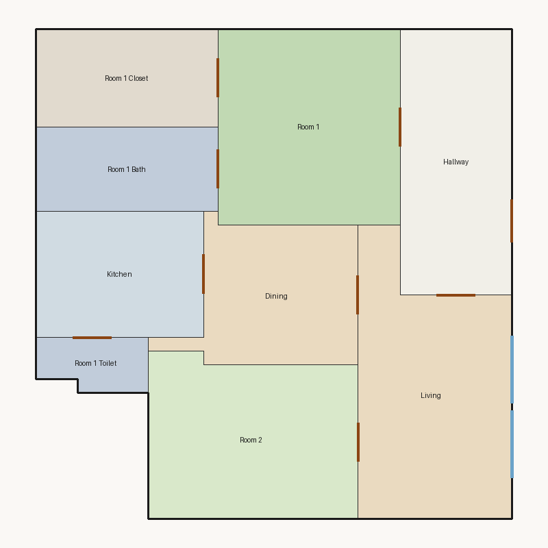

# Score report — 3-room

Source: `../plans/f2d381fede17.json`

This floor plan scores **5.08/10 (Weak)** for “3-room” with 9 rooms, 1115.0 ft² total room area. It fails 1 hard rule(s): Window Lines. Strong areas include living size, room proportions, kitchen–public link. Weaker areas include natural light, privacy, wet core compactness. Highest category is geometry (10.0); lowest is privacy (1.0).

### Layout prompt

Room 2 is in the north-center, next to Living.
Living is in the north-east, next to Dining, Hallway, and Room 2.
Room 1 Toilet is in the north-west, next to Kitchen.
Dining is in the center, next to Kitchen and Living.
Kitchen is in the west-center, next to Dining and Room 1 Toilet.
Room 1 Bath is in the south-west, next to Room 1.
Hallway is in the south-east, next to Living and Room 1.
Room 1 is in the north-center, next to Hallway, Room 1 Bath, and Room 1 Closet.
Room 1 Closet is in the south-west, next to Room 1.

## 3-room

**Overall score: 5.08 / 10 — Weak**

**Plan:** 3-room  
**Rooms (9):** Living (191.0 ft²), Room 1 (182.0 ft²), Room 2 (169.0 ft²), Room 1 Bath (78.0 ft²), Room 1 Toilet (29.0 ft²), Room 1 Closet (91.0 ft²), Kitchen (108.0 ft²), Dining (115.0 ft²), Hallway (152.0 ft²)  
**Doors:** 9 line openings · **Windows:** 2 line openings

### Hard failures (plan rejected by geometry/topology rules)
- **Window Lines** (windows_on_exterior): Missing exterior glazing: ['Room 1', 'Room 2', 'Dining'] — *Repair:* Add window line segments on exterior edges of living/bedrooms

### Category scores

| Category | Score | Rating | Weight |
|---|---:|---|---:|
| Geometry | 10.00 | Excellent | 0.15 |
| Topology | 10.00 | Excellent | 0.10 |
| Construction | 6.30 | Fair | 0.10 |
| Privacy | 1.00 | Poor | 0.11 |
| Circulation | 7.50 | Good | 0.10 |
| Daylight | 2.53 | Poor | 0.13 |
| Architecture | 7.05 | Fair | 0.13 |
| Aesthetics | 7.49 | Fair | 0.18 |

### Rule details

- **Polygon Validity** [HARD/PASS] — **10.0/10** (Excellent): Boundary polygon valid
- **Room Overlap** [HARD/PASS] — **10.0/10** (Excellent): No significant overlaps
- **Boundary Containment** [HARD/PASS] — **10.0/10** (Excellent): All rooms inside boundary
- **Minimum Area** [HARD/PASS] — **10.0/10** (Excellent): Areas OK
- **Minimum Width** [HARD/PASS] — **10.0/10** (Excellent): Widths OK
- **Reachability** [HARD/PASS] — **10.0/10** (Excellent): All rooms reachable
- **Required Rooms Exist** [HARD/PASS] — **10.0/10** (Excellent): Required rooms present
- **Door Lines** [HARD/PASS] — **10.0/10** (Excellent): Doors have room connections
- **Window Lines** [HARD/FAIL] — **0.0/10** (Poor): Missing exterior glazing: ['Room 1', 'Room 2', 'Dining']
  - Suggestion: Add window line segments on exterior edges of living/bedrooms
- **Bathroom Accessible** [HARD/PASS] — **10.0/10** (Excellent): Bathrooms connected
- **Kitchen Accessible** [HARD/PASS] — **10.0/10** (Excellent): Kitchen connected
- **Living Size** [soft/PASS] — **8.7/10** (Good): Living area 191.0 ft²
- **Bedroom Ratio** [soft/PASS] — **6.5/10** (Fair): Bedroom/living area ratio 1.84
  - Suggestion: Rebalance bedroom vs living areas
- **Natural Light** [soft/PASS] — **5.1/10** (Weak): Living: win 9.6/4.8 ft, WFR 22%, ext 16.0 ft, clear; Room 1: win 0.0/4.5 ft, WFR 0%, ext 13.0 ft, clear; Room 2: win 0.0/4.2 ft, WFR 0%, ext 15.0 ft, clear; Dining: win 0.0/2.9 ft, WFR 0%, ext 15.2 ft, blocked
  - Suggestion: Add adequately sized windows on exterior walls of bedrooms/living
- **Privacy** [soft/FAIL] — **1.0/10** (Poor): Direct public-private adjacencies: 4
  - Suggestion: Buffer bedrooms from kitchen/living with hallway or dining
- **Circulation Efficiency** [soft/PASS] — **7.5/10** (Fair): Circ 13.6%; min path width 8.0 ft; 1/2 beds via hall; 2 passageway rooms; 0 dead ends
- **Wet Core Compactness** [soft/FAIL] — **2.0/10** (Poor): Avg wet-room distance 9.37 ft
  - Suggestion: Cluster wet rooms for shared plumbing
- **Construction Shape** [soft/PASS] — **6.9/10** (Fair): Avg rectangularity 0.92; 0 short door edges
  - Suggestion: Simplify room shapes and place doors on longer shared walls
- **Room Proportions** [soft/PASS] — **10.0/10** (Excellent): Over-elongated rooms: 0
- **Storage Adequacy** [soft/PASS] — **7.0/10** (Fair): 1 storage spaces for 2 bedrooms
- **Balcony Usability** [soft/PASS] — **6.0/10** (Fair): No balcony in plan
- **Living Centrality** [soft/PASS] — **5.5/10** (Weak): Living 14.0 ft from plan center; mean 1.9 hops to other rooms
  - Suggestion: Place living nearer the center and connect rooms via hall/living hub
- **Kitchen–Public Link** [soft/PASS] — **10.0/10** (Excellent): Kitchen opens to dining/living
- **Entry Sequence** [soft/PASS] — **7.0/10** (Fair): no entry buffer before living
- **Public Near Exit** [soft/PASS] — **10.0/10** (Excellent): Living 1 hops from exit; bedrooms min 1 / avg 1.5 hops

### Areas to improve
- Privacy: Direct public-private adjacencies: 4 → Buffer bedrooms from kitchen/living with hallway or dining
- Wet Core Compactness: Avg wet-room distance 9.37 ft → Cluster wet rooms for shared plumbing
- Natural Light: Living: win 9.6/4.8 ft, WFR 22%, ext 16.0 ft, clear; Room 1: win 0.0/4.5 ft, WFR 0%, ext 13.0 ft, clear; Room 2: win 0.0/4.2 ft, WFR 0%, ext 15.0 ft, clear; Dining: win 0.0/2.9 ft, WFR 0%, ext 15.2 ft, blocked → Add adequately sized windows on exterior walls of bedrooms/living
- Living Centrality: Living 14.0 ft from plan center; mean 1.9 hops to other rooms → Place living nearer the center and connect rooms via hall/living hub
- Balcony Usability: No balcony in plan
- Bedroom Ratio: Bedroom/living area ratio 1.84 → Rebalance bedroom vs living areas
- Construction Shape: Avg rectangularity 0.92; 0 short door edges → Simplify room shapes and place doors on longer shared walls

_Summary: This floor plan scores **5.08/10 (Weak)** for “3-room” with 9 rooms, 1115.0 ft² total room area. It fails 1 hard rule(s): Window Lines. Strong areas include living size, room proportions, kitchen–public link. Weaker areas include natural light, privacy, wet core compactness. Highest category is geometry (10.0); lowest is privacy (1.0)._