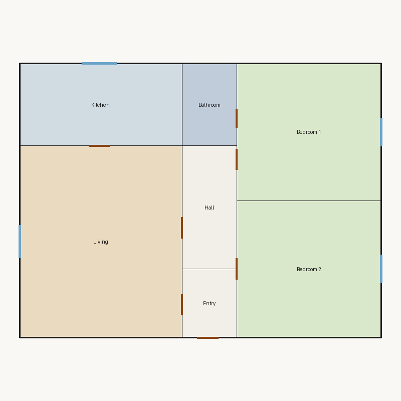
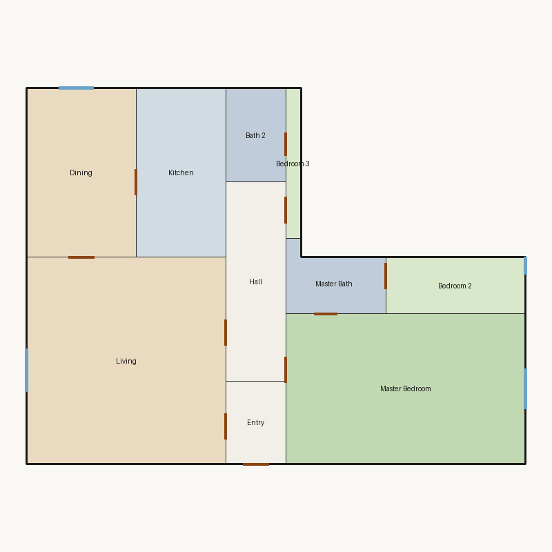
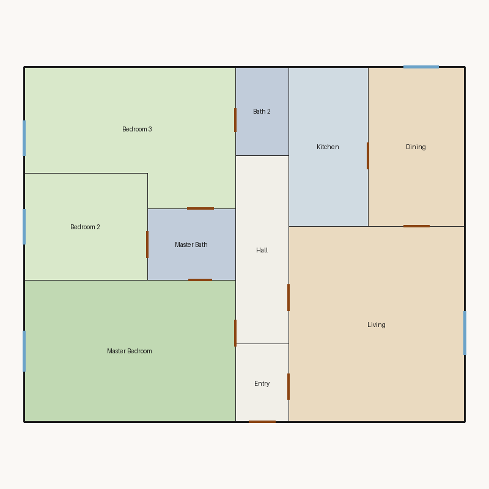

# Floor plan scores

Scored **5** plan(s) in `/workspace/dev/output`.

| Plan | Overall | Rating | Valid | Image |
|---|---:|---|---|---|
| [Studio](001.score.md) | 8.69 | Good | yes |  |
| [Compact 2 Bedroom](002.score.md) | 9.01 | Excellent | yes |  |
| [Luxury 2 Bedroom](003.score.md) | 8.97 | Good | yes |  |
| [3 Bedroom](004.score.md) | 5.11 | Weak | no |  |
| [3 Bedroom Corner](005.score.md) | 8.92 | Good | yes |  |

---

# Detailed reports

## Studio (`001.json`)

This floor plan scores **8.69/10 (Good)** for “Studio” with 3 rooms, 6000 sqft total room area. It passes all hard validity rules. Strong areas include living size, natural light, privacy. Weaker areas include bedroom ratio, circulation efficiency, wet core compactness. Highest category is geometry (10.0); lowest is circulation (5.0).

Full report: [001.score.md](001.score.md)

---

## Compact 2 Bedroom (`002.json`)

This floor plan scores **9.01/10 (Excellent)** for “Compact 2 Bedroom” with 7 rooms, 2000 sqft total room area. It passes all hard validity rules. Strong areas include bedroom ratio, natural light, privacy. Weaker areas include living size, wet core compactness, storage adequacy. Highest category is geometry (10.0); lowest is circulation (9.0).

Full report: [002.score.md](002.score.md)

---

## Luxury 2 Bedroom (`003.json`)

This floor plan scores **8.97/10 (Good)** for “Luxury 2 Bedroom” with 10 rooms, 5980 sqft total room area. It passes all hard validity rules. Strong areas include natural light, privacy, circulation efficiency. Weaker areas include wet core compactness, storage adequacy. Highest category is geometry (10.0); lowest is circulation (9.0).

Full report: [003.score.md](003.score.md)

---

## 3 Bedroom (`004.json`)

This floor plan scores **5.11/10 (Weak)** for “3 Bedroom” with 10 rooms, 2000 sqft total room area. It fails 2 hard rule(s): Minimum Area, Minimum Width. Strong areas include bedroom ratio, natural light, privacy. Weaker areas include living size, wet core compactness, storage adequacy. Highest category is privacy (10.0); lowest is geometry (6.0).

Full report: [004.score.md](004.score.md)

---

## 3 Bedroom Corner (`005.json`)

This floor plan scores **8.92/10 (Good)** for “3 Bedroom Corner” with 10 rooms, 2000 sqft total room area. It passes all hard validity rules. Strong areas include natural light, privacy, circulation efficiency. Weaker areas include living size, wet core compactness, storage adequacy. Highest category is geometry (10.0); lowest is circulation (9.0).

Full report: [005.score.md](005.score.md)

---
