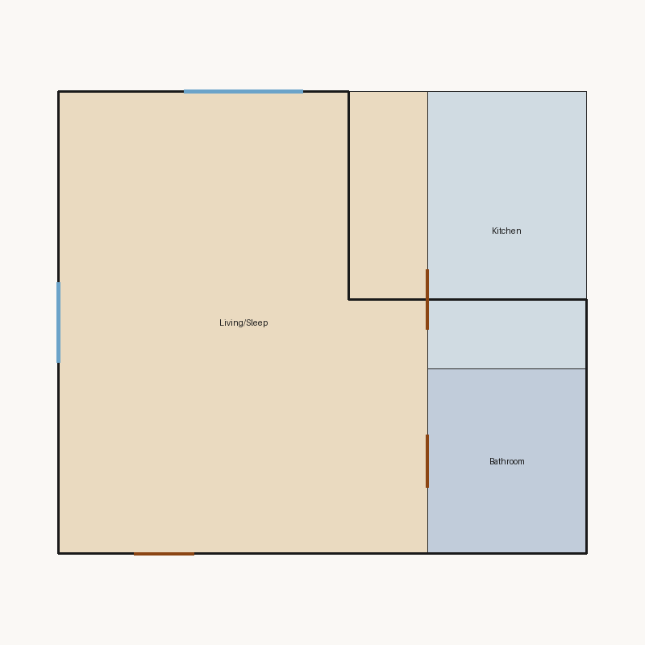
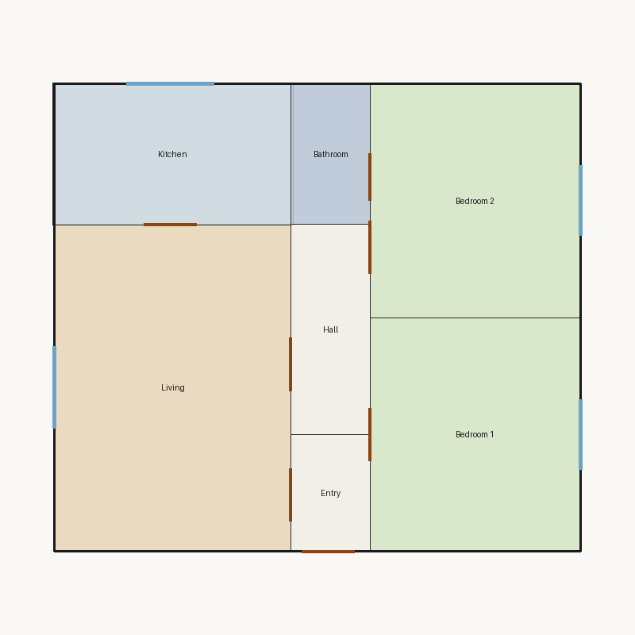
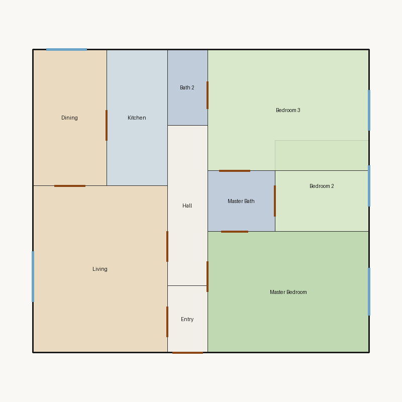

# Floor plan scores

Scored **3** plan(s) in `/workspace/dev/output`.

| Plan | Overall | Rating | Valid | Image |
|---|---:|---|---|---|
| [Studio](5d8872a8ebe9.score.md) | 7.05 | Fair | no |  |
| [Compact 2 Bedroom](aea1372a8555.score.md) | 9.37 | Excellent | yes |  |
| [Luxury 2 Bedroom](ba92c036e2a3.score.md) | 5.66 | Weak | no |  |

---

# Detailed reports

## Studio (`5d8872a8ebe9.json`)

This floor plan scores **7.05/10 (Fair)** for “Studio” with 3 rooms, 56.0 m² total room area. It fails 1 hard rule(s): Boundary Containment. Strong areas include living size, natural light, privacy. Weaker areas include bedroom ratio, circulation efficiency, wet core compactness. Highest category is privacy (10.0); lowest is circulation (5.0).

Full report: [5d8872a8ebe9.score.md](5d8872a8ebe9.score.md)

---

## Compact 2 Bedroom (`aea1372a8555.json`)

This floor plan scores **9.37/10 (Excellent)** for “Compact 2 Bedroom” with 7 rooms, 72.3 m² total room area. It passes all hard validity rules. Strong areas include living size, bedroom ratio, natural light. Weaker areas include wet core compactness, storage adequacy. Highest category is geometry (10.0); lowest is circulation (9.0).

Full report: [aea1372a8555.score.md](aea1372a8555.score.md)

---

## Luxury 2 Bedroom (`ba92c036e2a3.json`)

This floor plan scores **5.66/10 (Weak)** for “Luxury 2 Bedroom” with 10 rooms, 92.5 m² total room area. It fails 2 hard rule(s): Room Overlap, Minimum Area. Strong areas include living size, natural light, privacy. Weaker areas include wet core compactness, storage adequacy. Highest category is privacy (10.0); lowest is geometry (6.0).

Full report: [ba92c036e2a3.score.md](ba92c036e2a3.score.md)

---
