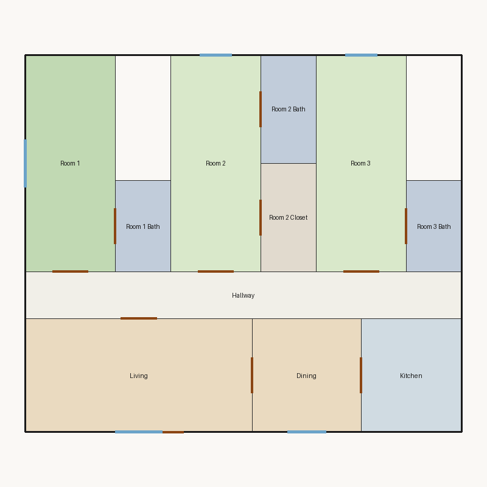

# Score report — 3-room

Source: `../plans/001.json`

This floor plan scores **8.77/10 (Good)** for “3-room” with 11 rooms, 1084.0 ft² total room area. It passes all hard validity rules. Strong areas include living size, natural light, privacy. Weaker areas include bedroom ratio, wet core compactness, living centrality. Highest category is geometry (10.0); lowest is aesthetics (7.9).

## 3-room

**Overall score: 8.77 / 10 — Good**

**Plan:** 3-room  
**Rooms (11):** Living (184.7 ft²), Room 1 (140.7 ft²), Room 2 (140.7 ft²), Room 3 (140.7 ft²), Room 1 Bath (36.2 ft²), Room 2 Bath (43.1 ft²), Room 2 Closet (43.1 ft²), Room 3 Bath (36.2 ft²), Kitchen (81.8 ft²), Dining (88.7 ft²), Hallway (148.0 ft²)  
**Doors:** 11 line openings · **Windows:** 5 line openings

### Hard rules
All hard rules passed — the plan is geometrically/topologically acceptable.

### Category scores

| Category | Score | Rating | Weight |
|---|---:|---|---:|
| Geometry | 10.00 | Excellent | 0.14 |
| Topology | 10.00 | Excellent | 0.09 |
| Construction | 6.00 | Fair | 0.09 |
| Privacy | 10.00 | Excellent | 0.10 |
| Circulation | 9.00 | Excellent | 0.09 |
| Furniture usability | 8.95 | Good | 0.09 |
| Daylight | 10.00 | Excellent | 0.12 |
| Architecture | 7.08 | Fair | 0.12 |
| Aesthetics | 7.91 | Good | 0.16 |

### Rule details

- **Polygon Validity** [HARD/PASS] — **10.0/10** (Excellent): Boundary polygon valid
- **Room Overlap** [HARD/PASS] — **10.0/10** (Excellent): No significant overlaps
- **Boundary Containment** [HARD/PASS] — **10.0/10** (Excellent): All rooms inside boundary
- **Minimum Area** [HARD/PASS] — **10.0/10** (Excellent): Areas OK
- **Minimum Width** [HARD/PASS] — **10.0/10** (Excellent): Widths OK
- **Reachability** [HARD/PASS] — **10.0/10** (Excellent): All rooms reachable
- **Required Rooms Exist** [HARD/PASS] — **10.0/10** (Excellent): Required rooms present
- **Door Lines** [HARD/PASS] — **10.0/10** (Excellent): Doors have room connections
- **Window Lines** [HARD/PASS] — **10.0/10** (Excellent): Window coverage OK
- **Bathroom Accessible** [HARD/PASS] — **10.0/10** (Excellent): Bathrooms connected
- **Kitchen Accessible** [HARD/PASS] — **10.0/10** (Excellent): Kitchen connected
- **Living Size** [soft/PASS] — **8.4/10** (Good): Living area 184.7 ft²
- **Bedroom Ratio** [soft/PASS] — **4.0/10** (Weak): Bedroom/living area ratio 2.29
  - Suggestion: Rebalance bedroom vs living areas
- **Natural Light** [soft/PASS] — **10.0/10** (Excellent): 5/5 critical rooms with windows
- **Privacy** [soft/PASS] — **10.0/10** (Excellent): Direct public-private adjacencies: 0
- **Circulation Efficiency** [soft/PASS] — **9.0/10** (Excellent): Circulation 13.7% of area
- **Wet Core Compactness** [soft/FAIL] — **2.0/10** (Poor): Avg wet-room distance 20.01 ft
  - Suggestion: Cluster wet rooms for shared plumbing
- **Construction Rectangularity** [soft/PASS] — **10.0/10** (Excellent): Avg rectangularity 1.00
- **Room Proportions** [soft/PASS] — **10.0/10** (Excellent): Over-elongated rooms: 0
- **Storage Adequacy** [soft/PASS] — **7.0/10** (Fair): 1 storage spaces for 3 bedrooms
- **Balcony Usability** [soft/PASS] — **6.0/10** (Fair): No balcony in plan
- **Living Centrality** [soft/PASS] — **5.1/10** (Weak): Living 13.3 ft from plan center; mean 2.1 hops to other rooms
  - Suggestion: Place living nearer the center and connect rooms via hall/living hub
- **Kitchen–Public Link** [soft/PASS] — **10.0/10** (Excellent): Kitchen opens to dining/living
- **Entry Sequence** [soft/PASS] — **7.5/10** (Good): no entry; living at exterior
- **Hall Organization** [soft/PASS] — **9.0/10** (Excellent): 3/3 bedrooms on hall/entry; 0 living-only; 0 bed pairs routed through living
- **Public Near Exit** [soft/PASS] — **10.0/10** (Excellent): Living 0 hops from exit; bedrooms min 2 / avg 2.0 hops
- **Furniture Usability** [soft/PASS] — **8.9/10** (Good): Placed 17/19 furniture items
  - Suggestion: Enlarge rooms failing furniture: Bed@Room 1, Kitchen counter@Kitchen

### Areas to improve
- Wet Core Compactness: Avg wet-room distance 20.01 ft → Cluster wet rooms for shared plumbing
- Bedroom Ratio: Bedroom/living area ratio 2.29 → Rebalance bedroom vs living areas
- Living Centrality: Living 13.3 ft from plan center; mean 2.1 hops to other rooms → Place living nearer the center and connect rooms via hall/living hub
- Balcony Usability: No balcony in plan

### Strengths
- Natural Light (10.0): 5/5 critical rooms with windows
- Privacy (10.0): Direct public-private adjacencies: 0
- Construction Rectangularity (10.0): Avg rectangularity 1.00
- Room Proportions (10.0): Over-elongated rooms: 0
- Kitchen–Public Link (10.0): Kitchen opens to dining/living

_Summary: This floor plan scores **8.77/10 (Good)** for “3-room” with 11 rooms, 1084.0 ft² total room area. It passes all hard validity rules. Strong areas include living size, natural light, privacy. Weaker areas include bedroom ratio, wet core compactness, living centrality. Highest category is geometry (10.0); lowest is aesthetics (7.9)._