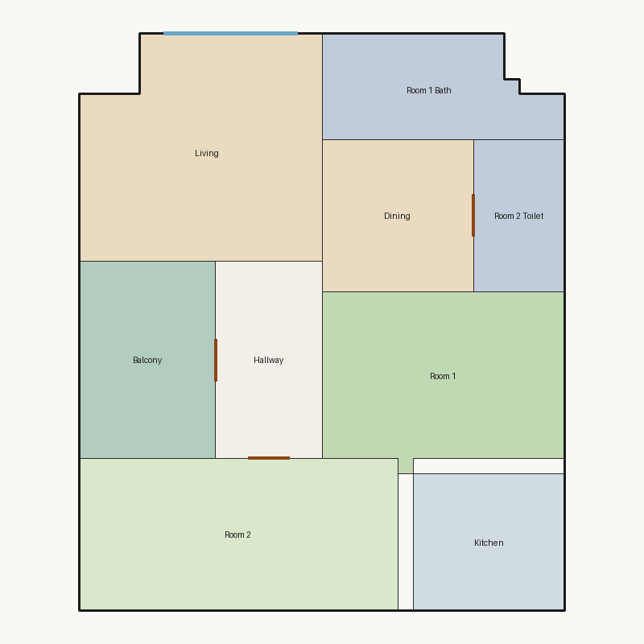

# Score report — 3-room

Source: `../plans/03e87f30ad10.json`

This floor plan scores **2.66/10 (Poor)** for “3-room” with 9 rooms, 1166.0 ft² total room area. It fails 4 hard rule(s): Reachability, Window Lines, Bathroom Accessible, Kitchen Accessible. Strong areas include living size, bedroom ratio, room proportions. Weaker areas include natural light, wet core compactness, storage adequacy. Highest category is geometry (10.0); lowest is daylight (2.7).

## 3-room

**Overall score: 2.66 / 10 — Poor**

**Plan:** 3-room  
**Rooms (9):** Living (224.0 ft²), Room 1 (177.0 ft²), Room 2 (210.0 ft²), Room 1 Bath (97.0 ft²), Room 2 Toilet (60.0 ft²), Kitchen (90.0 ft²), Dining (100.0 ft²), Hallway (91.0 ft²), Balcony (117.0 ft²)  
**Doors:** 4 line openings · **Windows:** 2 line openings

### Hard failures (plan rejected by geometry/topology rules)
- **Reachability** (reachability): Unreachable: Room 1, Room 2, Room 1 Bath, Room 2 Toilet, Kitchen, Dining, Hallway — *Repair:* Add doors connecting unreachable rooms to circulation
- **Window Lines** (windows_on_exterior): Missing exterior glazing: ['Room 1', 'Room 2', 'Dining'] — *Repair:* Add window line segments on exterior edges of living/bedrooms
- **Bathroom Accessible** (bathroom_accessible): Bathroom lacks door connections — *Repair:* Connect bathroom to hall or bedroom
- **Kitchen Accessible** (kitchen_accessible): Kitchen not connected — *Repair:* Connect kitchen to living/dining

### Category scores

| Category | Score | Rating | Weight |
|---|---:|---|---:|
| Geometry | 10.00 | Excellent | 0.15 |
| Topology | 3.67 | Poor | 0.10 |
| Construction | 4.41 | Weak | 0.10 |
| Privacy | 7.50 | Good | 0.11 |
| Circulation | 7.71 | Good | 0.10 |
| Daylight | 2.66 | Poor | 0.13 |
| Architecture | 8.60 | Good | 0.13 |
| Aesthetics | 7.17 | Fair | 0.18 |

### Rule details

- **Polygon Validity** [HARD/PASS] — **10.0/10** (Excellent): Boundary polygon valid
- **Room Overlap** [HARD/PASS] — **10.0/10** (Excellent): No significant overlaps
- **Boundary Containment** [HARD/PASS] — **10.0/10** (Excellent): All rooms inside boundary
- **Minimum Area** [HARD/PASS] — **10.0/10** (Excellent): Areas OK
- **Minimum Width** [HARD/PASS] — **10.0/10** (Excellent): Widths OK
- **Reachability** [HARD/FAIL] — **0.0/10** (Poor): Unreachable: Room 1, Room 2, Room 1 Bath, Room 2 Toilet, Kitchen, Dining, Hallway
  - Suggestion: Add doors connecting unreachable rooms to circulation
- **Required Rooms Exist** [HARD/PASS] — **10.0/10** (Excellent): Required rooms present
- **Door Lines** [HARD/PASS] — **10.0/10** (Excellent): Doors have room connections
- **Window Lines** [HARD/FAIL] — **0.0/10** (Poor): Missing exterior glazing: ['Room 1', 'Room 2', 'Dining']
  - Suggestion: Add window line segments on exterior edges of living/bedrooms
- **Bathroom Accessible** [HARD/FAIL] — **0.0/10** (Poor): Bathroom lacks door connections
  - Suggestion: Connect bathroom to hall or bedroom
- **Kitchen Accessible** [HARD/FAIL] — **0.0/10** (Poor): Kitchen not connected
  - Suggestion: Connect kitchen to living/dining
- **Living Size** [soft/PASS] — **10.0/10** (Excellent): Living area 224.0 ft²
- **Bedroom Ratio** [soft/PASS] — **9.0/10** (Excellent): Bedroom/living area ratio 1.73
- **Natural Light** [soft/PASS] — **5.3/10** (Weak): Living: win 9.6/4.8 ft, WFR 19%, ext 12.0 ft, clear; Room 1: win 0.0/4.4 ft, WFR 0%, ext 11.0 ft, clear; Room 2: win 0.0/5.2 ft, WFR 0%, ext 21.0 ft, clear; Dining: win 0.0/2.5 ft, WFR 0%, ext 10.2 ft, clear
  - Suggestion: Add adequately sized windows on exterior walls of bedrooms/living
- **Privacy** [soft/PASS] — **7.5/10** (Good): Direct public-private adjacencies: 1
- **Circulation Efficiency** [soft/PASS] — **7.7/10** (Good): Circ 7.8%; min path width 11.8 ft; 1/2 beds via hall; 0 passageway rooms; 0 dead ends
- **Wet Core Compactness** [soft/FAIL] — **2.0/10** (Poor): Avg wet-room distance 20.59 ft
  - Suggestion: Cluster wet rooms for shared plumbing
- **Construction Shape** [soft/PASS] — **6.8/10** (Fair): Avg rectangularity 0.97; 0 short door edges
  - Suggestion: Simplify room shapes and place doors on longer shared walls
- **Room Proportions** [soft/PASS] — **10.0/10** (Excellent): Over-elongated rooms: 0
- **Storage Adequacy** [soft/PASS] — **4.0/10** (Weak): 0 storage spaces for 2 bedrooms
  - Suggestion: Attach private closets to their bedroom; keep shared closets near bedrooms
- **Balcony Usability** [soft/PASS] — **10.0/10** (Excellent): Balcony 117.0 ft²
- **Living Centrality** [soft/PASS] — **4.5/10** (Weak): Living 13.6 ft from plan center; mean 0.0 hops to other rooms
  - Suggestion: Place living nearer the center and connect rooms via hall/living hub
- **Kitchen–Public Link** [soft/FAIL] — **2.0/10** (Poor): Kitchen unreachable from living/dining
  - Suggestion: Connect kitchen to dining/living; never directly to a bedroom
- **Entry Sequence** [soft/PASS] — **7.5/10** (Good): no entry; living at exterior
- **Public Near Exit** [soft/PASS] — **9.5/10** (Excellent): Living 0 hops from exit (no bedrooms)

### Areas to improve
- Wet Core Compactness: Avg wet-room distance 20.59 ft → Cluster wet rooms for shared plumbing
- Kitchen–Public Link: Kitchen unreachable from living/dining → Connect kitchen to dining/living; never directly to a bedroom
- Storage Adequacy: 0 storage spaces for 2 bedrooms → Attach private closets to their bedroom; keep shared closets near bedrooms
- Living Centrality: Living 13.6 ft from plan center; mean 0.0 hops to other rooms → Place living nearer the center and connect rooms via hall/living hub
- Natural Light: Living: win 9.6/4.8 ft, WFR 19%, ext 12.0 ft, clear; Room 1: win 0.0/4.4 ft, WFR 0%, ext 11.0 ft, clear; Room 2: win 0.0/5.2 ft, WFR 0%, ext 21.0 ft, clear; Dining: win 0.0/2.5 ft, WFR 0%, ext 10.2 ft, clear → Add adequately sized windows on exterior walls of bedrooms/living
- Construction Shape: Avg rectangularity 0.97; 0 short door edges → Simplify room shapes and place doors on longer shared walls

_Summary: This floor plan scores **2.66/10 (Poor)** for “3-room” with 9 rooms, 1166.0 ft² total room area. It fails 4 hard rule(s): Reachability, Window Lines, Bathroom Accessible, Kitchen Accessible. Strong areas include living size, bedroom ratio, room proportions. Weaker areas include natural light, wet core compactness, storage adequacy. Highest category is geometry (10.0); lowest is daylight (2.7)._