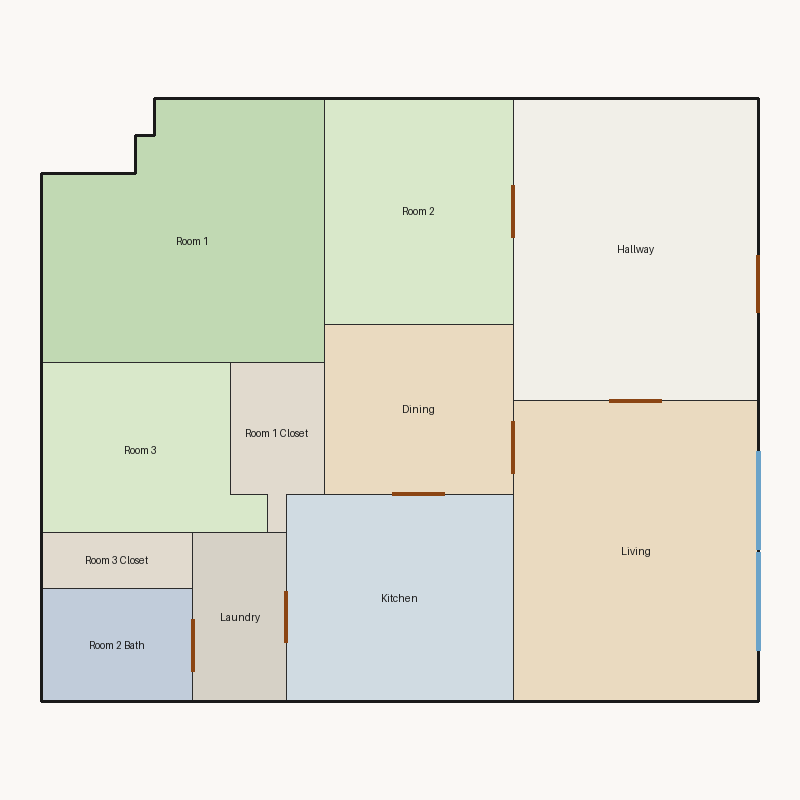

# Score report — 3-room

Source: `../plans/1d9f0b69995c.json`

This floor plan scores **3.73/10 (Poor)** for “3-room” with 11 rooms, 1194.0 ft² total room area. It fails 2 hard rule(s): Reachability, Window Lines. Strong areas include living size, room proportions, storage adequacy. Weaker areas include natural light, privacy, wet core compactness. Highest category is geometry (10.0); lowest is daylight (2.5).

## 3-room

**Overall score: 3.73 / 10 — Poor**

**Plan:** 3-room  
**Rooms (11):** Living (208.0 ft²), Room 1 (188.0 ft²), Room 2 (120.0 ft²), Room 3 (94.0 ft²), Room 1 Closet (37.0 ft²), Room 2 Bath (48.0 ft²), Room 3 Closet (24.0 ft²), Kitchen (132.0 ft²), Dining (90.0 ft²), Hallway (208.0 ft²), Laundry (45.0 ft²)  
**Doors:** 7 line openings · **Windows:** 2 line openings

### Hard failures (plan rejected by geometry/topology rules)
- **Reachability** (reachability): Unreachable: Room 1, Room 3, Room 1 Closet, Room 3 Closet — *Repair:* Add doors connecting unreachable rooms to circulation
- **Window Lines** (windows_on_exterior): Missing exterior glazing: ['Room 1', 'Room 2', 'Room 3', 'Dining'] — *Repair:* Add window line segments on exterior edges of living/bedrooms

### Category scores

| Category | Score | Rating | Weight |
|---|---:|---|---:|
| Geometry | 10.00 | Excellent | 0.15 |
| Topology | 8.33 | Good | 0.10 |
| Construction | 4.45 | Weak | 0.10 |
| Privacy | 5.00 | Weak | 0.11 |
| Circulation | 6.70 | Fair | 0.10 |
| Daylight | 2.54 | Poor | 0.13 |
| Architecture | 8.39 | Good | 0.13 |
| Aesthetics | 7.28 | Fair | 0.18 |

### Rule details

- **Polygon Validity** [HARD/PASS] — **10.0/10** (Excellent): Boundary polygon valid
- **Room Overlap** [HARD/PASS] — **10.0/10** (Excellent): No significant overlaps
- **Boundary Containment** [HARD/PASS] — **10.0/10** (Excellent): All rooms inside boundary
- **Minimum Area** [HARD/PASS] — **10.0/10** (Excellent): Areas OK
- **Minimum Width** [HARD/PASS] — **10.0/10** (Excellent): Widths OK
- **Reachability** [HARD/FAIL] — **0.0/10** (Poor): Unreachable: Room 1, Room 3, Room 1 Closet, Room 3 Closet
  - Suggestion: Add doors connecting unreachable rooms to circulation
- **Required Rooms Exist** [HARD/PASS] — **10.0/10** (Excellent): Required rooms present
- **Door Lines** [HARD/PASS] — **10.0/10** (Excellent): Doors have room connections
- **Window Lines** [HARD/FAIL] — **0.0/10** (Poor): Missing exterior glazing: ['Room 1', 'Room 2', 'Room 3', 'Dining']
  - Suggestion: Add window line segments on exterior edges of living/bedrooms
- **Bathroom Accessible** [HARD/PASS] — **10.0/10** (Excellent): Bathrooms connected
- **Kitchen Accessible** [HARD/PASS] — **10.0/10** (Excellent): Kitchen connected
- **Living Size** [soft/PASS] — **9.5/10** (Excellent): Living area 208.0 ft²
- **Bedroom Ratio** [soft/PASS] — **6.5/10** (Fair): Bedroom/living area ratio 1.93
  - Suggestion: Rebalance bedroom vs living areas
- **Natural Light** [soft/PASS] — **5.1/10** (Weak): Living: win 10.4/5.2 ft, WFR 22%, ext 16.0 ft, clear; Room 1: win 0.0/4.0 ft, WFR 0%, ext 10.0 ft, clear; Room 2: win 0.0/3.0 ft, WFR 0%, ext 10.0 ft, clear; Room 3: win 0.0/2.4 ft, WFR 0%, ext 9.0 ft, clear; Dining: win 0.0/2.2 ft, WFR 0%, ext 10.2 ft, clear
  - Suggestion: Add adequately sized windows on exterior walls of bedrooms/living
- **Privacy** [soft/PASS] — **5.0/10** (Weak): Direct public-private adjacencies: 2
  - Suggestion: Buffer bedrooms from kitchen/living with hallway or dining
- **Circulation Efficiency** [soft/PASS] — **6.7/10** (Fair): Circ 17.4%; min path width 10.0 ft; 1/3 beds via hall; 0 passageway rooms; 0 dead ends
  - Suggestion: Reduce hallway waste, widen paths, and serve bedrooms from circulation
- **Wet Core Compactness** [soft/FAIL] — **2.0/10** (Poor): Avg wet-room distance 15.21 ft
  - Suggestion: Cluster wet rooms for shared plumbing
- **Construction Shape** [soft/PASS] — **6.9/10** (Fair): Avg rectangularity 0.97; 0 short door edges
  - Suggestion: Simplify room shapes and place doors on longer shared walls
- **Room Proportions** [soft/PASS] — **10.0/10** (Excellent): Over-elongated rooms: 0
- **Storage Adequacy** [soft/PASS] — **10.0/10** (Excellent): 2 storage spaces for 3 bedrooms
- **Balcony Usability** [soft/PASS] — **6.0/10** (Fair): No balcony in plan
- **Living Centrality** [soft/PASS] — **4.8/10** (Weak): Living 14.4 ft from plan center; mean 2.2 hops to other rooms
  - Suggestion: Place living nearer the center and connect rooms via hall/living hub
- **Kitchen–Public Link** [soft/PASS] — **10.0/10** (Excellent): Kitchen opens to dining/living
- **Entry Sequence** [soft/PASS] — **7.0/10** (Fair): no entry buffer before living
- **Public Near Exit** [soft/PASS] — **10.0/10** (Excellent): Living 1 hops from exit; bedrooms min 1 / avg 1.0 hops

### Areas to improve
- Wet Core Compactness: Avg wet-room distance 15.21 ft → Cluster wet rooms for shared plumbing
- Living Centrality: Living 14.4 ft from plan center; mean 2.2 hops to other rooms → Place living nearer the center and connect rooms via hall/living hub
- Privacy: Direct public-private adjacencies: 2 → Buffer bedrooms from kitchen/living with hallway or dining
- Natural Light: Living: win 10.4/5.2 ft, WFR 22%, ext 16.0 ft, clear; Room 1: win 0.0/4.0 ft, WFR 0%, ext 10.0 ft, clear; Room 2: win 0.0/3.0 ft, WFR 0%, ext 10.0 ft, clear; Room 3: win 0.0/2.4 ft, WFR 0%, ext 9.0 ft, clear; Dining: win 0.0/2.2 ft, WFR 0%, ext 10.2 ft, clear → Add adequately sized windows on exterior walls of bedrooms/living
- Balcony Usability: No balcony in plan
- Bedroom Ratio: Bedroom/living area ratio 1.93 → Rebalance bedroom vs living areas
- Circulation Efficiency: Circ 17.4%; min path width 10.0 ft; 1/3 beds via hall; 0 passageway rooms; 0 dead ends → Reduce hallway waste, widen paths, and serve bedrooms from circulation
- Construction Shape: Avg rectangularity 0.97; 0 short door edges → Simplify room shapes and place doors on longer shared walls

_Summary: This floor plan scores **3.73/10 (Poor)** for “3-room” with 11 rooms, 1194.0 ft² total room area. It fails 2 hard rule(s): Reachability, Window Lines. Strong areas include living size, room proportions, storage adequacy. Weaker areas include natural light, privacy, wet core compactness. Highest category is geometry (10.0); lowest is daylight (2.5)._