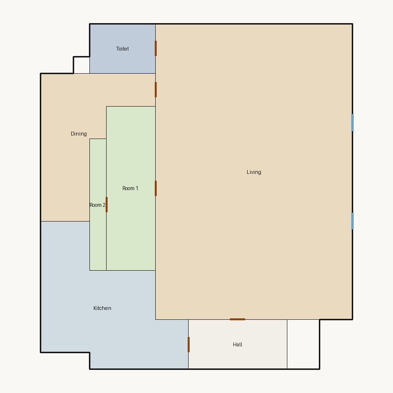

# Score report — 3-room

Source: `../plans/3c22111e270b.json`

This floor plan scores **2.01/10 (Poor)** for “3-room” with 7 rooms, 375.0 ft² total room area. It fails 4 hard rule(s): Minimum Area, Minimum Width, Required Rooms Exist, Window Lines. Strong areas include living size, circulation efficiency, construction rectangularity. Weaker areas include bedroom ratio, natural light, privacy. Highest category is circulation (9.0); lowest is privacy (2.5).

## 3-room

**Overall score: 2.01 / 10 — Poor**

**Plan:** 3-room  
**Rooms (7):** Living (216.0 ft²), Room 1 (30.0 ft²), Room 2 (8.0 ft²), Kitchen (54.0 ft²), Dining (37.0 ft²), Hall (18.0 ft²), Toilet (12.0 ft²)  
**Doors:** 6 line openings · **Windows:** 2 line openings

### Hard failures (plan rejected by geometry/topology rules)
- **Minimum Area** (minimum_area): Too small: Room 1 (30.0<75.0), Room 2 (8.0<75.0), Dining (37.0<65.0) — *Repair:* Expand undersized rooms
- **Minimum Width** (minimum_width): Too narrow: Room 1, Room 2 — *Repair:* Widen narrow rooms by moving shared walls
- **Required Rooms Exist** (required_rooms): Missing: bathroom — *Repair:* Insert missing required rooms
- **Window Lines** (windows_on_exterior): Poor exterior access for: ['Room 1', 'Room 2'] — *Repair:* Add window line segments on exterior edges of living/bedrooms

### Category scores

| Category | Score | Rating | Weight |
|---|---:|---|---:|
| Geometry | 6.00 | Fair | 0.14 |
| Topology | 8.00 | Good | 0.09 |
| Construction | 5.47 | Weak | 0.09 |
| Privacy | 2.50 | Poor | 0.10 |
| Circulation | 9.00 | Excellent | 0.09 |
| Furniture usability | 8.75 | Good | 0.09 |
| Daylight | 2.50 | Poor | 0.12 |
| Architecture | 5.96 | Weak | 0.12 |
| Aesthetics | 6.87 | Fair | 0.16 |

### Rule details

- **Polygon Validity** [HARD/PASS] — **10.0/10** (Excellent): Boundary polygon valid
- **Room Overlap** [HARD/PASS] — **10.0/10** (Excellent): No significant overlaps
- **Boundary Containment** [HARD/PASS] — **10.0/10** (Excellent): All rooms inside boundary
- **Minimum Area** [HARD/FAIL] — **0.0/10** (Poor): Too small: Room 1 (30.0<75.0), Room 2 (8.0<75.0), Dining (37.0<65.0)
  - Suggestion: Expand undersized rooms
- **Minimum Width** [HARD/FAIL] — **0.0/10** (Poor): Too narrow: Room 1, Room 2
  - Suggestion: Widen narrow rooms by moving shared walls
- **Reachability** [HARD/PASS] — **10.0/10** (Excellent): All rooms reachable
- **Required Rooms Exist** [HARD/FAIL] — **0.0/10** (Poor): Missing: bathroom
  - Suggestion: Insert missing required rooms
- **Door Lines** [HARD/PASS] — **10.0/10** (Excellent): Doors have room connections
- **Window Lines** [HARD/FAIL] — **0.0/10** (Poor): Poor exterior access for: ['Room 1', 'Room 2']
  - Suggestion: Add window line segments on exterior edges of living/bedrooms
- **Bathroom Accessible** [HARD/PASS] — **10.0/10** (Excellent): Bathrooms connected
- **Kitchen Accessible** [HARD/PASS] — **10.0/10** (Excellent): Kitchen connected
- **Living Size** [soft/PASS] — **9.8/10** (Excellent): Living area 216.0 ft²
- **Bedroom Ratio** [soft/PASS] — **4.0/10** (Weak): Bedroom/living area ratio 0.18
  - Suggestion: Rebalance bedroom vs living areas
- **Natural Light** [soft/PASS] — **5.0/10** (Weak): 2/4 critical rooms on exterior
  - Suggestion: Give bedrooms/living exterior walls
- **Privacy** [soft/FAIL] — **2.5/10** (Poor): Direct public-private adjacencies: 3
  - Suggestion: Buffer bedrooms with hallway
- **Circulation Efficiency** [soft/PASS] — **9.0/10** (Excellent): Circulation 4.8% of area
- **Wet Core Compactness** [soft/FAIL] — **2.0/10** (Poor): Avg wet-room distance 15.83 ft
  - Suggestion: Cluster wet rooms for shared plumbing
- **Construction Rectangularity** [soft/PASS] — **8.9/10** (Good): Avg rectangularity 0.89
- **Room Proportions** [soft/PASS] — **6.0/10** (Fair): Over-elongated rooms: 2
  - Suggestion: Improve aspect ratios toward 1–2
- **Storage Adequacy** [soft/PASS] — **4.0/10** (Weak): 0 storage spaces for 2 bedrooms
  - Suggestion: Insert closet near bedrooms
- **Balcony Usability** [soft/PASS] — **6.0/10** (Fair): No balcony in plan
- **Living Centrality** [soft/PASS] — **8.0/10** (Good): Living 3.7 ft from plan center; mean 1.3 hops to other rooms
- **Kitchen–Public Link** [soft/PASS] — **7.0/10** (Fair): Kitchen 2 hops via hall to public
- **Entry Sequence** [soft/PASS] — **7.5/10** (Good): no entry; living at exterior
- **Hall Organization** [soft/FAIL] — **1.8/10** (Poor): 0/2 bedrooms on hall/entry; 1 living-only; 0 bed pairs routed through living
  - Suggestion: Serve bedrooms from a hallway instead of crossing the living room
- **Public Near Exit** [soft/PASS] — **10.0/10** (Excellent): Living 0 hops from exit; bedrooms min 1 / avg 1.5 hops
- **Furniture Usability** [soft/PASS] — **8.8/10** (Good): Placed 7/8 furniture items
  - Suggestion: Enlarge rooms failing furniture: Bed@Room 2

### Areas to improve
- Hall Organization: 0/2 bedrooms on hall/entry; 1 living-only; 0 bed pairs routed through living → Serve bedrooms from a hallway instead of crossing the living room
- Wet Core Compactness: Avg wet-room distance 15.83 ft → Cluster wet rooms for shared plumbing
- Privacy: Direct public-private adjacencies: 3 → Buffer bedrooms with hallway
- Bedroom Ratio: Bedroom/living area ratio 0.18 → Rebalance bedroom vs living areas
- Storage Adequacy: 0 storage spaces for 2 bedrooms → Insert closet near bedrooms
- Natural Light: 2/4 critical rooms on exterior → Give bedrooms/living exterior walls
- Room Proportions: Over-elongated rooms: 2 → Improve aspect ratios toward 1–2
- Balcony Usability: No balcony in plan

_Summary: This floor plan scores **2.01/10 (Poor)** for “3-room” with 7 rooms, 375.0 ft² total room area. It fails 4 hard rule(s): Minimum Area, Minimum Width, Required Rooms Exist, Window Lines. Strong areas include living size, circulation efficiency, construction rectangularity. Weaker areas include bedroom ratio, natural light, privacy. Highest category is circulation (9.0); lowest is privacy (2.5)._