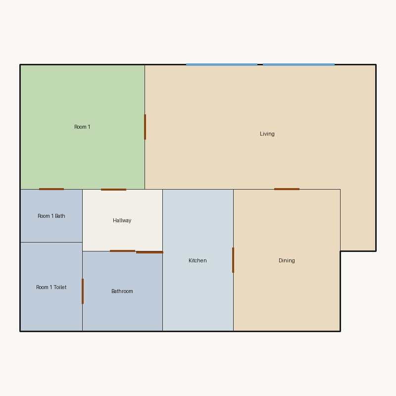

# Score report — 3-room

Source: `../plans/4d5fb82ed552.json`

This floor plan scores **5.45/10 (Weak)** for “3-room” with 8 rooms, 1164.0 ft² total room area. It fails 1 hard rule(s): Window Lines. Strong areas include living size, room proportions, kitchen–public link. Weaker areas include natural light, wet core compactness, storage adequacy. Highest category is geometry (10.0); lowest is daylight (2.9).

### Layout prompt

Bathroom is in the north-west, next to Hallway and Room 1 Toilet.
Room 1 Toilet is in the north-west, next to Bathroom.
Kitchen is in the north-center, next to Dining.
Dining is in the north-east, next to Kitchen and Living.
Hallway is in the west-center, next to Bathroom and Room 1.
Room 1 Bath is in the west-center, next to Room 1.
Living is in the south-east, next to Dining and Room 1.
Room 1 is in the south-west, next to Hallway, Living, and Room 1 Bath.

## 3-room

**Overall score: 5.45 / 10 — Weak**

**Plan:** 3-room  
**Rooms (8):** Living (392.0 ft²), Room 1 (196.0 ft²), Room 1 Bath (42.0 ft²), Room 1 Toilet (70.0 ft²), Kitchen (128.0 ft²), Dining (192.0 ft²), Hallway (63.0 ft²), Bathroom (81.0 ft²)  
**Doors:** 8 line openings · **Windows:** 2 line openings

### Hard failures (plan rejected by geometry/topology rules)
- **Window Lines** (windows_on_exterior): Missing exterior glazing: ['Room 1', 'Dining'] — *Repair:* Add window line segments on exterior edges of living/bedrooms

### Category scores

| Category | Score | Rating | Weight |
|---|---:|---|---:|
| Geometry | 10.00 | Excellent | 0.15 |
| Topology | 10.00 | Excellent | 0.10 |
| Construction | 6.43 | Fair | 0.10 |
| Privacy | 7.50 | Good | 0.11 |
| Circulation | 7.79 | Good | 0.10 |
| Daylight | 2.87 | Poor | 0.13 |
| Architecture | 6.62 | Fair | 0.13 |
| Aesthetics | 5.38 | Weak | 0.18 |

### Rule details

- **Polygon Validity** [HARD/PASS] — **10.0/10** (Excellent): Boundary polygon valid
- **Room Overlap** [HARD/PASS] — **10.0/10** (Excellent): No significant overlaps
- **Boundary Containment** [HARD/PASS] — **10.0/10** (Excellent): All rooms inside boundary
- **Minimum Area** [HARD/PASS] — **10.0/10** (Excellent): Areas OK
- **Minimum Width** [HARD/PASS] — **10.0/10** (Excellent): Widths OK
- **Reachability** [HARD/PASS] — **10.0/10** (Excellent): All rooms reachable
- **Required Rooms Exist** [HARD/PASS] — **10.0/10** (Excellent): Required rooms present
- **Door Lines** [HARD/PASS] — **10.0/10** (Excellent): Doors have room connections
- **Window Lines** [HARD/FAIL] — **0.0/10** (Poor): Missing exterior glazing: ['Room 1', 'Dining']
  - Suggestion: Add window line segments on exterior edges of living/bedrooms
- **Bathroom Accessible** [HARD/PASS] — **10.0/10** (Excellent): Bathrooms connected
- **Kitchen Accessible** [HARD/PASS] — **10.0/10** (Excellent): Kitchen connected
- **Living Size** [soft/PASS] — **10.0/10** (Excellent): Living area 392.0 ft²
- **Bedroom Ratio** [soft/PASS] — **6.5/10** (Fair): Bedroom/living area ratio 0.50
  - Suggestion: Rebalance bedroom vs living areas
- **Natural Light** [soft/PASS] — **5.7/10** (Weak): Living: win 16.0/8.0 ft, WFR 18%, ext 26.0 ft, clear; Room 1: win 0.0/4.9 ft, WFR 0%, ext 14.0 ft, clear; Dining: win 0.0/4.8 ft, WFR 0%, ext 12.0 ft, clear
  - Suggestion: Add adequately sized windows on exterior walls of bedrooms/living
- **Privacy** [soft/PASS] — **7.5/10** (Good): Direct public-private adjacencies: 1
- **Circulation Efficiency** [soft/PASS] — **7.8/10** (Good): Circ 5.4%; min path width 7.0 ft; 1/1 beds via hall; 1 passageway rooms; 0 dead ends
- **Wet Core Compactness** [soft/FAIL] — **2.0/10** (Poor): Avg wet-room distance 11.82 ft
  - Suggestion: Cluster wet rooms for shared plumbing
- **Construction Shape** [soft/PASS] — **7.3/10** (Fair): Avg rectangularity 0.96; 0 short door edges
- **Room Proportions** [soft/PASS] — **10.0/10** (Excellent): Over-elongated rooms: 0
- **Storage Adequacy** [soft/PASS] — **4.0/10** (Weak): 0 storage spaces for 1 bedrooms
  - Suggestion: Attach private closets to their bedroom; keep shared closets near bedrooms
- **Balcony Usability** [soft/PASS] — **6.0/10** (Fair): No balcony in plan
- **Living Centrality** [soft/PASS] — **5.6/10** (Weak): Living 10.8 ft from plan center; mean 2.1 hops to other rooms
  - Suggestion: Place living nearer the center and connect rooms via hall/living hub
- **Kitchen–Public Link** [soft/PASS] — **10.0/10** (Excellent): Kitchen opens to dining/living
- **Entry Sequence** [soft/PASS] — **5.5/10** (Weak): no entry; living 2 hops from exit
  - Suggestion: Add a small entry/foyer so exit leads to living, not bedrooms
- **Public Near Exit** [soft/PASS] — **5.0/10** (Weak): Living 2 hops from exit; bedrooms min 1 / avg 1.0 hops
  - Suggestion: Keep living closer to the exit than bedrooms

### Areas to improve
- Wet Core Compactness: Avg wet-room distance 11.82 ft → Cluster wet rooms for shared plumbing
- Storage Adequacy: 0 storage spaces for 1 bedrooms → Attach private closets to their bedroom; keep shared closets near bedrooms
- Public Near Exit: Living 2 hops from exit; bedrooms min 1 / avg 1.0 hops → Keep living closer to the exit than bedrooms
- Entry Sequence: no entry; living 2 hops from exit → Add a small entry/foyer so exit leads to living, not bedrooms
- Living Centrality: Living 10.8 ft from plan center; mean 2.1 hops to other rooms → Place living nearer the center and connect rooms via hall/living hub
- Natural Light: Living: win 16.0/8.0 ft, WFR 18%, ext 26.0 ft, clear; Room 1: win 0.0/4.9 ft, WFR 0%, ext 14.0 ft, clear; Dining: win 0.0/4.8 ft, WFR 0%, ext 12.0 ft, clear → Add adequately sized windows on exterior walls of bedrooms/living
- Balcony Usability: No balcony in plan
- Bedroom Ratio: Bedroom/living area ratio 0.50 → Rebalance bedroom vs living areas

_Summary: This floor plan scores **5.45/10 (Weak)** for “3-room” with 8 rooms, 1164.0 ft² total room area. It fails 1 hard rule(s): Window Lines. Strong areas include living size, room proportions, kitchen–public link. Weaker areas include natural light, wet core compactness, storage adequacy. Highest category is geometry (10.0); lowest is daylight (2.9)._