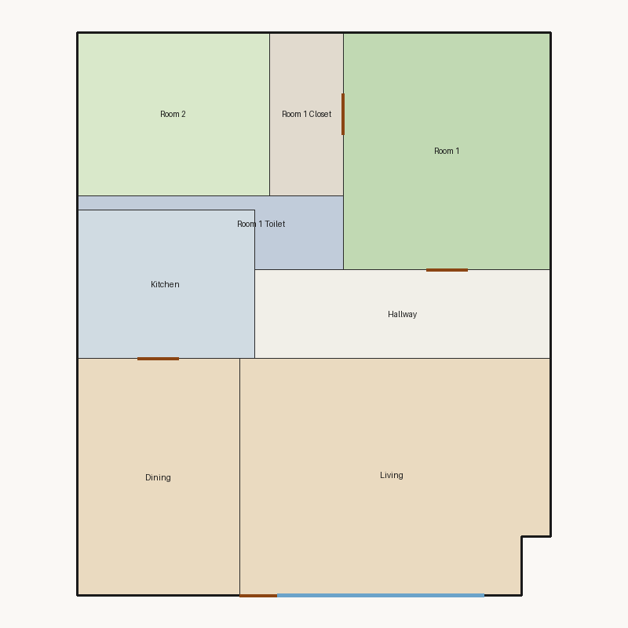

# Score report — 3-room

Source: `../plans/767bfda6bbaf.json`

This floor plan scores **2.86/10 (Poor)** for “3-room” with 8 rooms, 1208.0 ft² total room area. It fails 4 hard rule(s): Reachability, Required Rooms Exist, Window Lines, Bathroom Accessible. Strong areas include living size, bedroom ratio, privacy. Weaker areas include natural light, wet core compactness, construction shape. Highest category is geometry (10.0); lowest is daylight (2.7).

## 3-room

**Overall score: 2.86 / 10 — Poor**

**Plan:** 3-room  
**Rooms (8):** Living (328.0 ft²), Room 1 (224.0 ft²), Room 2 (143.0 ft²), Room 1 Toilet (42.0 ft²), Room 1 Closet (55.0 ft²), Kitchen (120.0 ft²), Dining (176.0 ft²), Hallway (120.0 ft²)  
**Doors:** 4 line openings · **Windows:** 2 line openings

### Hard failures (plan rejected by geometry/topology rules)
- **Reachability** (reachability): Unreachable: Room 1, Room 2, Room 1 Toilet, Room 1 Closet, Kitchen, Dining, Hallway — *Repair:* Add doors connecting unreachable rooms to circulation
- **Required Rooms Exist** (required_rooms): Missing: bathroom — *Repair:* Insert missing required rooms
- **Window Lines** (windows_on_exterior): Missing exterior glazing: ['Room 1', 'Room 2', 'Dining'] — *Repair:* Add window line segments on exterior edges of living/bedrooms
- **Bathroom Accessible** (bathroom_accessible): Bathroom lacks door connections — *Repair:* Connect bathroom to hall or bedroom

### Category scores

| Category | Score | Rating | Weight |
|---|---:|---|---:|
| Geometry | 10.00 | Excellent | 0.15 |
| Topology | 5.00 | Weak | 0.10 |
| Construction | 3.29 | Poor | 0.10 |
| Privacy | 10.00 | Excellent | 0.11 |
| Circulation | 7.35 | Fair | 0.10 |
| Daylight | 2.66 | Poor | 0.13 |
| Architecture | 8.00 | Good | 0.13 |
| Aesthetics | 7.26 | Fair | 0.18 |

### Rule details

- **Polygon Validity** [HARD/PASS] — **10.0/10** (Excellent): Boundary polygon valid
- **Room Overlap** [HARD/PASS] — **10.0/10** (Excellent): No significant overlaps
- **Boundary Containment** [HARD/PASS] — **10.0/10** (Excellent): All rooms inside boundary
- **Minimum Area** [HARD/PASS] — **10.0/10** (Excellent): Areas OK
- **Minimum Width** [HARD/PASS] — **10.0/10** (Excellent): Widths OK
- **Reachability** [HARD/FAIL] — **0.0/10** (Poor): Unreachable: Room 1, Room 2, Room 1 Toilet, Room 1 Closet, Kitchen, Dining, Hallway
  - Suggestion: Add doors connecting unreachable rooms to circulation
- **Required Rooms Exist** [HARD/FAIL] — **0.0/10** (Poor): Missing: bathroom
  - Suggestion: Insert missing required rooms
- **Door Lines** [HARD/PASS] — **10.0/10** (Excellent): Doors have room connections
- **Window Lines** [HARD/FAIL] — **0.0/10** (Poor): Missing exterior glazing: ['Room 1', 'Room 2', 'Dining']
  - Suggestion: Add window line segments on exterior edges of living/bedrooms
- **Bathroom Accessible** [HARD/FAIL] — **0.0/10** (Poor): Bathroom lacks door connections
  - Suggestion: Connect bathroom to hall or bedroom
- **Kitchen Accessible** [HARD/PASS] — **10.0/10** (Excellent): Kitchen connected
- **Living Size** [soft/PASS] — **10.0/10** (Excellent): Living area 328.0 ft²
- **Bedroom Ratio** [soft/PASS] — **9.0/10** (Excellent): Bedroom/living area ratio 1.12
- **Natural Light** [soft/PASS] — **5.3/10** (Weak): Living: win 15.2/7.6 ft, WFR 21%, ext 19.0 ft, clear; Room 1: win 0.0/5.6 ft, WFR 0%, ext 16.0 ft, clear; Room 2: win 0.0/3.6 ft, WFR 0%, ext 13.0 ft, clear; Dining: win 0.0/4.4 ft, WFR 0%, ext 16.0 ft, clear
  - Suggestion: Add adequately sized windows on exterior walls of bedrooms/living
- **Privacy** [soft/PASS] — **10.0/10** (Excellent): Direct public-private adjacencies: 0
- **Circulation Efficiency** [soft/PASS] — **7.3/10** (Fair): Circ 9.9%; min path width 15.7 ft; 1/2 beds via hall; 0 passageway rooms; 1 dead ends
- **Wet Core Compactness** [soft/FAIL] — **2.0/10** (Poor): Avg wet-room distance 7.61 ft
  - Suggestion: Cluster wet rooms for shared plumbing
- **Construction Shape** [soft/PASS] — **4.6/10** (Weak): Avg rectangularity 0.92; 0 short door edges
  - Suggestion: Simplify room shapes and place doors on longer shared walls
- **Room Proportions** [soft/PASS] — **8.0/10** (Good): Over-elongated rooms: 1
- **Storage Adequacy** [soft/PASS] — **7.0/10** (Fair): 1 storage spaces for 2 bedrooms
- **Balcony Usability** [soft/PASS] — **6.0/10** (Fair): No balcony in plan
- **Living Centrality** [soft/PASS] — **4.8/10** (Weak): Living 12.2 ft from plan center; mean 0.0 hops to other rooms
  - Suggestion: Place living nearer the center and connect rooms via hall/living hub
- **Kitchen–Public Link** [soft/PASS] — **10.0/10** (Excellent): Kitchen opens to dining/living
- **Entry Sequence** [soft/PASS] — **7.5/10** (Good): no entry; living at exterior
- **Public Near Exit** [soft/PASS] — **9.5/10** (Excellent): Living 0 hops from exit (no bedrooms)

### Areas to improve
- Wet Core Compactness: Avg wet-room distance 7.61 ft → Cluster wet rooms for shared plumbing
- Construction Shape: Avg rectangularity 0.92; 0 short door edges → Simplify room shapes and place doors on longer shared walls
- Living Centrality: Living 12.2 ft from plan center; mean 0.0 hops to other rooms → Place living nearer the center and connect rooms via hall/living hub
- Natural Light: Living: win 15.2/7.6 ft, WFR 21%, ext 19.0 ft, clear; Room 1: win 0.0/5.6 ft, WFR 0%, ext 16.0 ft, clear; Room 2: win 0.0/3.6 ft, WFR 0%, ext 13.0 ft, clear; Dining: win 0.0/4.4 ft, WFR 0%, ext 16.0 ft, clear → Add adequately sized windows on exterior walls of bedrooms/living
- Balcony Usability: No balcony in plan

_Summary: This floor plan scores **2.86/10 (Poor)** for “3-room” with 8 rooms, 1208.0 ft² total room area. It fails 4 hard rule(s): Reachability, Required Rooms Exist, Window Lines, Bathroom Accessible. Strong areas include living size, bedroom ratio, privacy. Weaker areas include natural light, wet core compactness, construction shape. Highest category is geometry (10.0); lowest is daylight (2.7)._