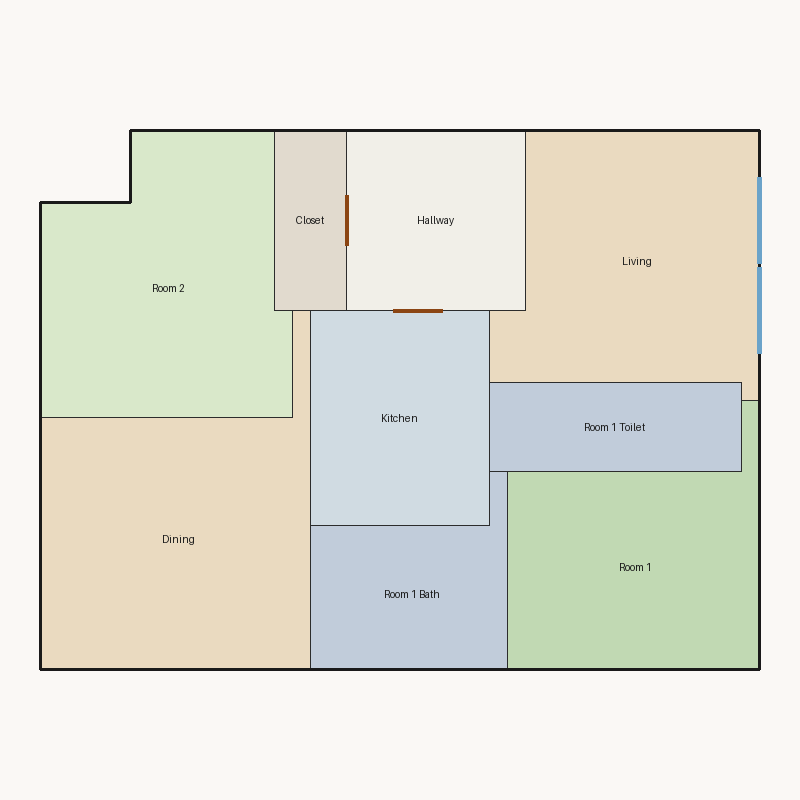

# Score report — 3-room

Source: `../plans/7a8e37b017cf.json`

This floor plan scores **4.41/10 (Weak)** for “3-room” with 9 rooms, 1180.0 ft² total room area. It fails 2 hard rule(s): Reachability, Bathroom Accessible. Strong areas include living size, natural light, circulation efficiency. Weaker areas include privacy, wet core compactness, living centrality. Highest category is geometry (10.0); lowest is privacy (5.0).

## 3-room

**Overall score: 4.41 / 10 — Weak**

**Plan:** 3-room  
**Rooms (9):** Living (191.0 ft²), Room 1 (158.0 ft²), Room 2 (194.0 ft²), Room 1 Bath (91.0 ft²), Room 1 Toilet (70.0 ft²), Kitchen (120.0 ft²), Dining (216.0 ft²), Hallway (100.0 ft²), Closet (40.0 ft²)  
**Doors:** 3 line openings · **Windows:** 2 line openings

### Hard failures (plan rejected by geometry/topology rules)
- **Reachability** (reachability): Unreachable: Room 1, Room 2, Room 1 Bath, Room 1 Toilet, Kitchen, Dining, Hallway, Closet — *Repair:* Add doors connecting unreachable rooms to circulation
- **Bathroom Accessible** (bathroom_accessible): Bathroom lacks door connections — *Repair:* Connect bathroom to hall or bedroom

### Category scores

| Category | Score | Rating | Weight |
|---|---:|---|---:|
| Geometry | 10.00 | Excellent | 0.15 |
| Topology | 5.33 | Weak | 0.10 |
| Construction | 5.41 | Weak | 0.10 |
| Privacy | 5.00 | Weak | 0.11 |
| Circulation | 9.00 | Excellent | 0.10 |
| Daylight | 10.00 | Excellent | 0.13 |
| Architecture | 7.64 | Good | 0.13 |
| Aesthetics | 6.05 | Fair | 0.18 |

### Rule details

- **Polygon Validity** [HARD/PASS] — **10.0/10** (Excellent): Boundary polygon valid
- **Room Overlap** [HARD/PASS] — **10.0/10** (Excellent): No significant overlaps
- **Boundary Containment** [HARD/PASS] — **10.0/10** (Excellent): All rooms inside boundary
- **Minimum Area** [HARD/PASS] — **10.0/10** (Excellent): Areas OK
- **Minimum Width** [HARD/PASS] — **10.0/10** (Excellent): Widths OK
- **Reachability** [HARD/FAIL] — **0.0/10** (Poor): Unreachable: Room 1, Room 2, Room 1 Bath, Room 1 Toilet, Kitchen, Dining, Hallway, Closet
  - Suggestion: Add doors connecting unreachable rooms to circulation
- **Required Rooms Exist** [HARD/PASS] — **10.0/10** (Excellent): Required rooms present
- **Door Lines** [HARD/PASS] — **10.0/10** (Excellent): Doors have room connections
- **Window Lines** [HARD/PASS] — **10.0/10** (Excellent): Exterior exposure OK
- **Bathroom Accessible** [HARD/FAIL] — **0.0/10** (Poor): Bathroom lacks door connections
  - Suggestion: Connect bathroom to hall or bedroom
- **Kitchen Accessible** [HARD/PASS] — **10.0/10** (Excellent): Kitchen connected
- **Living Size** [soft/PASS] — **8.7/10** (Good): Living area 191.0 ft²
- **Bedroom Ratio** [soft/PASS] — **6.5/10** (Fair): Bedroom/living area ratio 1.84
  - Suggestion: Rebalance bedroom vs living areas
- **Natural Light** [soft/PASS] — **10.0/10** (Excellent): 4/4 critical rooms on exterior
- **Privacy** [soft/PASS] — **5.0/10** (Weak): Direct public-private adjacencies: 2
  - Suggestion: Buffer bedrooms from kitchen/living with hallway or dining
- **Circulation Efficiency** [soft/PASS] — **9.0/10** (Excellent): Circulation 8.5% of area
- **Wet Core Compactness** [soft/FAIL] — **2.0/10** (Poor): Avg wet-room distance 12.18 ft
  - Suggestion: Cluster wet rooms for shared plumbing
- **Construction Rectangularity** [soft/PASS] — **8.8/10** (Good): Avg rectangularity 0.88
- **Room Proportions** [soft/PASS] — **10.0/10** (Excellent): Over-elongated rooms: 0
- **Storage Adequacy** [soft/PASS] — **7.0/10** (Fair): 1 storage spaces for 2 bedrooms
- **Balcony Usability** [soft/PASS] — **6.0/10** (Fair): No balcony in plan
- **Living Centrality** [soft/PASS] — **4.2/10** (Weak): Living 15.2 ft from plan center; mean 0.0 hops to other rooms
  - Suggestion: Place living nearer the center and connect rooms via hall/living hub
- **Kitchen–Public Link** [soft/FAIL] — **2.0/10** (Poor): Kitchen unreachable from living/dining
  - Suggestion: Connect kitchen to dining/living; never directly to a bedroom
- **Entry Sequence** [soft/PASS] — **7.5/10** (Good): no entry; living at exterior
- **Hall Organization** [soft/FAIL] — **3.0/10** (Poor): 0/2 bedrooms on hall/entry; 0 living-only; 0 bed pairs routed through living
  - Suggestion: Serve bedrooms from a hallway instead of crossing the living room
- **Public Near Exit** [soft/PASS] — **9.5/10** (Excellent): Living 0 hops from exit (no bedrooms)

### Areas to improve
- Wet Core Compactness: Avg wet-room distance 12.18 ft → Cluster wet rooms for shared plumbing
- Kitchen–Public Link: Kitchen unreachable from living/dining → Connect kitchen to dining/living; never directly to a bedroom
- Hall Organization: 0/2 bedrooms on hall/entry; 0 living-only; 0 bed pairs routed through living → Serve bedrooms from a hallway instead of crossing the living room
- Living Centrality: Living 15.2 ft from plan center; mean 0.0 hops to other rooms → Place living nearer the center and connect rooms via hall/living hub
- Privacy: Direct public-private adjacencies: 2 → Buffer bedrooms from kitchen/living with hallway or dining
- Balcony Usability: No balcony in plan
- Bedroom Ratio: Bedroom/living area ratio 1.84 → Rebalance bedroom vs living areas

_Summary: This floor plan scores **4.41/10 (Weak)** for “3-room” with 9 rooms, 1180.0 ft² total room area. It fails 2 hard rule(s): Reachability, Bathroom Accessible. Strong areas include living size, natural light, circulation efficiency. Weaker areas include privacy, wet core compactness, living centrality. Highest category is geometry (10.0); lowest is privacy (5.0)._