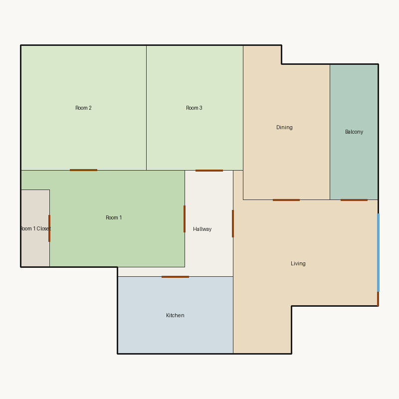

# Score report — 3-room

Source: `../plans/839f9676aefe.json`

This floor plan scores **3.12/10 (Poor)** for “3-room” with 9 rooms, 1029.0 ft² total room area. It fails 3 hard rule(s): Required Rooms Exist, Window Lines, Bathroom Accessible. Strong areas include living size, circulation efficiency, room proportions. Weaker areas include bedroom ratio, natural light, privacy. Highest category is geometry (10.0); lowest is daylight (2.4).

### Layout prompt

Kitchen is in the north-center, next to Hallway.
Living is in the north-east, next to Balcony, Dining, and Hallway.
Hallway is in the center, next to Kitchen, Living, Room 1, and Room 3.
Room 1 Closet is in the west-center, next to Room 1.
Room 1 is in the west-center, next to Hallway, Room 1 Closet, and Room 2.
Balcony is in the south-east, next to Living.
Dining is in the south-east, next to Living.
Room 2 is in the south-west, next to Room 1.
Room 3 is in the north-center, next to Hallway.

## 3-room

**Overall score: 3.12 / 10 — Poor**

**Plan:** 3-room  
**Rooms (9):** Living (198.0 ft²), Room 1 (146.0 ft²), Room 2 (169.0 ft²), Room 3 (130.0 ft²), Room 1 Closet (24.0 ft²), Kitchen (96.0 ft²), Dining (134.0 ft²), Hallway (62.0 ft²), Balcony (70.0 ft²)  
**Doors:** 9 line openings · **Windows:** 2 line openings

### Hard failures (plan rejected by geometry/topology rules)
- **Required Rooms Exist** (required_rooms): Missing: bathroom — *Repair:* Insert missing required rooms
- **Window Lines** (windows_on_exterior): Missing exterior glazing: ['Room 1', 'Room 2', 'Room 3', 'Dining'] — *Repair:* Add window line segments on exterior edges of living/bedrooms
- **Bathroom Accessible** (bathroom_accessible): No bathroom — *Repair:* Insert bathroom

### Category scores

| Category | Score | Rating | Weight |
|---|---:|---|---:|
| Geometry | 10.00 | Excellent | 0.15 |
| Topology | 6.17 | Fair | 0.10 |
| Construction | 8.02 | Good | 0.10 |
| Privacy | 5.00 | Weak | 0.11 |
| Circulation | 9.70 | Excellent | 0.10 |
| Daylight | 2.39 | Poor | 0.13 |
| Architecture | 7.50 | Good | 0.13 |
| Aesthetics | 7.77 | Good | 0.18 |

### Rule details

- **Polygon Validity** [HARD/PASS] — **10.0/10** (Excellent): Boundary polygon valid
- **Room Overlap** [HARD/PASS] — **10.0/10** (Excellent): No significant overlaps
- **Boundary Containment** [HARD/PASS] — **10.0/10** (Excellent): All rooms inside boundary
- **Minimum Area** [HARD/PASS] — **10.0/10** (Excellent): Areas OK
- **Minimum Width** [HARD/PASS] — **10.0/10** (Excellent): Widths OK
- **Reachability** [HARD/PASS] — **10.0/10** (Excellent): All rooms reachable
- **Required Rooms Exist** [HARD/FAIL] — **0.0/10** (Poor): Missing: bathroom
  - Suggestion: Insert missing required rooms
- **Door Lines** [HARD/PASS] — **10.0/10** (Excellent): Doors have room connections
- **Window Lines** [HARD/FAIL] — **0.0/10** (Poor): Missing exterior glazing: ['Room 1', 'Room 2', 'Room 3', 'Dining']
  - Suggestion: Add window line segments on exterior edges of living/bedrooms
- **Bathroom Accessible** [HARD/FAIL] — **0.0/10** (Poor): No bathroom
  - Suggestion: Insert bathroom
- **Kitchen Accessible** [HARD/PASS] — **10.0/10** (Excellent): Kitchen connected
- **Living Size** [soft/PASS] — **9.0/10** (Excellent): Living area 198.0 ft²
- **Bedroom Ratio** [soft/PASS] — **4.0/10** (Weak): Bedroom/living area ratio 2.25
  - Suggestion: Rebalance bedroom vs living areas
- **Natural Light** [soft/PASS] — **4.8/10** (Weak): Living: win 8.8/4.4 ft, WFR 20%, ext 11.0 ft, clear; Room 1: win 0.0/2.8 ft, WFR 0%, ext 7.0 ft, clear; Room 2: win 0.0/4.2 ft, WFR 0%, ext 13.0 ft, clear; Room 3: win 0.0/3.2 ft, WFR 0%, ext 10.0 ft, clear; Dining: win 0.0/2.0 ft, WFR 0%, ext 5.0 ft, clear
  - Suggestion: Add adequately sized windows on exterior walls of bedrooms/living
- **Privacy** [soft/PASS] — **5.0/10** (Weak): Direct public-private adjacencies: 2
  - Suggestion: Buffer bedrooms from kitchen/living with hallway or dining
- **Circulation Efficiency** [soft/PASS] — **9.7/10** (Excellent): Circ 6.0%; min path width 3.6 ft; 2/3 beds via hall; 2 passageway rooms; 0 dead ends
- **Wet Core Compactness** [soft/PASS] — **7.0/10** (Fair): Single wet room
- **Construction Shape** [soft/PASS] — **7.1/10** (Fair): Avg rectangularity 0.85; 0 short door edges
- **Room Proportions** [soft/PASS] — **10.0/10** (Excellent): Over-elongated rooms: 0
- **Storage Adequacy** [soft/PASS] — **7.0/10** (Fair): 1 storage spaces for 3 bedrooms
- **Balcony Usability** [soft/PASS] — **10.0/10** (Excellent): Balcony 70.0 ft²
- **Living Centrality** [soft/PASS] — **5.8/10** (Weak): Living 12.7 ft from plan center; mean 1.8 hops to other rooms
  - Suggestion: Place living nearer the center and connect rooms via hall/living hub
- **Kitchen–Public Link** [soft/PASS] — **7.0/10** (Fair): Kitchen 2 hops via hall to public
- **Entry Sequence** [soft/PASS] — **7.5/10** (Good): no entry; living at exterior
- **Public Near Exit** [soft/PASS] — **10.0/10** (Excellent): Living 0 hops from exit; bedrooms min 2 / avg 2.3 hops

### Areas to improve
- Bedroom Ratio: Bedroom/living area ratio 2.25 → Rebalance bedroom vs living areas
- Natural Light: Living: win 8.8/4.4 ft, WFR 20%, ext 11.0 ft, clear; Room 1: win 0.0/2.8 ft, WFR 0%, ext 7.0 ft, clear; Room 2: win 0.0/4.2 ft, WFR 0%, ext 13.0 ft, clear; Room 3: win 0.0/3.2 ft, WFR 0%, ext 10.0 ft, clear; Dining: win 0.0/2.0 ft, WFR 0%, ext 5.0 ft, clear → Add adequately sized windows on exterior walls of bedrooms/living
- Privacy: Direct public-private adjacencies: 2 → Buffer bedrooms from kitchen/living with hallway or dining
- Living Centrality: Living 12.7 ft from plan center; mean 1.8 hops to other rooms → Place living nearer the center and connect rooms via hall/living hub

_Summary: This floor plan scores **3.12/10 (Poor)** for “3-room” with 9 rooms, 1029.0 ft² total room area. It fails 3 hard rule(s): Required Rooms Exist, Window Lines, Bathroom Accessible. Strong areas include living size, circulation efficiency, room proportions. Weaker areas include bedroom ratio, natural light, privacy. Highest category is geometry (10.0); lowest is daylight (2.4)._