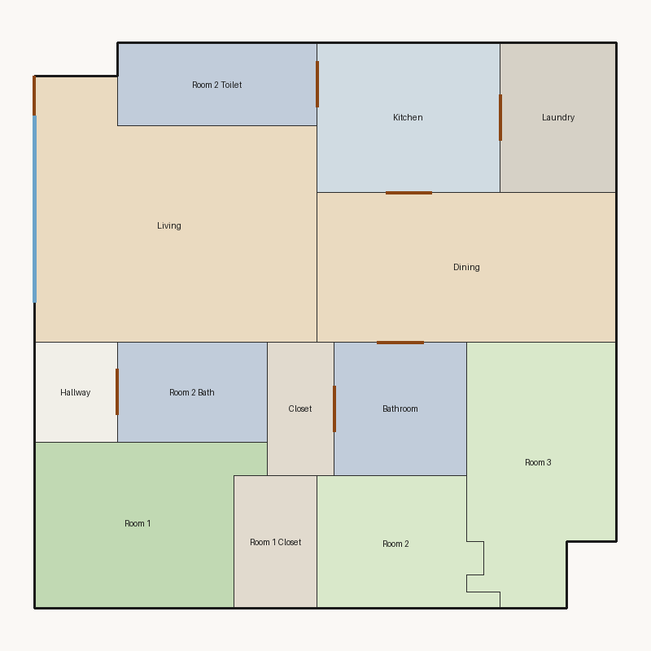

# Score report — 3-room

Source: `../plans/9244ec949953.json`

This floor plan scores **4.11/10 (Weak)** for “3-room” with 13 rooms, 1168.0 ft² total room area. It fails 2 hard rule(s): Reachability, Window Lines. Strong areas include living size, bedroom ratio, room proportions. Weaker areas include natural light, wet core compactness, living centrality. Highest category is geometry (10.0); lowest is daylight (2.5).

### Layout prompt

Room 2 is in the north-center.
Room 1 Closet is in the north-center.
Room 1 is in the north-west.
Room 3 is in the north-east.
Closet is in the center, next to Bathroom.
Bathroom is in the center, next to Closet and Dining.
Hallway is in the west-center, next to Room 2 Bath.
Room 2 Bath is in the west-center, next to Hallway.
Dining is in the west-center, next to Bathroom and Kitchen.
Living is in the south-west.
Kitchen is in the north-center, next to Dining, Laundry, and Room 2 Toilet.
Laundry is in the south-east, next to Kitchen.
Room 2 Toilet is in the south-west, next to Kitchen.

## 3-room

**Overall score: 4.11 / 10 — Weak**

**Plan:** 3-room  
**Rooms (13):** Living (236.0 ft²), Room 1 (124.0 ft²), Room 2 (76.0 ft²), Room 3 (128.0 ft²), Room 1 Closet (40.0 ft²), Room 2 Bath (54.0 ft²), Room 2 Toilet (60.0 ft²), Kitchen (99.0 ft²), Dining (162.0 ft²), Hallway (30.0 ft²), Bathroom (64.0 ft²), Closet (32.0 ft²), Laundry (63.0 ft²)  
**Doors:** 7 line openings · **Windows:** 2 line openings

### Hard failures (plan rejected by geometry/topology rules)
- **Reachability** (reachability): Unreachable: Room 1, Room 2, Room 3, Room 1 Closet, Room 2 Bath, Room 2 Toilet, Kitchen, Dining, Hallway, Bathroom, Closet, Laundry — *Repair:* Add doors connecting unreachable rooms to circulation
- **Window Lines** (windows_on_exterior): Missing exterior glazing: ['Room 1', 'Room 2', 'Room 3', 'Dining'] — *Repair:* Add window line segments on exterior edges of living/bedrooms

### Category scores

| Category | Score | Rating | Weight |
|---|---:|---|---:|
| Geometry | 10.00 | Excellent | 0.15 |
| Topology | 8.33 | Good | 0.10 |
| Construction | 4.40 | Weak | 0.10 |
| Privacy | 7.50 | Good | 0.11 |
| Circulation | 6.90 | Fair | 0.10 |
| Daylight | 2.54 | Poor | 0.13 |
| Architecture | 9.00 | Excellent | 0.13 |
| Aesthetics | 7.32 | Fair | 0.18 |

### Rule details

- **Polygon Validity** [HARD/PASS] — **10.0/10** (Excellent): Boundary polygon valid
- **Room Overlap** [HARD/PASS] — **10.0/10** (Excellent): No significant overlaps
- **Boundary Containment** [HARD/PASS] — **10.0/10** (Excellent): All rooms inside boundary
- **Minimum Area** [HARD/PASS] — **10.0/10** (Excellent): Areas OK
- **Minimum Width** [HARD/PASS] — **10.0/10** (Excellent): Widths OK
- **Reachability** [HARD/FAIL] — **0.0/10** (Poor): Unreachable: Room 1, Room 2, Room 3, Room 1 Closet, Room 2 Bath, Room 2 Toilet, Kitchen, Dining, Hallway, Bathroom, Closet, Laundry
  - Suggestion: Add doors connecting unreachable rooms to circulation
- **Required Rooms Exist** [HARD/PASS] — **10.0/10** (Excellent): Required rooms present
- **Door Lines** [HARD/PASS] — **10.0/10** (Excellent): Doors have room connections
- **Window Lines** [HARD/FAIL] — **0.0/10** (Poor): Missing exterior glazing: ['Room 1', 'Room 2', 'Room 3', 'Dining']
  - Suggestion: Add window line segments on exterior edges of living/bedrooms
- **Bathroom Accessible** [HARD/PASS] — **10.0/10** (Excellent): Bathrooms connected
- **Kitchen Accessible** [HARD/PASS] — **10.0/10** (Excellent): Kitchen connected
- **Living Size** [soft/PASS] — **10.0/10** (Excellent): Living area 236.0 ft²
- **Bedroom Ratio** [soft/PASS] — **9.0/10** (Excellent): Bedroom/living area ratio 1.39
- **Natural Light** [soft/PASS] — **5.1/10** (Weak): Living: win 11.8/5.9 ft, WFR 23%, ext 16.0 ft, clear; Room 1: win 0.0/3.1 ft, WFR 0%, ext 12.0 ft, clear; Room 2: win 0.0/2.0 ft, WFR 0%, ext 11.0 ft, clear; Room 3: win 0.0/3.2 ft, WFR 0%, ext 12.0 ft, clear; Dining: win 0.0/3.6 ft, WFR 0%, ext 9.0 ft, clear
  - Suggestion: Add adequately sized windows on exterior walls of bedrooms/living
- **Privacy** [soft/PASS] — **7.5/10** (Good): Direct public-private adjacencies: 1
- **Circulation Efficiency** [soft/PASS] — **6.9/10** (Fair): Circ 2.6%; min path width 12.0 ft; 0/3 beds via hall; 1 passageway rooms; 1 dead ends
  - Suggestion: Reduce hallway waste, widen paths, and serve bedrooms from circulation
- **Wet Core Compactness** [soft/FAIL] — **2.0/10** (Poor): Avg wet-room distance 17.28 ft
  - Suggestion: Cluster wet rooms for shared plumbing
- **Construction Shape** [soft/PASS] — **6.8/10** (Fair): Avg rectangularity 0.96; 0 short door edges
  - Suggestion: Simplify room shapes and place doors on longer shared walls
- **Room Proportions** [soft/PASS] — **10.0/10** (Excellent): Over-elongated rooms: 0
- **Storage Adequacy** [soft/PASS] — **10.0/10** (Excellent): 2 storage spaces for 3 bedrooms
- **Balcony Usability** [soft/PASS] — **6.0/10** (Fair): No balcony in plan
- **Living Centrality** [soft/PASS] — **5.0/10** (Weak): Living 11.1 ft from plan center; mean 0.0 hops to other rooms
  - Suggestion: Place living nearer the center and connect rooms via hall/living hub
- **Kitchen–Public Link** [soft/PASS] — **10.0/10** (Excellent): Kitchen opens to dining/living
- **Entry Sequence** [soft/PASS] — **7.5/10** (Good): no entry; living at exterior
- **Public Near Exit** [soft/PASS] — **9.5/10** (Excellent): Living 0 hops from exit (no bedrooms)

### Areas to improve
- Wet Core Compactness: Avg wet-room distance 17.28 ft → Cluster wet rooms for shared plumbing
- Living Centrality: Living 11.1 ft from plan center; mean 0.0 hops to other rooms → Place living nearer the center and connect rooms via hall/living hub
- Natural Light: Living: win 11.8/5.9 ft, WFR 23%, ext 16.0 ft, clear; Room 1: win 0.0/3.1 ft, WFR 0%, ext 12.0 ft, clear; Room 2: win 0.0/2.0 ft, WFR 0%, ext 11.0 ft, clear; Room 3: win 0.0/3.2 ft, WFR 0%, ext 12.0 ft, clear; Dining: win 0.0/3.6 ft, WFR 0%, ext 9.0 ft, clear → Add adequately sized windows on exterior walls of bedrooms/living
- Balcony Usability: No balcony in plan
- Construction Shape: Avg rectangularity 0.96; 0 short door edges → Simplify room shapes and place doors on longer shared walls
- Circulation Efficiency: Circ 2.6%; min path width 12.0 ft; 0/3 beds via hall; 1 passageway rooms; 1 dead ends → Reduce hallway waste, widen paths, and serve bedrooms from circulation

_Summary: This floor plan scores **4.11/10 (Weak)** for “3-room” with 13 rooms, 1168.0 ft² total room area. It fails 2 hard rule(s): Reachability, Window Lines. Strong areas include living size, bedroom ratio, room proportions. Weaker areas include natural light, wet core compactness, living centrality. Highest category is geometry (10.0); lowest is daylight (2.5)._