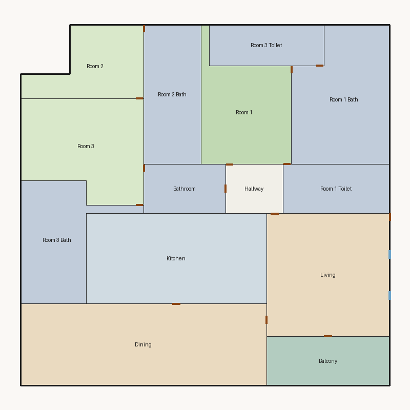

# Score report — 3-room

Source: `../plans/abeb95cbe357.json`

This floor plan scores **8.46/10 (Good)** for “3-room” with 14 rooms, 1944.0 ft² total room area. It passes all hard validity rules. Strong areas include living size, natural light, privacy. Weaker areas include wet core compactness, storage adequacy, living centrality. Highest category is geometry (10.0); lowest is circulation (6.5).

## 3-room

**Overall score: 8.46 / 10 — Good**

**Plan:** 3-room  
**Rooms (14):** Living (225.0 ft²), Room 1 (137.0 ft²), Room 2 (99.0 ft²), Room 3 (171.0 ft²), Room 1 Bath (184.0 ft²), Room 1 Toilet (78.0 ft²), Room 2 Bath (119.0 ft²), Room 3 Bath (127.0 ft²), Room 3 Toilet (70.0 ft²), Kitchen (242.0 ft²), Dining (300.0 ft²), Hallway (42.0 ft²), Bathroom (60.0 ft²), Balcony (90.0 ft²)  
**Doors:** 14 line openings · **Windows:** 2 line openings

### Hard rules
All hard rules passed — the plan is geometrically/topologically acceptable.

### Category scores

| Category | Score | Rating | Weight |
|---|---:|---|---:|
| Geometry | 10.00 | Excellent | 0.14 |
| Topology | 10.00 | Excellent | 0.09 |
| Construction | 5.57 | Weak | 0.09 |
| Privacy | 10.00 | Excellent | 0.10 |
| Circulation | 6.50 | Fair | 0.09 |
| Furniture usability | 10.00 | Excellent | 0.09 |
| Daylight | 10.00 | Excellent | 0.12 |
| Architecture | 7.70 | Good | 0.12 |
| Aesthetics | 6.58 | Fair | 0.16 |

### Rule details

- **Polygon Validity** [HARD/PASS] — **10.0/10** (Excellent): Boundary polygon valid
- **Room Overlap** [HARD/PASS] — **10.0/10** (Excellent): No significant overlaps
- **Boundary Containment** [HARD/PASS] — **10.0/10** (Excellent): All rooms inside boundary
- **Minimum Area** [HARD/PASS] — **10.0/10** (Excellent): Areas OK
- **Minimum Width** [HARD/PASS] — **10.0/10** (Excellent): Widths OK
- **Reachability** [HARD/PASS] — **10.0/10** (Excellent): All rooms reachable
- **Required Rooms Exist** [HARD/PASS] — **10.0/10** (Excellent): Required rooms present
- **Door Lines** [HARD/PASS] — **10.0/10** (Excellent): Doors have room connections
- **Window Lines** [HARD/PASS] — **10.0/10** (Excellent): Exterior exposure OK
- **Bathroom Accessible** [HARD/PASS] — **10.0/10** (Excellent): Bathrooms connected
- **Kitchen Accessible** [HARD/PASS] — **10.0/10** (Excellent): Kitchen connected
- **Living Size** [soft/PASS] — **10.0/10** (Excellent): Living area 225.0 ft²
- **Bedroom Ratio** [soft/PASS] — **6.5/10** (Fair): Bedroom/living area ratio 1.81
  - Suggestion: Rebalance bedroom vs living areas
- **Natural Light** [soft/PASS] — **10.0/10** (Excellent): 5/5 critical rooms on exterior
- **Privacy** [soft/PASS] — **10.0/10** (Excellent): Direct public-private adjacencies: 0
- **Circulation Efficiency** [soft/PASS] — **6.5/10** (Fair): Circulation 2.2% of area
  - Suggestion: Reduce hallway or add clear entry path
- **Wet Core Compactness** [soft/FAIL] — **2.0/10** (Poor): Avg wet-room distance 20.97 ft
  - Suggestion: Cluster wet rooms for shared plumbing
- **Construction Rectangularity** [soft/PASS] — **9.1/10** (Excellent): Avg rectangularity 0.91
- **Room Proportions** [soft/PASS] — **8.0/10** (Good): Over-elongated rooms: 1
- **Storage Adequacy** [soft/PASS] — **4.0/10** (Weak): 0 storage spaces for 3 bedrooms
  - Suggestion: Attach private closets to their bedroom; keep shared closets near bedrooms
- **Balcony Usability** [soft/PASS] — **10.0/10** (Excellent): Balcony 90.0 ft²
- **Living Centrality** [soft/FAIL] — **3.8/10** (Poor): Living 16.8 ft from plan center; mean 2.8 hops to other rooms
  - Suggestion: Place living nearer the center and connect rooms via hall/living hub
- **Kitchen–Public Link** [soft/PASS] — **10.0/10** (Excellent): Kitchen opens to dining/living
- **Entry Sequence** [soft/PASS] — **7.5/10** (Good): no entry; living at exterior
- **Hall Organization** [soft/PASS] — **5.0/10** (Weak): 1/3 bedrooms on hall/entry; 0 living-only; 0 bed pairs routed through living
  - Suggestion: Serve bedrooms from a hallway instead of crossing the living room
- **Public Near Exit** [soft/PASS] — **10.0/10** (Excellent): Living 0 hops from exit; bedrooms min 2 / avg 3.0 hops
- **Furniture Usability** [soft/PASS] — **10.0/10** (Excellent): Placed 22/22 furniture items

### Areas to improve
- Wet Core Compactness: Avg wet-room distance 20.97 ft → Cluster wet rooms for shared plumbing
- Living Centrality: Living 16.8 ft from plan center; mean 2.8 hops to other rooms → Place living nearer the center and connect rooms via hall/living hub
- Storage Adequacy: 0 storage spaces for 3 bedrooms → Attach private closets to their bedroom; keep shared closets near bedrooms
- Hall Organization: 1/3 bedrooms on hall/entry; 0 living-only; 0 bed pairs routed through living → Serve bedrooms from a hallway instead of crossing the living room
- Bedroom Ratio: Bedroom/living area ratio 1.81 → Rebalance bedroom vs living areas
- Circulation Efficiency: Circulation 2.2% of area → Reduce hallway or add clear entry path

### Strengths
- Living Size (10.0): Living area 225.0 ft²
- Natural Light (10.0): 5/5 critical rooms on exterior
- Privacy (10.0): Direct public-private adjacencies: 0
- Balcony Usability (10.0): Balcony 90.0 ft²
- Kitchen–Public Link (10.0): Kitchen opens to dining/living

_Summary: This floor plan scores **8.46/10 (Good)** for “3-room” with 14 rooms, 1944.0 ft² total room area. It passes all hard validity rules. Strong areas include living size, natural light, privacy. Weaker areas include wet core compactness, storage adequacy, living centrality. Highest category is geometry (10.0); lowest is circulation (6.5)._