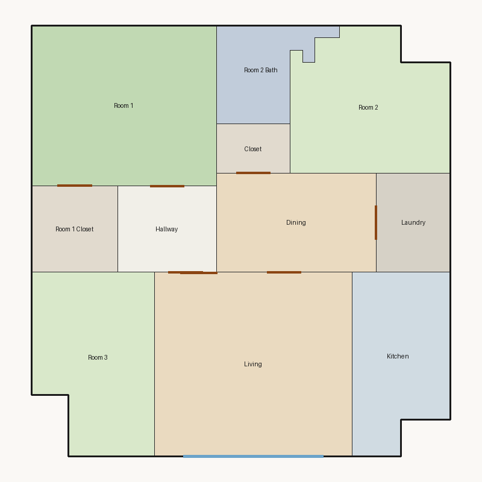

# Score report — 3-room

Source: `../plans/bd78bd14beea.json`

This floor plan scores **2.15/10 (Poor)** for “3-room” with 11 rooms, 1151.0 ft² total room area. It fails 4 hard rule(s): Reachability, Window Lines, Bathroom Accessible, Kitchen Accessible. Strong areas include living size, room proportions, storage adequacy. Weaker areas include natural light, privacy, wet core compactness. Highest category is geometry (10.0); lowest is privacy (2.5).

## 3-room

**Overall score: 2.15 / 10 — Poor**

**Plan:** 3-room  
**Rooms (11):** Living (240.0 ft²), Room 1 (195.0 ft²), Room 2 (137.0 ft²), Room 3 (135.0 ft²), Room 1 Closet (49.0 ft²), Room 2 Bath (55.0 ft²), Kitchen (108.0 ft²), Dining (104.0 ft²), Hallway (56.0 ft²), Closet (24.0 ft²), Laundry (48.0 ft²)  
**Doors:** 7 line openings · **Windows:** 2 line openings

### Hard failures (plan rejected by geometry/topology rules)
- **Reachability** (reachability): Unreachable: Room 2, Room 3, Room 2 Bath, Kitchen — *Repair:* Add doors connecting unreachable rooms to circulation
- **Window Lines** (windows_on_exterior): Missing exterior glazing: ['Room 1', 'Room 2', 'Room 3', 'Dining'] — *Repair:* Add window line segments on exterior edges of living/bedrooms
- **Bathroom Accessible** (bathroom_accessible): Bathroom lacks door connections — *Repair:* Connect bathroom to hall or bedroom
- **Kitchen Accessible** (kitchen_accessible): Kitchen not connected — *Repair:* Connect kitchen to living/dining

### Category scores

| Category | Score | Rating | Weight |
|---|---:|---|---:|
| Geometry | 10.00 | Excellent | 0.15 |
| Topology | 3.67 | Poor | 0.10 |
| Construction | 4.11 | Weak | 0.10 |
| Privacy | 2.50 | Poor | 0.11 |
| Circulation | 7.23 | Fair | 0.10 |
| Daylight | 2.54 | Poor | 0.13 |
| Architecture | 8.50 | Good | 0.13 |
| Aesthetics | 7.98 | Good | 0.18 |

### Rule details

- **Polygon Validity** [HARD/PASS] — **10.0/10** (Excellent): Boundary polygon valid
- **Room Overlap** [HARD/PASS] — **10.0/10** (Excellent): No significant overlaps
- **Boundary Containment** [HARD/PASS] — **10.0/10** (Excellent): All rooms inside boundary
- **Minimum Area** [HARD/PASS] — **10.0/10** (Excellent): Areas OK
- **Minimum Width** [HARD/PASS] — **10.0/10** (Excellent): Widths OK
- **Reachability** [HARD/FAIL] — **0.0/10** (Poor): Unreachable: Room 2, Room 3, Room 2 Bath, Kitchen
  - Suggestion: Add doors connecting unreachable rooms to circulation
- **Required Rooms Exist** [HARD/PASS] — **10.0/10** (Excellent): Required rooms present
- **Door Lines** [HARD/PASS] — **10.0/10** (Excellent): Doors have room connections
- **Window Lines** [HARD/FAIL] — **0.0/10** (Poor): Missing exterior glazing: ['Room 1', 'Room 2', 'Room 3', 'Dining']
  - Suggestion: Add window line segments on exterior edges of living/bedrooms
- **Bathroom Accessible** [HARD/FAIL] — **0.0/10** (Poor): Bathroom lacks door connections
  - Suggestion: Connect bathroom to hall or bedroom
- **Kitchen Accessible** [HARD/FAIL] — **0.0/10** (Poor): Kitchen not connected
  - Suggestion: Connect kitchen to living/dining
- **Living Size** [soft/PASS] — **10.0/10** (Excellent): Living area 240.0 ft²
- **Bedroom Ratio** [soft/PASS] — **6.5/10** (Fair): Bedroom/living area ratio 1.95
  - Suggestion: Rebalance bedroom vs living areas
- **Natural Light** [soft/PASS] — **5.1/10** (Weak): Living: win 12.0/6.0 ft, WFR 22%, ext 16.0 ft, clear; Room 1: win 0.0/4.9 ft, WFR 0%, ext 15.0 ft, clear; Room 2: win 0.0/3.4 ft, WFR 0%, ext 9.0 ft, clear; Room 3: win 0.0/3.4 ft, WFR 0%, ext 10.0 ft, clear; Dining: win 0.0/2.6 ft, WFR 0%, ext 13.2 ft, clear
  - Suggestion: Add adequately sized windows on exterior walls of bedrooms/living
- **Privacy** [soft/FAIL] — **2.5/10** (Poor): Direct public-private adjacencies: 3
  - Suggestion: Buffer bedrooms from kitchen/living with hallway or dining
- **Circulation Efficiency** [soft/PASS] — **7.2/10** (Fair): Circ 4.9%; min path width 7.0 ft; 1/3 beds via hall; 1 passageway rooms; 0 dead ends
- **Wet Core Compactness** [soft/FAIL] — **2.0/10** (Poor): Avg wet-room distance 25.76 ft
  - Suggestion: Cluster wet rooms for shared plumbing
- **Construction Shape** [soft/PASS] — **6.2/10** (Fair): Avg rectangularity 0.93; 0 short door edges
  - Suggestion: Simplify room shapes and place doors on longer shared walls
- **Room Proportions** [soft/PASS] — **10.0/10** (Excellent): Over-elongated rooms: 0
- **Storage Adequacy** [soft/PASS] — **10.0/10** (Excellent): 2 storage spaces for 3 bedrooms
- **Balcony Usability** [soft/PASS] — **6.0/10** (Fair): No balcony in plan
- **Living Centrality** [soft/PASS] — **6.9/10** (Fair): Living 10.3 ft from plan center; mean 1.5 hops to other rooms
  - Suggestion: Place living nearer the center and connect rooms via hall/living hub
- **Kitchen–Public Link** [soft/FAIL] — **2.0/10** (Poor): Kitchen unreachable from living/dining
  - Suggestion: Connect kitchen to dining/living; never directly to a bedroom
- **Entry Sequence** [soft/PASS] — **7.0/10** (Fair): no entry buffer before living
- **Public Near Exit** [soft/PASS] — **10.0/10** (Excellent): Living 1 hops from exit; bedrooms min 1 / avg 1.0 hops

### Areas to improve
- Wet Core Compactness: Avg wet-room distance 25.76 ft → Cluster wet rooms for shared plumbing
- Kitchen–Public Link: Kitchen unreachable from living/dining → Connect kitchen to dining/living; never directly to a bedroom
- Privacy: Direct public-private adjacencies: 3 → Buffer bedrooms from kitchen/living with hallway or dining
- Natural Light: Living: win 12.0/6.0 ft, WFR 22%, ext 16.0 ft, clear; Room 1: win 0.0/4.9 ft, WFR 0%, ext 15.0 ft, clear; Room 2: win 0.0/3.4 ft, WFR 0%, ext 9.0 ft, clear; Room 3: win 0.0/3.4 ft, WFR 0%, ext 10.0 ft, clear; Dining: win 0.0/2.6 ft, WFR 0%, ext 13.2 ft, clear → Add adequately sized windows on exterior walls of bedrooms/living
- Balcony Usability: No balcony in plan
- Construction Shape: Avg rectangularity 0.93; 0 short door edges → Simplify room shapes and place doors on longer shared walls
- Bedroom Ratio: Bedroom/living area ratio 1.95 → Rebalance bedroom vs living areas
- Living Centrality: Living 10.3 ft from plan center; mean 1.5 hops to other rooms → Place living nearer the center and connect rooms via hall/living hub

_Summary: This floor plan scores **2.15/10 (Poor)** for “3-room” with 11 rooms, 1151.0 ft² total room area. It fails 4 hard rule(s): Reachability, Window Lines, Bathroom Accessible, Kitchen Accessible. Strong areas include living size, room proportions, storage adequacy. Weaker areas include natural light, privacy, wet core compactness. Highest category is geometry (10.0); lowest is privacy (2.5)._