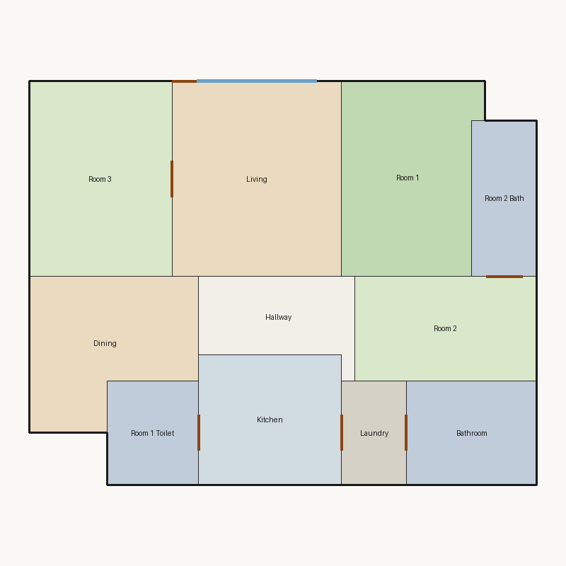

# Score report — 3-room

Source: `../plans/cacde6db9ec0.json`

This floor plan scores **3.37/10 (Poor)** for “3-room” with 11 rooms, 1173.0 ft² total room area. It fails 2 hard rule(s): Reachability, Window Lines. Strong areas include living size, room proportions, living centrality. Weaker areas include bedroom ratio, natural light, privacy. Highest category is geometry (10.0); lowest is privacy (2.5).

## 3-room

**Overall score: 3.37 / 10 — Poor**

**Plan:** 3-room  
**Rooms (11):** Living (195.0 ft²), Room 1 (153.0 ft²), Room 2 (112.0 ft²), Room 3 (165.0 ft²), Room 1 Toilet (56.0 ft²), Room 2 Bath (60.0 ft²), Kitchen (110.0 ft²), Dining (128.0 ft²), Hallway (74.0 ft²), Bathroom (80.0 ft²), Laundry (40.0 ft²)  
**Doors:** 6 line openings · **Windows:** 2 line openings

### Hard failures (plan rejected by geometry/topology rules)
- **Reachability** (reachability): Unreachable: Room 1, Room 2, Room 1 Toilet, Room 2 Bath, Kitchen, Dining, Hallway, Bathroom, Laundry — *Repair:* Add doors connecting unreachable rooms to circulation
- **Window Lines** (windows_on_exterior): Missing exterior glazing: ['Room 1', 'Room 2', 'Room 3', 'Dining'] — *Repair:* Add window line segments on exterior edges of living/bedrooms

### Category scores

| Category | Score | Rating | Weight |
|---|---:|---|---:|
| Geometry | 10.00 | Excellent | 0.15 |
| Topology | 7.00 | Fair | 0.10 |
| Construction | 4.59 | Weak | 0.10 |
| Privacy | 2.50 | Poor | 0.11 |
| Circulation | 7.03 | Fair | 0.10 |
| Daylight | 2.54 | Poor | 0.13 |
| Architecture | 6.57 | Fair | 0.13 |
| Aesthetics | 8.62 | Good | 0.18 |

### Rule details

- **Polygon Validity** [HARD/PASS] — **10.0/10** (Excellent): Boundary polygon valid
- **Room Overlap** [HARD/PASS] — **10.0/10** (Excellent): No significant overlaps
- **Boundary Containment** [HARD/PASS] — **10.0/10** (Excellent): All rooms inside boundary
- **Minimum Area** [HARD/PASS] — **10.0/10** (Excellent): Areas OK
- **Minimum Width** [HARD/PASS] — **10.0/10** (Excellent): Widths OK
- **Reachability** [HARD/FAIL] — **0.0/10** (Poor): Unreachable: Room 1, Room 2, Room 1 Toilet, Room 2 Bath, Kitchen, Dining, Hallway, Bathroom, Laundry
  - Suggestion: Add doors connecting unreachable rooms to circulation
- **Required Rooms Exist** [HARD/PASS] — **10.0/10** (Excellent): Required rooms present
- **Door Lines** [HARD/PASS] — **10.0/10** (Excellent): Doors have room connections
- **Window Lines** [HARD/FAIL] — **0.0/10** (Poor): Missing exterior glazing: ['Room 1', 'Room 2', 'Room 3', 'Dining']
  - Suggestion: Add window line segments on exterior edges of living/bedrooms
- **Bathroom Accessible** [HARD/PASS] — **10.0/10** (Excellent): Bathrooms connected
- **Kitchen Accessible** [HARD/PASS] — **10.0/10** (Excellent): Kitchen connected
- **Living Size** [soft/PASS] — **8.9/10** (Good): Living area 195.0 ft²
- **Bedroom Ratio** [soft/PASS] — **4.0/10** (Weak): Bedroom/living area ratio 2.21
  - Suggestion: Rebalance bedroom vs living areas
- **Natural Light** [soft/PASS] — **5.1/10** (Weak): Living: win 9.8/4.9 ft, WFR 22%, ext 13.0 ft, clear; Room 1: win 0.0/3.8 ft, WFR 0%, ext 11.0 ft, clear; Room 2: win 0.0/2.8 ft, WFR 0%, ext 8.0 ft, clear; Room 3: win 0.0/4.1 ft, WFR 0%, ext 15.0 ft, clear; Dining: win 0.0/3.2 ft, WFR 0%, ext 12.0 ft, clear
  - Suggestion: Add adequately sized windows on exterior walls of bedrooms/living
- **Privacy** [soft/FAIL] — **2.5/10** (Poor): Direct public-private adjacencies: 3
  - Suggestion: Buffer bedrooms from kitchen/living with hallway or dining
- **Circulation Efficiency** [soft/PASS] — **7.0/10** (Fair): Circ 6.3%; min path width 11.0 ft; 0/3 beds via hall; 0 passageway rooms; 1 dead ends
- **Wet Core Compactness** [soft/FAIL] — **2.0/10** (Poor): Avg wet-room distance 20.74 ft
  - Suggestion: Cluster wet rooms for shared plumbing
- **Construction Shape** [soft/PASS] — **7.2/10** (Fair): Avg rectangularity 0.96; 0 short door edges
- **Room Proportions** [soft/PASS] — **10.0/10** (Excellent): Over-elongated rooms: 0
- **Storage Adequacy** [soft/PASS] — **4.0/10** (Weak): 0 storage spaces for 3 bedrooms
  - Suggestion: Attach private closets to their bedroom; keep shared closets near bedrooms
- **Balcony Usability** [soft/PASS] — **6.0/10** (Fair): No balcony in plan
- **Living Centrality** [soft/PASS] — **8.4/10** (Good): Living 8.2 ft from plan center; mean 1.0 hops to other rooms
- **Kitchen–Public Link** [soft/FAIL] — **2.0/10** (Poor): Kitchen unreachable from living/dining
  - Suggestion: Connect kitchen to dining/living; never directly to a bedroom
- **Entry Sequence** [soft/PASS] — **7.5/10** (Good): no entry; living at exterior
- **Public Near Exit** [soft/PASS] — **10.0/10** (Excellent): Living 0 hops from exit; bedrooms min 1 / avg 1.0 hops

### Areas to improve
- Wet Core Compactness: Avg wet-room distance 20.74 ft → Cluster wet rooms for shared plumbing
- Kitchen–Public Link: Kitchen unreachable from living/dining → Connect kitchen to dining/living; never directly to a bedroom
- Privacy: Direct public-private adjacencies: 3 → Buffer bedrooms from kitchen/living with hallway or dining
- Bedroom Ratio: Bedroom/living area ratio 2.21 → Rebalance bedroom vs living areas
- Storage Adequacy: 0 storage spaces for 3 bedrooms → Attach private closets to their bedroom; keep shared closets near bedrooms
- Natural Light: Living: win 9.8/4.9 ft, WFR 22%, ext 13.0 ft, clear; Room 1: win 0.0/3.8 ft, WFR 0%, ext 11.0 ft, clear; Room 2: win 0.0/2.8 ft, WFR 0%, ext 8.0 ft, clear; Room 3: win 0.0/4.1 ft, WFR 0%, ext 15.0 ft, clear; Dining: win 0.0/3.2 ft, WFR 0%, ext 12.0 ft, clear → Add adequately sized windows on exterior walls of bedrooms/living
- Balcony Usability: No balcony in plan

_Summary: This floor plan scores **3.37/10 (Poor)** for “3-room” with 11 rooms, 1173.0 ft² total room area. It fails 2 hard rule(s): Reachability, Window Lines. Strong areas include living size, room proportions, living centrality. Weaker areas include bedroom ratio, natural light, privacy. Highest category is geometry (10.0); lowest is privacy (2.5)._