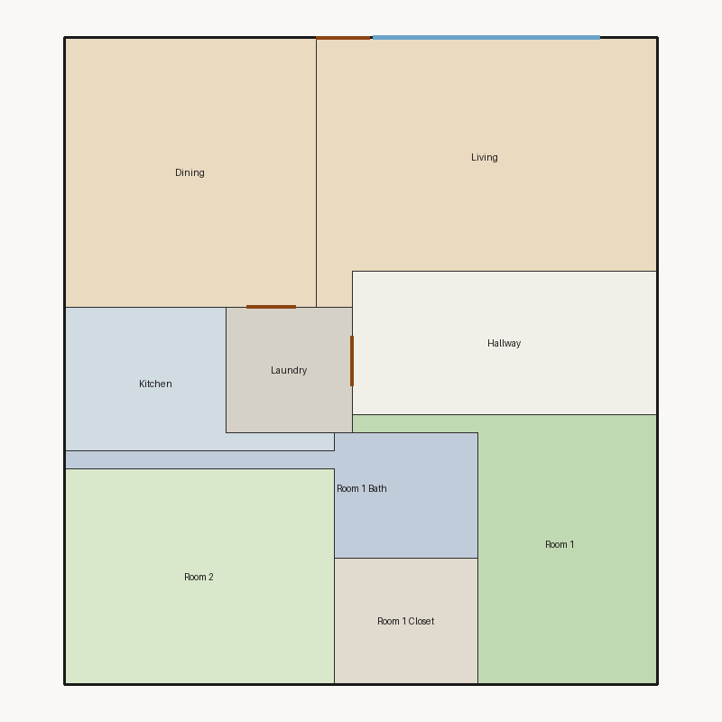

# Score report — 3-room

Source: `../plans/d2dcbdc3ab35.json`

This floor plan scores **2.39/10 (Poor)** for “3-room” with 9 rooms, 1188.0 ft² total room area. It fails 5 hard rule(s): Minimum Width, Reachability, Window Lines, Bathroom Accessible, Kitchen Accessible. Strong areas include living size, bedroom ratio, privacy. Weaker areas include natural light, wet core compactness, construction shape. Highest category is privacy (10.0); lowest is daylight (2.7).

## 3-room

**Overall score: 2.39 / 10 — Poor**

**Plan:** 3-room  
**Rooms (9):** Living (251.0 ft²), Room 1 (157.0 ft²), Room 2 (180.0 ft²), Room 1 Bath (71.0 ft²), Room 1 Closet (56.0 ft²), Kitchen (78.0 ft²), Dining (210.0 ft²), Hallway (136.0 ft²), Laundry (49.0 ft²)  
**Doors:** 3 line openings · **Windows:** 2 line openings

### Hard failures (plan rejected by geometry/topology rules)
- **Minimum Width** (minimum_width): Too narrow: Room 1 Bath — *Repair:* Widen narrow rooms by moving shared walls
- **Reachability** (reachability): Unreachable: Room 1, Room 2, Room 1 Bath, Room 1 Closet, Kitchen, Dining, Hallway, Laundry — *Repair:* Add doors connecting unreachable rooms to circulation
- **Window Lines** (windows_on_exterior): Missing exterior glazing: ['Room 1', 'Room 2', 'Dining'] — *Repair:* Add window line segments on exterior edges of living/bedrooms
- **Bathroom Accessible** (bathroom_accessible): Bathroom lacks door connections — *Repair:* Connect bathroom to hall or bedroom
- **Kitchen Accessible** (kitchen_accessible): Kitchen not connected — *Repair:* Connect kitchen to living/dining

### Category scores

| Category | Score | Rating | Weight |
|---|---:|---|---:|
| Geometry | 8.00 | Good | 0.15 |
| Topology | 3.67 | Poor | 0.10 |
| Construction | 3.60 | Poor | 0.10 |
| Privacy | 10.00 | Excellent | 0.11 |
| Circulation | 6.85 | Fair | 0.10 |
| Daylight | 2.66 | Poor | 0.13 |
| Architecture | 8.00 | Good | 0.13 |
| Aesthetics | 7.18 | Fair | 0.18 |

### Rule details

- **Polygon Validity** [HARD/PASS] — **10.0/10** (Excellent): Boundary polygon valid
- **Room Overlap** [HARD/PASS] — **10.0/10** (Excellent): No significant overlaps
- **Boundary Containment** [HARD/PASS] — **10.0/10** (Excellent): All rooms inside boundary
- **Minimum Area** [HARD/PASS] — **10.0/10** (Excellent): Areas OK
- **Minimum Width** [HARD/FAIL] — **0.0/10** (Poor): Too narrow: Room 1 Bath
  - Suggestion: Widen narrow rooms by moving shared walls
- **Reachability** [HARD/FAIL] — **0.0/10** (Poor): Unreachable: Room 1, Room 2, Room 1 Bath, Room 1 Closet, Kitchen, Dining, Hallway, Laundry
  - Suggestion: Add doors connecting unreachable rooms to circulation
- **Required Rooms Exist** [HARD/PASS] — **10.0/10** (Excellent): Required rooms present
- **Door Lines** [HARD/PASS] — **10.0/10** (Excellent): Doors have room connections
- **Window Lines** [HARD/FAIL] — **0.0/10** (Poor): Missing exterior glazing: ['Room 1', 'Room 2', 'Dining']
  - Suggestion: Add window line segments on exterior edges of living/bedrooms
- **Bathroom Accessible** [HARD/FAIL] — **0.0/10** (Poor): Bathroom lacks door connections
  - Suggestion: Connect bathroom to hall or bedroom
- **Kitchen Accessible** [HARD/FAIL] — **0.0/10** (Poor): Kitchen not connected
  - Suggestion: Connect kitchen to living/dining
- **Living Size** [soft/PASS] — **10.0/10** (Excellent): Living area 251.0 ft²
- **Bedroom Ratio** [soft/PASS] — **9.0/10** (Excellent): Bedroom/living area ratio 1.34
- **Natural Light** [soft/PASS] — **5.3/10** (Weak): Living: win 12.5/6.3 ft, WFR 22%, ext 19.0 ft, clear; Room 1: win 0.0/3.9 ft, WFR 0%, ext 15.0 ft, clear; Room 2: win 0.0/4.5 ft, WFR 0%, ext 15.0 ft, clear; Dining: win 0.0/5.2 ft, WFR 0%, ext 15.0 ft, clear
  - Suggestion: Add adequately sized windows on exterior walls of bedrooms/living
- **Privacy** [soft/PASS] — **10.0/10** (Excellent): Direct public-private adjacencies: 0
- **Circulation Efficiency** [soft/PASS] — **6.9/10** (Fair): Circ 11.4%; min path width 12.8 ft; 0/2 beds via hall; 0 passageway rooms; 1 dead ends
  - Suggestion: Reduce hallway waste, widen paths, and serve bedrooms from circulation
- **Wet Core Compactness** [soft/FAIL] — **2.0/10** (Poor): Avg wet-room distance 12.88 ft
  - Suggestion: Cluster wet rooms for shared plumbing
- **Construction Shape** [soft/PASS] — **5.2/10** (Weak): Avg rectangularity 0.82; 0 short door edges
  - Suggestion: Simplify room shapes and place doors on longer shared walls
- **Room Proportions** [soft/PASS] — **8.0/10** (Good): Over-elongated rooms: 1
- **Storage Adequacy** [soft/PASS] — **7.0/10** (Fair): 1 storage spaces for 2 bedrooms
- **Balcony Usability** [soft/PASS] — **6.0/10** (Fair): No balcony in plan
- **Living Centrality** [soft/PASS] — **4.5/10** (Weak): Living 13.3 ft from plan center; mean 0.0 hops to other rooms
  - Suggestion: Place living nearer the center and connect rooms via hall/living hub
- **Kitchen–Public Link** [soft/FAIL] — **2.0/10** (Poor): Kitchen unreachable from living/dining
  - Suggestion: Connect kitchen to dining/living; never directly to a bedroom
- **Entry Sequence** [soft/PASS] — **7.5/10** (Good): no entry; living at exterior
- **Public Near Exit** [soft/PASS] — **9.5/10** (Excellent): Living 0 hops from exit (no bedrooms)

### Areas to improve
- Wet Core Compactness: Avg wet-room distance 12.88 ft → Cluster wet rooms for shared plumbing
- Kitchen–Public Link: Kitchen unreachable from living/dining → Connect kitchen to dining/living; never directly to a bedroom
- Living Centrality: Living 13.3 ft from plan center; mean 0.0 hops to other rooms → Place living nearer the center and connect rooms via hall/living hub
- Construction Shape: Avg rectangularity 0.82; 0 short door edges → Simplify room shapes and place doors on longer shared walls
- Natural Light: Living: win 12.5/6.3 ft, WFR 22%, ext 19.0 ft, clear; Room 1: win 0.0/3.9 ft, WFR 0%, ext 15.0 ft, clear; Room 2: win 0.0/4.5 ft, WFR 0%, ext 15.0 ft, clear; Dining: win 0.0/5.2 ft, WFR 0%, ext 15.0 ft, clear → Add adequately sized windows on exterior walls of bedrooms/living
- Balcony Usability: No balcony in plan
- Circulation Efficiency: Circ 11.4%; min path width 12.8 ft; 0/2 beds via hall; 0 passageway rooms; 1 dead ends → Reduce hallway waste, widen paths, and serve bedrooms from circulation

_Summary: This floor plan scores **2.39/10 (Poor)** for “3-room” with 9 rooms, 1188.0 ft² total room area. It fails 5 hard rule(s): Minimum Width, Reachability, Window Lines, Bathroom Accessible, Kitchen Accessible. Strong areas include living size, bedroom ratio, privacy. Weaker areas include natural light, wet core compactness, construction shape. Highest category is privacy (10.0); lowest is daylight (2.7)._