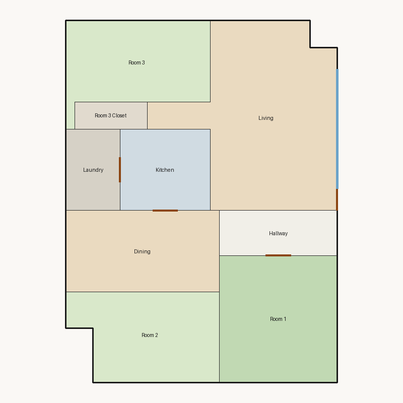

# Score report — 3-room

Source: `../plans/d8b832ebc160.json`

This floor plan scores **2.43/10 (Poor)** for “3-room” with 9 rooms, 1173.0 ft² total room area. It fails 4 hard rule(s): Reachability, Required Rooms Exist, Window Lines, Bathroom Accessible. Strong areas include living size, bedroom ratio, room proportions. Weaker areas include natural light, privacy, living centrality. Highest category is geometry (10.0); lowest is privacy (2.5).

## 3-room

**Overall score: 2.43 / 10 — Poor**

**Plan:** 3-room  
**Rooms (9):** Living (306.0 ft²), Room 1 (182.0 ft²), Room 2 (152.0 ft²), Room 3 (147.0 ft²), Room 3 Closet (24.0 ft²), Kitchen (90.0 ft²), Dining (153.0 ft²), Hallway (65.0 ft²), Laundry (54.0 ft²)  
**Doors:** 4 line openings · **Windows:** 2 line openings

### Hard failures (plan rejected by geometry/topology rules)
- **Reachability** (reachability): Unreachable: Room 1, Room 2, Room 3, Room 3 Closet, Kitchen, Dining, Hallway, Laundry — *Repair:* Add doors connecting unreachable rooms to circulation
- **Required Rooms Exist** (required_rooms): Missing: bathroom — *Repair:* Insert missing required rooms
- **Window Lines** (windows_on_exterior): Missing exterior glazing: ['Room 1', 'Room 2', 'Room 3', 'Dining'] — *Repair:* Add window line segments on exterior edges of living/bedrooms
- **Bathroom Accessible** (bathroom_accessible): No bathroom — *Repair:* Insert bathroom

### Category scores

| Category | Score | Rating | Weight |
|---|---:|---|---:|
| Geometry | 10.00 | Excellent | 0.15 |
| Topology | 5.00 | Weak | 0.10 |
| Construction | 6.77 | Fair | 0.10 |
| Privacy | 2.50 | Poor | 0.11 |
| Circulation | 7.38 | Fair | 0.10 |
| Daylight | 2.54 | Poor | 0.13 |
| Architecture | 8.40 | Good | 0.13 |
| Aesthetics | 7.32 | Fair | 0.18 |

### Rule details

- **Polygon Validity** [HARD/PASS] — **10.0/10** (Excellent): Boundary polygon valid
- **Room Overlap** [HARD/PASS] — **10.0/10** (Excellent): No significant overlaps
- **Boundary Containment** [HARD/PASS] — **10.0/10** (Excellent): All rooms inside boundary
- **Minimum Area** [HARD/PASS] — **10.0/10** (Excellent): Areas OK
- **Minimum Width** [HARD/PASS] — **10.0/10** (Excellent): Widths OK
- **Reachability** [HARD/FAIL] — **0.0/10** (Poor): Unreachable: Room 1, Room 2, Room 3, Room 3 Closet, Kitchen, Dining, Hallway, Laundry
  - Suggestion: Add doors connecting unreachable rooms to circulation
- **Required Rooms Exist** [HARD/FAIL] — **0.0/10** (Poor): Missing: bathroom
  - Suggestion: Insert missing required rooms
- **Door Lines** [HARD/PASS] — **10.0/10** (Excellent): Doors have room connections
- **Window Lines** [HARD/FAIL] — **0.0/10** (Poor): Missing exterior glazing: ['Room 1', 'Room 2', 'Room 3', 'Dining']
  - Suggestion: Add window line segments on exterior edges of living/bedrooms
- **Bathroom Accessible** [HARD/FAIL] — **0.0/10** (Poor): No bathroom
  - Suggestion: Insert bathroom
- **Kitchen Accessible** [HARD/PASS] — **10.0/10** (Excellent): Kitchen connected
- **Living Size** [soft/PASS] — **10.0/10** (Excellent): Living area 306.0 ft²
- **Bedroom Ratio** [soft/PASS] — **9.0/10** (Excellent): Bedroom/living area ratio 1.57
- **Natural Light** [soft/PASS] — **5.1/10** (Weak): Living: win 14.4/7.2 ft, WFR 21%, ext 18.0 ft, clear; Room 1: win 0.0/4.5 ft, WFR 0%, ext 14.0 ft, clear; Room 2: win 0.0/3.8 ft, WFR 0%, ext 14.0 ft, clear; Room 3: win 0.0/3.7 ft, WFR 0%, ext 16.0 ft, clear; Dining: win 0.0/3.6 ft, WFR 0%, ext 9.0 ft, clear
  - Suggestion: Add adequately sized windows on exterior walls of bedrooms/living
- **Privacy** [soft/FAIL] — **2.5/10** (Poor): Direct public-private adjacencies: 3
  - Suggestion: Buffer bedrooms from kitchen/living with hallway or dining
- **Circulation Efficiency** [soft/PASS] — **7.4/10** (Fair): Circ 5.5%; min path width 12.5 ft; 1/3 beds via hall; 0 passageway rooms; 1 dead ends
- **Wet Core Compactness** [soft/PASS] — **7.0/10** (Fair): Single wet room
- **Construction Shape** [soft/PASS] — **6.5/10** (Fair): Avg rectangularity 0.92; 0 short door edges
  - Suggestion: Simplify room shapes and place doors on longer shared walls
- **Room Proportions** [soft/PASS] — **10.0/10** (Excellent): Over-elongated rooms: 0
- **Storage Adequacy** [soft/PASS] — **7.0/10** (Fair): 1 storage spaces for 3 bedrooms
- **Balcony Usability** [soft/PASS] — **6.0/10** (Fair): No balcony in plan
- **Living Centrality** [soft/PASS] — **4.9/10** (Weak): Living 11.5 ft from plan center; mean 0.0 hops to other rooms
  - Suggestion: Place living nearer the center and connect rooms via hall/living hub
- **Kitchen–Public Link** [soft/PASS] — **10.0/10** (Excellent): Kitchen opens to dining/living
- **Entry Sequence** [soft/PASS] — **7.5/10** (Good): no entry; living at exterior
- **Public Near Exit** [soft/PASS] — **9.5/10** (Excellent): Living 0 hops from exit (no bedrooms)

### Areas to improve
- Privacy: Direct public-private adjacencies: 3 → Buffer bedrooms from kitchen/living with hallway or dining
- Living Centrality: Living 11.5 ft from plan center; mean 0.0 hops to other rooms → Place living nearer the center and connect rooms via hall/living hub
- Natural Light: Living: win 14.4/7.2 ft, WFR 21%, ext 18.0 ft, clear; Room 1: win 0.0/4.5 ft, WFR 0%, ext 14.0 ft, clear; Room 2: win 0.0/3.8 ft, WFR 0%, ext 14.0 ft, clear; Room 3: win 0.0/3.7 ft, WFR 0%, ext 16.0 ft, clear; Dining: win 0.0/3.6 ft, WFR 0%, ext 9.0 ft, clear → Add adequately sized windows on exterior walls of bedrooms/living
- Balcony Usability: No balcony in plan
- Construction Shape: Avg rectangularity 0.92; 0 short door edges → Simplify room shapes and place doors on longer shared walls

_Summary: This floor plan scores **2.43/10 (Poor)** for “3-room” with 9 rooms, 1173.0 ft² total room area. It fails 4 hard rule(s): Reachability, Required Rooms Exist, Window Lines, Bathroom Accessible. Strong areas include living size, bedroom ratio, room proportions. Weaker areas include natural light, privacy, living centrality. Highest category is geometry (10.0); lowest is privacy (2.5)._