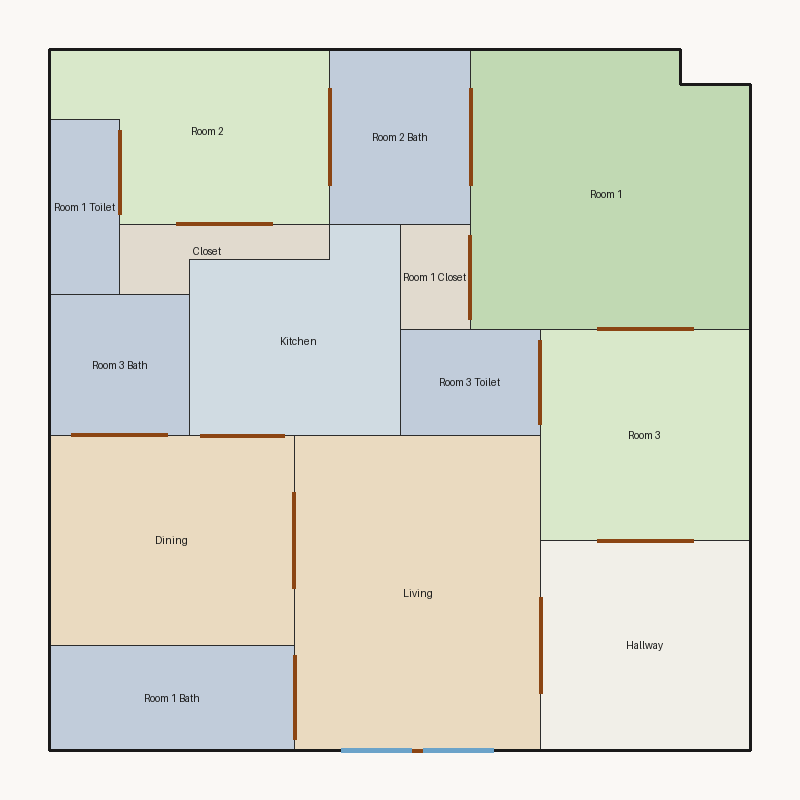

# Score report — 3-room

Source: `../plans/dc09cb8878af.json`

This floor plan scores **2.58/10 (Poor)** for “3-room” with 14 rooms, 398.0 ft² total room area. It fails 3 hard rule(s): Minimum Area, Minimum Width, Window Lines. Strong areas include circulation efficiency, room proportions, storage adequacy. Weaker areas include living size, natural light, wet core compactness. Highest category is circulation (8.5); lowest is daylight (2.3).

### Layout prompt

Room 1 Bath is in the north-west, next to Living.
Hallway is in the north-east, next to Living and Room 3.
Living is in the north-center, next to Dining, Hallway, and Room 1 Bath.
Dining is in the north-west, next to Kitchen, Living, and Room 3 Bath.
Room 3 is in the west-center, next to Hallway, Room 1, and Room 3 Toilet.
Room 3 Toilet is in the center, next to Room 3.
Room 3 Bath is in the west-center, next to Dining.
Kitchen is in the center, next to Dining.
Room 1 Closet is in the north-center, next to Room 1.
Closet is in the south-west, next to Room 2.
Room 1 Toilet is in the south-west, next to Room 2.
Room 1 is in the south-east, next to Room 1 Closet, Room 2 Bath, and Room 3.
Room 2 Bath is in the north-center, next to Room 1 and Room 2.
Room 2 is in the south-west, next to Closet, Room 1 Toilet, and Room 2 Bath.

## 3-room

**Overall score: 2.58 / 10 — Poor**

**Plan:** 3-room  
**Rooms (14):** Living (63.0 ft²), Room 1 (62.0 ft²), Room 2 (34.0 ft²), Room 3 (36.0 ft²), Room 1 Bath (21.0 ft²), Room 1 Toilet (10.0 ft²), Room 1 Closet (6.0 ft²), Room 2 Bath (20.0 ft²), Room 3 Bath (16.0 ft²), Room 3 Toilet (12.0 ft²), Kitchen (32.0 ft²), Dining (42.0 ft²), Hallway (36.0 ft²), Closet (8.0 ft²)  
**Doors:** 14 line openings · **Windows:** 2 line openings

### Hard failures (plan rejected by geometry/topology rules)
- **Minimum Area** (minimum_area): Too small: Living (63.0<129.0), Room 1 (62.0<108.0), Room 2 (34.0<75.0), Room 3 (36.0<75.0), Room 1 Bath (21.0<32.0), Room 2 Bath (20.0<32.0), Room 3 Bath (16.0<32.0), Kitchen (32.0<43.0), Dining (42.0<65.0) — *Repair:* Expand undersized rooms
- **Minimum Width** (minimum_width): Too narrow: Living, Room 2, Room 3, Room 1 Bath — *Repair:* Widen narrow rooms by moving shared walls
- **Window Lines** (windows_on_exterior): Missing exterior glazing: ['Room 1', 'Room 2', 'Room 3', 'Dining'] — *Repair:* Add window line segments on exterior edges of living/bedrooms

### Category scores

| Category | Score | Rating | Weight |
|---|---:|---|---:|
| Geometry | 6.00 | Fair | 0.15 |
| Topology | 10.00 | Excellent | 0.10 |
| Construction | 4.51 | Weak | 0.10 |
| Privacy | 7.50 | Good | 0.11 |
| Circulation | 8.53 | Good | 0.10 |
| Daylight | 2.30 | Poor | 0.13 |
| Architecture | 7.07 | Fair | 0.13 |
| Aesthetics | 7.41 | Fair | 0.18 |

### Rule details

- **Polygon Validity** [HARD/PASS] — **10.0/10** (Excellent): Boundary polygon valid
- **Room Overlap** [HARD/PASS] — **10.0/10** (Excellent): No significant overlaps
- **Boundary Containment** [HARD/PASS] — **10.0/10** (Excellent): All rooms inside boundary
- **Minimum Area** [HARD/FAIL] — **0.0/10** (Poor): Too small: Living (63.0<129.0), Room 1 (62.0<108.0), Room 2 (34.0<75.0), Room 3 (36.0<75.0), Room 1 Bath (21.0<32.0), Room 2 Bath (20.0<32.0), Room 3 Bath (16.0<32.0), Kitchen (32.0<43.0), Dining (42.0<65.0)
  - Suggestion: Expand undersized rooms
- **Minimum Width** [HARD/FAIL] — **0.0/10** (Poor): Too narrow: Living, Room 2, Room 3, Room 1 Bath
  - Suggestion: Widen narrow rooms by moving shared walls
- **Reachability** [HARD/PASS] — **10.0/10** (Excellent): All rooms reachable
- **Required Rooms Exist** [HARD/PASS] — **10.0/10** (Excellent): Required rooms present
- **Door Lines** [HARD/PASS] — **10.0/10** (Excellent): Doors have room connections
- **Window Lines** [HARD/FAIL] — **0.0/10** (Poor): Missing exterior glazing: ['Room 1', 'Room 2', 'Room 3', 'Dining']
  - Suggestion: Add window line segments on exterior edges of living/bedrooms
- **Bathroom Accessible** [HARD/PASS] — **10.0/10** (Excellent): Bathrooms connected
- **Kitchen Accessible** [HARD/PASS] — **10.0/10** (Excellent): Kitchen connected
- **Living Size** [soft/FAIL] — **2.9/10** (Poor): Living area 63.0 ft²
  - Suggestion: Expand living room
- **Bedroom Ratio** [soft/PASS] — **6.5/10** (Fair): Bedroom/living area ratio 2.10
  - Suggestion: Rebalance bedroom vs living areas
- **Natural Light** [soft/PASS] — **4.6/10** (Weak): Living: win 4.0/2.0 ft, WFR 29%, ext 7.0 ft, clear; Room 1: win 0.0/2.0 ft, WFR 0%, ext 7.0 ft, clear; Room 2: win 0.0/2.0 ft, WFR 0%, ext 8.0 ft, clear; Room 3: win 0.0/2.0 ft, WFR 0%, ext 6.0 ft, clear; Dining: win 0.0/2.0 ft, WFR 0%, ext 6.0 ft, clear
  - Suggestion: Add adequately sized windows on exterior walls of bedrooms/living
- **Privacy** [soft/PASS] — **7.5/10** (Good): Direct public-private adjacencies: 1
- **Circulation Efficiency** [soft/PASS] — **8.5/10** (Good): Circ 9.0%; min path width 4.0 ft; 1/3 beds via hall; 5 passageway rooms; 0 dead ends
- **Wet Core Compactness** [soft/FAIL] — **2.0/10** (Poor): Avg wet-room distance 9.45 ft
  - Suggestion: Cluster wet rooms for shared plumbing
- **Construction Shape** [soft/PASS] — **7.0/10** (Fair): Avg rectangularity 0.98; 0 short door edges
- **Room Proportions** [soft/PASS] — **10.0/10** (Excellent): Over-elongated rooms: 0
- **Storage Adequacy** [soft/PASS] — **10.0/10** (Excellent): 2 storage spaces for 3 bedrooms
- **Balcony Usability** [soft/PASS] — **6.0/10** (Fair): No balcony in plan
- **Living Centrality** [soft/PASS] — **4.7/10** (Weak): Living 5.5 ft from plan center; mean 2.7 hops to other rooms
  - Suggestion: Place living nearer the center and connect rooms via hall/living hub
- **Kitchen–Public Link** [soft/PASS] — **10.0/10** (Excellent): Kitchen opens to dining/living
- **Entry Sequence** [soft/PASS] — **7.5/10** (Good): no entry; living at exterior
- **Public Near Exit** [soft/PASS] — **10.0/10** (Excellent): Living 0 hops from exit; bedrooms min 2 / avg 3.3 hops

### Areas to improve
- Wet Core Compactness: Avg wet-room distance 9.45 ft → Cluster wet rooms for shared plumbing
- Living Size: Living area 63.0 ft² → Expand living room
- Natural Light: Living: win 4.0/2.0 ft, WFR 29%, ext 7.0 ft, clear; Room 1: win 0.0/2.0 ft, WFR 0%, ext 7.0 ft, clear; Room 2: win 0.0/2.0 ft, WFR 0%, ext 8.0 ft, clear; Room 3: win 0.0/2.0 ft, WFR 0%, ext 6.0 ft, clear; Dining: win 0.0/2.0 ft, WFR 0%, ext 6.0 ft, clear → Add adequately sized windows on exterior walls of bedrooms/living
- Living Centrality: Living 5.5 ft from plan center; mean 2.7 hops to other rooms → Place living nearer the center and connect rooms via hall/living hub
- Balcony Usability: No balcony in plan
- Bedroom Ratio: Bedroom/living area ratio 2.10 → Rebalance bedroom vs living areas

_Summary: This floor plan scores **2.58/10 (Poor)** for “3-room” with 14 rooms, 398.0 ft² total room area. It fails 3 hard rule(s): Minimum Area, Minimum Width, Window Lines. Strong areas include circulation efficiency, room proportions, storage adequacy. Weaker areas include living size, natural light, wet core compactness. Highest category is circulation (8.5); lowest is daylight (2.3)._