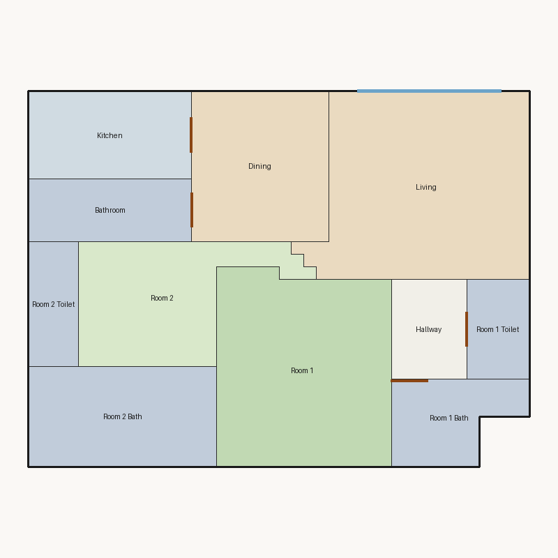

# Score report — 3-room

Source: `../plans/f76147d29d70.json`

This floor plan scores **1.58/10 (Poor)** for “3-room” with 11 rooms, 1184.0 ft² total room area. It fails 3 hard rule(s): Reachability, Window Lines, Bathroom Accessible. Strong areas include living size, bedroom ratio, room proportions. Weaker areas include natural light, privacy, circulation efficiency. Highest category is geometry (10.0); lowest is privacy (2.5).

## 3-room

**Overall score: 1.58 / 10 — Poor**

**Plan:** 3-room  
**Rooms (11):** Living (246.0 ft²), Room 1 (215.0 ft²), Room 2 (126.0 ft²), Room 1 Bath (61.0 ft²), Room 1 Toilet (40.0 ft²), Room 2 Bath (120.0 ft²), Room 2 Toilet (40.0 ft²), Kitchen (91.0 ft²), Dining (132.0 ft²), Hallway (48.0 ft²), Bathroom (65.0 ft²)  
**Doors:** 4 line openings · **Windows:** 2 line openings

### Hard failures (plan rejected by geometry/topology rules)
- **Reachability** (reachability): Unreachable: Room 1, Room 2, Room 1 Bath, Room 1 Toilet, Room 2 Bath, Room 2 Toilet, Kitchen, Dining, Hallway, Bathroom — *Repair:* Add doors connecting unreachable rooms to circulation
- **Window Lines** (windows_on_exterior): Missing exterior glazing: ['Room 1', 'Room 2', 'Dining'] — *Repair:* Add window line segments on exterior edges of living/bedrooms
- **Bathroom Accessible** (bathroom_accessible): Bathroom lacks door connections — *Repair:* Connect bathroom to hall or bedroom

### Category scores

| Category | Score | Rating | Weight |
|---|---:|---|---:|
| Geometry | 10.00 | Excellent | 0.15 |
| Topology | 6.67 | Fair | 0.10 |
| Construction | 4.29 | Weak | 0.10 |
| Privacy | 2.50 | Poor | 0.11 |
| Circulation | 5.61 | Weak | 0.10 |
| Daylight | 2.53 | Poor | 0.13 |
| Architecture | 7.80 | Good | 0.13 |
| Aesthetics | 4.48 | Weak | 0.18 |

### Rule details

- **Polygon Validity** [HARD/PASS] — **10.0/10** (Excellent): Boundary polygon valid
- **Room Overlap** [HARD/PASS] — **10.0/10** (Excellent): No significant overlaps
- **Boundary Containment** [HARD/PASS] — **10.0/10** (Excellent): All rooms inside boundary
- **Minimum Area** [HARD/PASS] — **10.0/10** (Excellent): Areas OK
- **Minimum Width** [HARD/PASS] — **10.0/10** (Excellent): Widths OK
- **Reachability** [HARD/FAIL] — **0.0/10** (Poor): Unreachable: Room 1, Room 2, Room 1 Bath, Room 1 Toilet, Room 2 Bath, Room 2 Toilet, Kitchen, Dining, Hallway, Bathroom
  - Suggestion: Add doors connecting unreachable rooms to circulation
- **Required Rooms Exist** [HARD/PASS] — **10.0/10** (Excellent): Required rooms present
- **Door Lines** [HARD/PASS] — **10.0/10** (Excellent): Doors have room connections
- **Window Lines** [HARD/FAIL] — **0.0/10** (Poor): Missing exterior glazing: ['Room 1', 'Room 2', 'Dining']
  - Suggestion: Add window line segments on exterior edges of living/bedrooms
- **Bathroom Accessible** [HARD/FAIL] — **0.0/10** (Poor): Bathroom lacks door connections
  - Suggestion: Connect bathroom to hall or bedroom
- **Kitchen Accessible** [HARD/PASS] — **10.0/10** (Excellent): Kitchen connected
- **Living Size** [soft/PASS] — **10.0/10** (Excellent): Living area 246.0 ft²
- **Bedroom Ratio** [soft/PASS] — **9.0/10** (Excellent): Bedroom/living area ratio 1.39
- **Natural Light** [soft/PASS] — **5.1/10** (Weak): Living: win 12.3/6.2 ft, WFR 22%, ext 16.0 ft, clear; Room 1: win 0.0/5.4 ft, WFR 0%, ext 14.0 ft, clear; Room 2: win 0.0/3.1 ft, WFR 0%, ext 19.2 ft, blocked; Dining: win 0.0/3.3 ft, WFR 0%, ext 11.0 ft, clear
  - Suggestion: Add adequately sized windows on exterior walls of bedrooms/living
- **Privacy** [soft/FAIL] — **2.5/10** (Poor): Direct public-private adjacencies: 3
  - Suggestion: Buffer bedrooms from kitchen/living with hallway or dining
- **Circulation Efficiency** [soft/PASS] — **5.6/10** (Weak): Circ 4.1%; 0/2 beds via hall; 0 passageway rooms; 1 dead ends
  - Suggestion: Reduce hallway waste, widen paths, and serve bedrooms from circulation
- **Wet Core Compactness** [soft/FAIL] — **2.0/10** (Poor): Avg wet-room distance 23.08 ft
  - Suggestion: Cluster wet rooms for shared plumbing
- **Construction Shape** [soft/PASS] — **6.6/10** (Fair): Avg rectangularity 0.93; 0 short door edges
  - Suggestion: Simplify room shapes and place doors on longer shared walls
- **Room Proportions** [soft/PASS] — **10.0/10** (Excellent): Over-elongated rooms: 0
- **Storage Adequacy** [soft/PASS] — **4.0/10** (Weak): 0 storage spaces for 2 bedrooms
  - Suggestion: Attach private closets to their bedroom; keep shared closets near bedrooms
- **Balcony Usability** [soft/PASS] — **6.0/10** (Fair): No balcony in plan
- **Living Centrality** [soft/PASS] — **4.4/10** (Weak): Living 14.0 ft from plan center; mean 0.0 hops to other rooms
  - Suggestion: Place living nearer the center and connect rooms via hall/living hub
- **Kitchen–Public Link** [soft/PASS] — **10.0/10** (Excellent): Kitchen opens to dining/living
- **Entry Sequence** [soft/PASS] — **6.0/10** (Fair): no entry; living far from exit
  - Suggestion: Add a small entry/foyer so exit leads to living, not bedrooms
- **Public Near Exit** [soft/FAIL] — **3.0/10** (Poor): Living unreachable from exit/entry
  - Suggestion: Connect living to the entry path

### Areas to improve
- Wet Core Compactness: Avg wet-room distance 23.08 ft → Cluster wet rooms for shared plumbing
- Privacy: Direct public-private adjacencies: 3 → Buffer bedrooms from kitchen/living with hallway or dining
- Public Near Exit: Living unreachable from exit/entry → Connect living to the entry path
- Storage Adequacy: 0 storage spaces for 2 bedrooms → Attach private closets to their bedroom; keep shared closets near bedrooms
- Living Centrality: Living 14.0 ft from plan center; mean 0.0 hops to other rooms → Place living nearer the center and connect rooms via hall/living hub
- Natural Light: Living: win 12.3/6.2 ft, WFR 22%, ext 16.0 ft, clear; Room 1: win 0.0/5.4 ft, WFR 0%, ext 14.0 ft, clear; Room 2: win 0.0/3.1 ft, WFR 0%, ext 19.2 ft, blocked; Dining: win 0.0/3.3 ft, WFR 0%, ext 11.0 ft, clear → Add adequately sized windows on exterior walls of bedrooms/living
- Circulation Efficiency: Circ 4.1%; 0/2 beds via hall; 0 passageway rooms; 1 dead ends → Reduce hallway waste, widen paths, and serve bedrooms from circulation
- Balcony Usability: No balcony in plan
- Entry Sequence: no entry; living far from exit → Add a small entry/foyer so exit leads to living, not bedrooms
- Construction Shape: Avg rectangularity 0.93; 0 short door edges → Simplify room shapes and place doors on longer shared walls

_Summary: This floor plan scores **1.58/10 (Poor)** for “3-room” with 11 rooms, 1184.0 ft² total room area. It fails 3 hard rule(s): Reachability, Window Lines, Bathroom Accessible. Strong areas include living size, bedroom ratio, room proportions. Weaker areas include natural light, privacy, circulation efficiency. Highest category is geometry (10.0); lowest is privacy (2.5)._