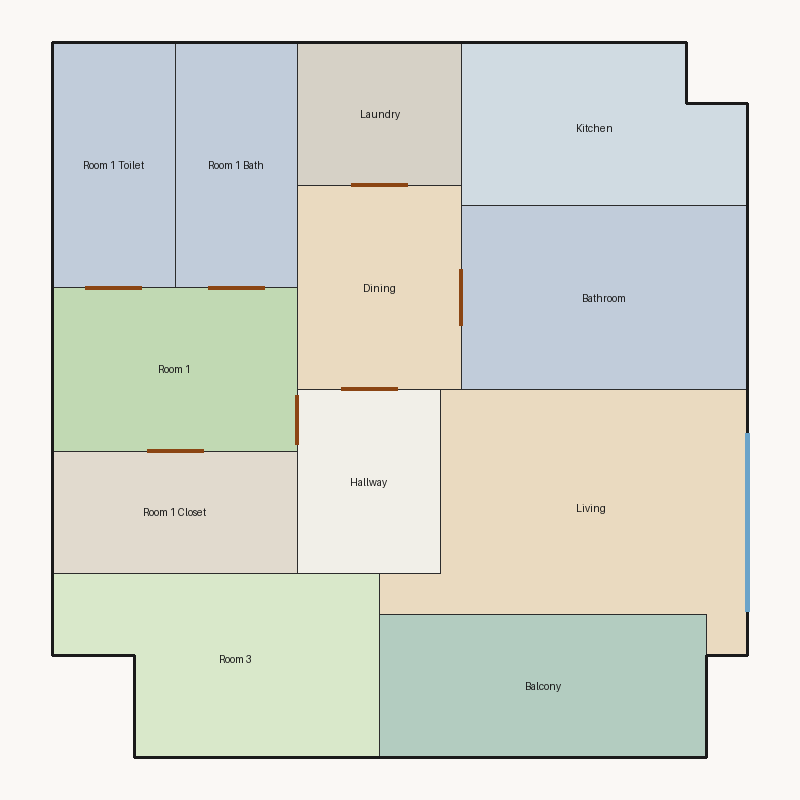

# Score report — 3-room

Source: `../plans/fd57551c874d.json`

This floor plan scores **2.23/10 (Poor)** for “3-room” with 12 rooms, 1151.0 ft² total room area. It fails 4 hard rule(s): Minimum Area, Reachability, Window Lines, Kitchen Accessible. Strong areas include bedroom ratio, room proportions, balcony usability. Weaker areas include natural light, privacy, wet core compactness. Highest category is geometry (8.0); lowest is daylight (2.5).

## 3-room

**Overall score: 2.23 / 10 — Poor**

**Plan:** 3-room  
**Rooms (12):** Living (175.0 ft²), Room 1 (96.0 ft²), Room 3 (124.0 ft²), Room 1 Bath (72.0 ft²), Room 1 Toilet (72.0 ft²), Room 1 Closet (72.0 ft²), Kitchen (103.0 ft²), Dining (80.0 ft²), Hallway (63.0 ft²), Bathroom (126.0 ft²), Balcony (112.0 ft²), Laundry (56.0 ft²)  
**Doors:** 8 line openings · **Windows:** 2 line openings

### Hard failures (plan rejected by geometry/topology rules)
- **Minimum Area** (minimum_area): Too small: Room 1 (96.0<108.0) — *Repair:* Expand undersized rooms
- **Reachability** (reachability): Unreachable: Room 1, Room 3, Room 1 Bath, Room 1 Toilet, Room 1 Closet, Kitchen, Dining, Hallway, Bathroom, Laundry — *Repair:* Add doors connecting unreachable rooms to circulation
- **Window Lines** (windows_on_exterior): Missing exterior glazing: ['Room 1', 'Room 3', 'Dining'] — *Repair:* Add window line segments on exterior edges of living/bedrooms
- **Kitchen Accessible** (kitchen_accessible): Kitchen not connected — *Repair:* Connect kitchen to living/dining

### Category scores

| Category | Score | Rating | Weight |
|---|---:|---|---:|
| Geometry | 8.00 | Good | 0.15 |
| Topology | 5.33 | Weak | 0.10 |
| Construction | 4.42 | Weak | 0.10 |
| Privacy | 5.00 | Weak | 0.11 |
| Circulation | 7.15 | Fair | 0.10 |
| Daylight | 2.48 | Poor | 0.13 |
| Architecture | 8.79 | Good | 0.13 |
| Aesthetics | 7.34 | Fair | 0.18 |

### Rule details

- **Polygon Validity** [HARD/PASS] — **10.0/10** (Excellent): Boundary polygon valid
- **Room Overlap** [HARD/PASS] — **10.0/10** (Excellent): No significant overlaps
- **Boundary Containment** [HARD/PASS] — **10.0/10** (Excellent): All rooms inside boundary
- **Minimum Area** [HARD/FAIL] — **0.0/10** (Poor): Too small: Room 1 (96.0<108.0)
  - Suggestion: Expand undersized rooms
- **Minimum Width** [HARD/PASS] — **10.0/10** (Excellent): Widths OK
- **Reachability** [HARD/FAIL] — **0.0/10** (Poor): Unreachable: Room 1, Room 3, Room 1 Bath, Room 1 Toilet, Room 1 Closet, Kitchen, Dining, Hallway, Bathroom, Laundry
  - Suggestion: Add doors connecting unreachable rooms to circulation
- **Required Rooms Exist** [HARD/PASS] — **10.0/10** (Excellent): Required rooms present
- **Door Lines** [HARD/PASS] — **10.0/10** (Excellent): Doors have room connections
- **Window Lines** [HARD/FAIL] — **0.0/10** (Poor): Missing exterior glazing: ['Room 1', 'Room 3', 'Dining']
  - Suggestion: Add window line segments on exterior edges of living/bedrooms
- **Bathroom Accessible** [HARD/PASS] — **10.0/10** (Excellent): Bathrooms connected
- **Kitchen Accessible** [HARD/FAIL] — **0.0/10** (Poor): Kitchen not connected
  - Suggestion: Connect kitchen to living/dining
- **Living Size** [soft/PASS] — **8.0/10** (Good): Living area 175.0 ft²
- **Bedroom Ratio** [soft/PASS] — **9.0/10** (Excellent): Bedroom/living area ratio 1.26
- **Natural Light** [soft/PASS] — **5.0/10** (Weak): Living: win 8.8/4.4 ft, WFR 22%, ext 13.0 ft, clear; Room 1: win 0.0/2.4 ft, WFR 0%, ext 8.0 ft, clear; Room 3: win 0.0/3.1 ft, WFR 0%, ext 12.0 ft, clear; Dining: win 0.0/2.0 ft, WFR 0%, ext 8.2 ft, blocked
  - Suggestion: Add adequately sized windows on exterior walls of bedrooms/living
- **Privacy** [soft/PASS] — **5.0/10** (Weak): Direct public-private adjacencies: 2
  - Suggestion: Buffer bedrooms from kitchen/living with hallway or dining
- **Circulation Efficiency** [soft/PASS] — **7.1/10** (Fair): Circ 5.5%; min path width 10.4 ft; 1/2 beds via hall; 2 passageway rooms; 0 dead ends
- **Wet Core Compactness** [soft/FAIL] — **2.0/10** (Poor): Avg wet-room distance 16.58 ft
  - Suggestion: Cluster wet rooms for shared plumbing
- **Construction Shape** [soft/PASS] — **6.8/10** (Fair): Avg rectangularity 0.95; 0 short door edges
  - Suggestion: Simplify room shapes and place doors on longer shared walls
- **Room Proportions** [soft/PASS] — **10.0/10** (Excellent): Over-elongated rooms: 0
- **Storage Adequacy** [soft/PASS] — **7.0/10** (Fair): 1 storage spaces for 2 bedrooms
- **Balcony Usability** [soft/PASS] — **10.0/10** (Excellent): Balcony 112.0 ft²
- **Living Centrality** [soft/PASS] — **5.0/10** (Weak): Living 10.9 ft from plan center; mean 0.0 hops to other rooms
  - Suggestion: Place living nearer the center and connect rooms via hall/living hub
- **Kitchen–Public Link** [soft/FAIL] — **2.0/10** (Poor): Kitchen unreachable from living/dining
  - Suggestion: Connect kitchen to dining/living; never directly to a bedroom
- **Entry Sequence** [soft/PASS] — **7.5/10** (Good): no entry; living at exterior
- **Public Near Exit** [soft/PASS] — **9.5/10** (Excellent): Living 0 hops from exit (no bedrooms)

### Areas to improve
- Wet Core Compactness: Avg wet-room distance 16.58 ft → Cluster wet rooms for shared plumbing
- Kitchen–Public Link: Kitchen unreachable from living/dining → Connect kitchen to dining/living; never directly to a bedroom
- Natural Light: Living: win 8.8/4.4 ft, WFR 22%, ext 13.0 ft, clear; Room 1: win 0.0/2.4 ft, WFR 0%, ext 8.0 ft, clear; Room 3: win 0.0/3.1 ft, WFR 0%, ext 12.0 ft, clear; Dining: win 0.0/2.0 ft, WFR 0%, ext 8.2 ft, blocked → Add adequately sized windows on exterior walls of bedrooms/living
- Privacy: Direct public-private adjacencies: 2 → Buffer bedrooms from kitchen/living with hallway or dining
- Living Centrality: Living 10.9 ft from plan center; mean 0.0 hops to other rooms → Place living nearer the center and connect rooms via hall/living hub
- Construction Shape: Avg rectangularity 0.95; 0 short door edges → Simplify room shapes and place doors on longer shared walls

_Summary: This floor plan scores **2.23/10 (Poor)** for “3-room” with 12 rooms, 1151.0 ft² total room area. It fails 4 hard rule(s): Minimum Area, Reachability, Window Lines, Kitchen Accessible. Strong areas include bedroom ratio, room proportions, balcony usability. Weaker areas include natural light, privacy, wet core compactness. Highest category is geometry (8.0); lowest is daylight (2.5)._